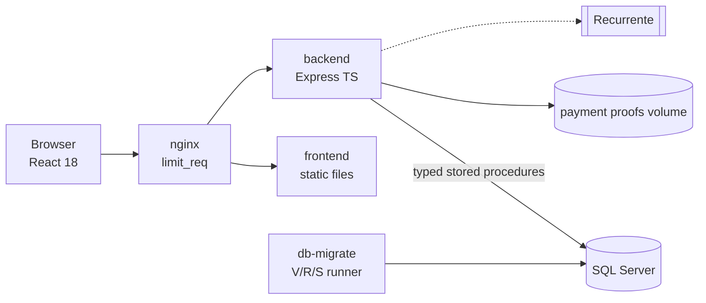
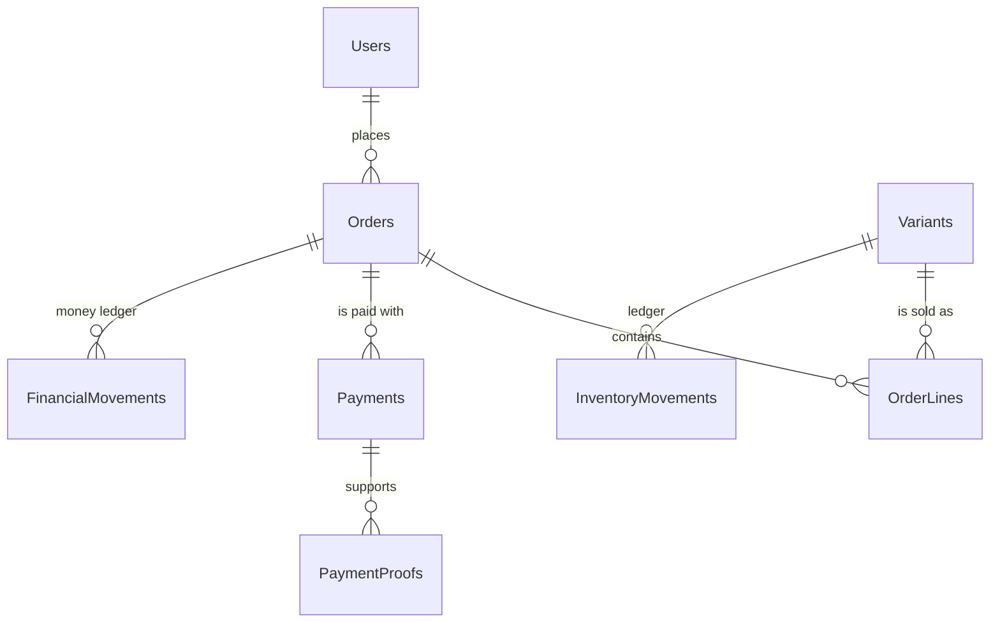
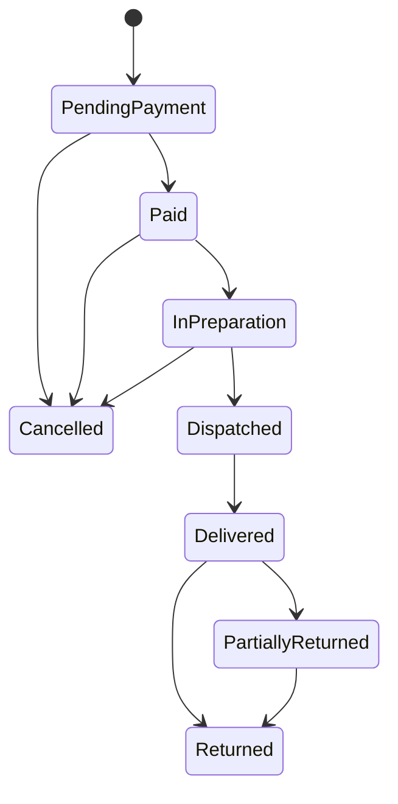

# ShopCart · "Dulce Aroma" bakery

🇬🇹 Versión en español: [README.md](README.md) <!-- spelling-ignore -->

A production-grade e-commerce platform for a bakery, built for the **Tech Challenge 360 · ShopCart challenge (Grupo Pentandra)**. It covers the catalogue, cart, coupons, checkout with stock reservation, payment by **bank deposit** (proof of payment and review) and by **card through Recurrente**, orders and returns, a sales dashboard and an audit log.

Mandatory stack: **SQL Server 2019+ (stored procedures only) · Node 24 + TypeScript `strict` + Express · React 18 + TypeScript**. Delivery dates: **Phase 1 (database and backend) Monday 2 November 2026, 23:59** and **Phase 2 (frontend and complete project) Monday 9 November 2026, 23:59**.

## 1. The scenario

A retail chain sells only in its physical shops and wants to sell online. Customers browse the catalogue (cakes, cupcakes, biscuits, sweet bread, cold desserts and seasonal items), fill a cart, apply coupons, choose an address and a delivery date, pay and follow their order. The internal team prepares and dispatches orders, controls stock and analyses sales. Amounts are in quetzales and published prices include 12 % VAT.

The business has six concrete concerns and each has a mechanism:

| Concern | Mechanism |
|---|---|
| Never sell the last unit twice | Atomic conditional `UPDATE` plus `CHECK (ReservedStock <= OnHandStock)` |
| Respect the price the customer saw | Price snapshot in `OrderLines` and immutability triggers |
| No duplicate orders or charges | `Idempotency-Key` plus unique indexes |
| Sales and abandonment without manual reports | Views and table-valued functions |
| Traceability of changes | `AuditLog` written inside each procedure |
| Inventory traceability | Ledger with resulting balance |

## 2. Requirements coverage

| Requirement | Status | Where it is solved |
|---|---|---|
| RF-01 Authentication and roles | Planned (Stage 5) | [Security](docs/architecture/05-security.md) |
| RF-02 Catalogue | Planned (Stages 3 and 5) | [Procedure catalogue](docs/database/stored-procedure-catalogue.md) |
| RF-03 Inventory and ledger | Planned (Stage 3) | [ADR-0007](docs/adr/0007-stock-reservation-as-expiring-counter.md) |
| RF-04 Cart | Planned (Stage 4) | [ADR-0013](docs/adr/0013-cart-with-absolute-quantities.md) |
| RF-05 Coupons | Planned (Stage 4) | [Procedure catalogue](docs/database/stored-procedure-catalogue.md) |
| RF-06 Checkout and payment | Planned (Stage 4) | [High-level design](docs/architecture/02-hld.md) |
| RF-07 Orders and returns | Planned (Stage 4) | [State machines](docs/architecture/04-state-machines.md) |
| RF-08 Dashboard and reports | Planned (Stage 6) | [ADR-0009](docs/adr/0009-definition-of-completed-order-for-reports.md) |
| RF-09 Audit log | Planned (Stage 4) | [Data model](docs/database/er-diagram.md) |

## 3. Architecture

A modular monolith with vertical slices; inside each module the dependency rule is `presentation → application → domain ← infrastructure`, and `dependency-cruiser` verifies it in CI.



More detail in [docs/architecture](docs/architecture/01-system-overview.md) and the [C4](docs/architecture/c4/context.md) diagrams.

## 4. Technical decisions

Decisions are recorded as ADRs (24 in total). The ones that shape everything:

| Decision | ADR |
|---|---|
| Modular monolith with vertical slices | [0001](docs/adr/0001-modular-monolith-with-vertical-slices.md) |
| Critical rules live in stored procedures and `CHECK` constraints | [0002](docs/adr/0002-critical-rules-in-stored-procedures-and-checks.md) |
| Own forward-only migration runner | [0003](docs/adr/0003-own-forward-only-migration-runner-in-node.md) |
| Idempotency at two levels | [0004](docs/adr/0004-idempotency-at-two-levels.md) |
| The server never takes cards | [0005](docs/adr/0005-server-never-takes-cards.md) |
| The order is born as `PendingPayment` | [0014](docs/adr/0014-order-created-as-pending-payment.md) |
| Half-even rounding and integer arithmetic | [0019](docs/adr/0019-half-even-rounding-and-integer-arithmetic.md) |
| Amounts as decimal strings in the API | [0020](docs/adr/0020-amounts-as-decimal-strings-in-the-api.md) |
| British English everywhere, Spanish comments | [0024](docs/adr/0024-language-and-spelling-conventions.md) |

The assumptions the brief leaves open are in [open-questions](docs/progress/open-questions.md).

## 5. Data model and lifecycle

The full diagram and the migration order are in [docs/database/er-diagram.md](docs/database/er-diagram.md). Summary of the main relationships:



Order lifecycle (the payment one is in [docs/architecture/04-state-machines.md](docs/architecture/04-state-machines.md)):



## 6. Quick start

Requirements: Node.js 24, Docker Desktop (Windows with WSL2) or Docker Engine with the compose plugin (Linux), and Git.

```bash
git clone <repository-url>
cd shopcart
npm install
npm run up
```

`npm run up` creates `.env` with generated local secrets if it does not exist, builds the images and waits until the services are healthy. The shop is then available at `http://localhost:8080`. To stop everything:

```bash
npm run down
```

Optional profiles: `payments-sandbox` (Recurrente simulator), `quality` (SonarQube) and `observability`. More help in the [runbook](docs/operations/runbook.md) and in [Windows and Linux](docs/operations/environment-windows-linux.md).

## 7. Commands

| Command | What it does |
|---|---|
| `npm run up` / `down` / `logs` | Starts, stops and follows the logs of the environment |
| `npm run lint` | ESLint, Prettier, cspell, British spelling, README sync and SQL names |
| `npm run typecheck` | Type checking |
| `npm test` | Unit and integration tests |
| `npm run arch:check` | Dependency rules and their self-test |
| `npm run db:migrate` / `db:verify` / `seed` | Migrations, drift verification and seeds (Stage 2) |
| `npm run sql:lint` / `sql:test` / `sql:coverage` | SQL lint, tSQLt tests (CI only) and procedure coverage |
| `npm run api:generate` | TypeScript client generated from OpenAPI (Stage 7) |
| `npm run sonar` | Optional quality analysis (Stage 9) |

## 8. Test credentials

The sample accounts (an administrator, an operator and customers) are created by the Stage 2 seed and will be listed here. The repository holds no real credentials; local passwords are generated when you run `npm run up`.

## 9. Card payments

Card payment uses the hosted checkout of **Recurrente** and needs credentials (`RECURRENTE_PUBLIC_KEY`, `RECURRENTE_SECRET_KEY`) or the simulator of the `payments-sandbox` profile. **Without credentials only bank deposit is offered**, both in the interface and in the backend (`422 PAYMENT_METHOD_UNAVAILABLE`). Details in [payments/availability-rule](docs/payments/availability-rule.md).

## 10. Repository map

| Path | Content |
|---|---|
| `backend/` | Express + TypeScript API organised by modules |
| `frontend/` | React 18 + Vite + Tailwind |
| `db/` | `V` migrations, `R` objects, `S` seeds, tSQLt tests, lint and runner |
| `docker/`, `docker-compose.yml` | nginx, SQL Server initialisation and profiles |
| `docs/` | ADRs, architecture, database, API, payments, quality, operations and progress |
| `tools/` | Verification scripts and the Recurrente simulator |

## 11. Documentation

Full index in [docs/README.md](docs/README.md). API contract in [docs/api/openapi/openapi.yaml](docs/api/openapi/openapi.yaml). Contribution guide in [CONTRIBUTING.md](CONTRIBUTING.md) and security policy in [SECURITY.md](SECURITY.md).

## 12. Delivery status

Stage 0 (foundations) and Stage 1 (documentation and conventions) are complete. Stage 2 (migration runner and tables) is next. Details in the [ROADMAP](docs/progress/ROADMAP.md) and [STATUS](docs/progress/STATUS.md).
