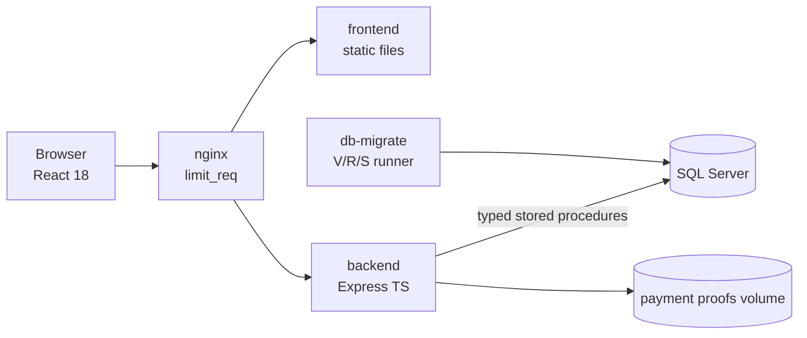
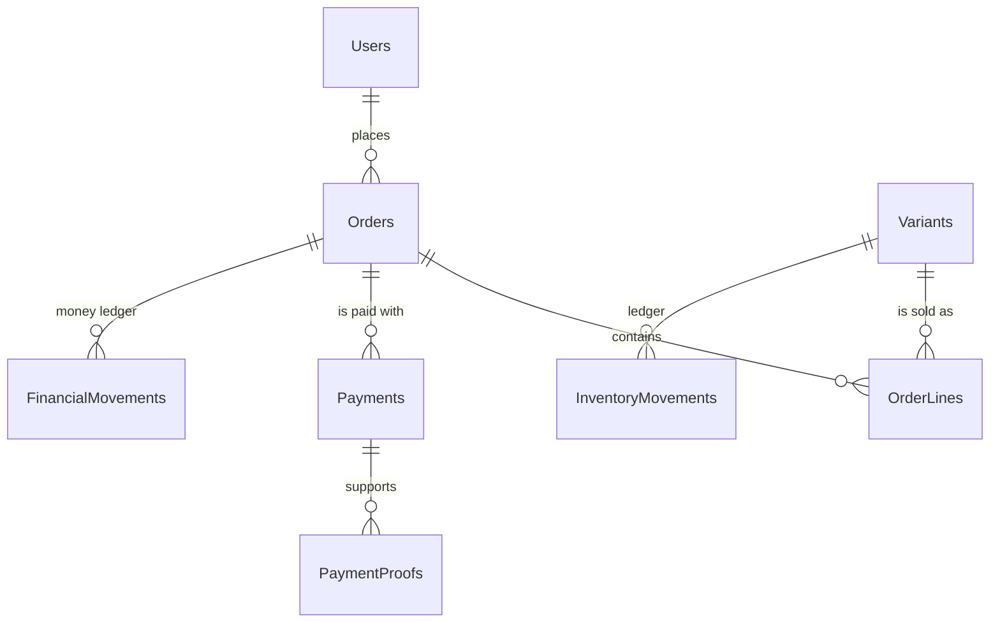
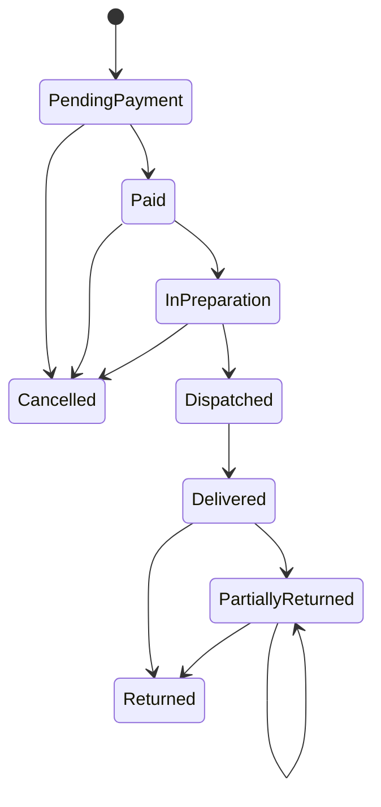

# ShopCart · Pastelería

🇬🇹 Versión en español: [README.md](README.md) <!-- spelling-ignore -->

A production-grade e-commerce platform for a bakery, built for the **Tech Challenge 360 · ShopCart Challenge (Grupo Pentandra)**. It has a catalogue, a cart, coupons, a checkout that reserves the stock for 15 minutes, a **bank deposit** payment simulated end to end (proof, review, rejection and retry), orders and returns, a sales dashboard and an audit log.

Mandatory stack: **SQL Server 2019+ (stored procedures only) · Node 26 + TypeScript `strict` + Express · React 18 + TypeScript**. Delivery dates: **Phase 1 (database and backend) Monday 2 November 2026, 23:59** and **Phase 2 (frontend and complete project) Monday 9 November 2026, 23:59**.

**Status:** Phase 1 is complete and can be verified in minutes with a Postman collection (section 8). The frontend belongs to Phase 2 and is not built yet (section 14).

## 1. The scenario

A chain of shops sells only in its physical stores and wants to sell online. Customers browse the catalogue (cakes, cupcakes, cookies, sweet bread, cold desserts and seasonal items), fill a cart, apply coupons, choose an address and a delivery date, pay and follow their order. The internal team prepares and dispatches the orders, controls the stock and analyses the sales. Amounts are in quetzales and the published prices include the 12 % VAT.

The business has six concrete concerns and each one has a mechanism:

| Concern | Mechanism |
|---|---|
| Never sell the last unit twice | Atomic conditional `UPDATE` plus `CHECK (ReservedStock <= OnHandStock)` |
| Honour the price the customer saw | Price copy in `OrderLines` and immutability triggers |
| No duplicate orders or charges | `Idempotency-Key` plus unique indexes |
| Sales and abandonment without manual reports | Views and table functions |
| Traceability of changes | `AuditLog` written inside each procedure |
| Traceability of inventory | Movement ledger with the resulting balance |

## 2. Requirement coverage

The nine modules of the brief are built in the database and the backend. What each one still lacks is only its screen, which belongs to Phase 2.

| Requirement | Phase 1 (database and API) | Where it is solved |
|---|---|---|
| RF-01 Authentication and roles | Complete | [Security](docs/architecture/05-security.md) |
| RF-02 Catalogue | Complete | [Procedure catalogue](docs/database/stored-procedure-catalogue.md) |
| RF-03 Inventory and ledger | Complete | [ADR-0007](docs/adr/0007-stock-reservation-as-expiring-counter.md) |
| RF-04 Cart | Complete | [ADR-0013](docs/adr/0013-cart-with-absolute-quantities.md) |
| RF-05 Coupons | Complete | [Procedure catalogue](docs/database/stored-procedure-catalogue.md) |
| RF-06 Checkout and payment | Complete (simulated payment) | [Payments](docs/payments/overview.md) |
| RF-07 Orders and returns | Complete | [State machines](docs/architecture/04-state-machines.md) |
| RF-08 Dashboard and reports | Complete (the charts belong to Phase 2) | [ADR-0009](docs/adr/0009-definition-of-completed-order-for-reports.md) |
| RF-09 Audit log | Complete | [Data model](docs/database/er-diagram.md) |

The 21 acceptance criteria of the brief are in the [criteria map](docs/quality/acceptance-criteria-map.md): for each one it says what makes it hold and which test proves it. The tests are 537 for the database (tSQLt), 16 concurrency scenarios with real connections, 17 HTTP flows against SQL Server and 523 unit tests.

## 3. Architecture

A modular monolith with vertical slices; inside each module the dependency rule is `presentation → application → domain ← infrastructure` and `dependency-cruiser` checks it in CI.



**How controllers and routes are organised.** Each module in `backend/src/modules/<module>/` has the same four folders, and a request goes through them in order:

| Layer | Where | What it does |
|---|---|---|
| Routes and controllers | `presentation/*.routes.ts` | Validates the body with zod, applies security, rate limiting and idempotency, calls the port and builds the answer. It has no business logic |
| Application | `application/` | The ports (interfaces) that the presentation layer uses |
| Domain | `domain/` | Pure rules, with no Express and no SQL |
| Infrastructure | `infrastructure/sql-*-repository.ts` | The only place that calls a stored procedure, with typed parameters |

Example, `PUT /api/v1/cart/items/{id}`: `cart.routes.ts` validates the quantity (1 to 99) and takes the user from the token, calls `CartRepository.setItem`, and `sql-cart-repository.ts` runs `SP_Cart_SetItemQuantity`, which is the one that checks the stock. Everything is wired in a single place, `backend/src/composition-root.ts`. The logic that has to be atomic lives in the stored procedures ([ADR-0002](docs/adr/0002-critical-rules-in-stored-procedures-and-checks.md)); the backend orchestrates and never calculates amounts.

The contract is in [docs/api/openapi/openapi.yaml](docs/api/openapi/openapi.yaml) and has **73 operations**:

| Module | Operations | Module | Operations |
|---|---|---|---|
| Authentication | 5 | Orders | 7 |
| Catalogue (public and administration) | 15 | Payments, deposits and refunds | 14 |
| Cart | 6 | Inventory | 3 |
| Addresses | 3 | Coupons | 4 |
| Checkout | 3 | Users | 2 |
| Audit log and system | 4 | Dashboard | 5 |
| Health | 2 | | |

More detail in [docs/architecture](docs/architecture/01-system-overview.md) and in the [C4](docs/architecture/c4/context.md) diagrams.

## 4. Technical decisions

Decisions are recorded as ADRs (25 in total). The ones that shape everything:

| Decision | ADR |
|---|---|
| Modular monolith with vertical slices | [0001](docs/adr/0001-modular-monolith-with-vertical-slices.md) |
| Critical rules live in procedures and `CHECK` | [0002](docs/adr/0002-critical-rules-in-stored-procedures-and-checks.md) |
| Own forward-only migration runner | [0003](docs/adr/0003-own-forward-only-migration-runner-in-node.md) |
| Idempotency at two levels | [0004](docs/adr/0004-idempotency-at-two-levels.md) |
| The server never takes cards | [0005](docs/adr/0005-server-never-takes-cards.md) |
| The order is born as `PendingPayment` | [0014](docs/adr/0014-order-created-as-pending-payment.md) |
| Half-even rounding and integer arithmetic | [0019](docs/adr/0019-half-even-rounding-and-integer-arithmetic.md) |
| Amounts as decimal strings in the API | [0020](docs/adr/0020-amounts-as-decimal-strings-in-the-api.md) |
| British English everywhere, comments in Spanish | [0024](docs/adr/0024-language-and-spelling-conventions.md) |

## 5. Open decisions and assumptions

The brief leaves some decisions open on purpose. These are the positions taken; the full record is in [decision-log](docs/progress/decision-log.md) and [open-questions](docs/progress/open-questions.md).

| Topic | What was decided |
|---|---|
| Payment gateway | There is no gateway. The payment is a simulated **bank deposit**: the customer uploads the proof, the staff reviews it and approves it (success) or rejects it with a reason (rejection), and the customer opens another attempt, up to three (retry). The evaluator confirmed it in writing on 27 October. The card code is inactive by default |
| Stock and reservation | When the payment starts the units are reserved for 15 minutes. The order is created in a single transaction that takes the reservation; the exit movement of the ledger is written when the payment is approved ([ADR-0007](docs/adr/0007-stock-reservation-as-expiring-counter.md)). An abandoned order leaves no noise in the ledger |
| Returns | Total or partial by line, **several per order** (confirmed by the evaluator). The operator or the administrator registers them; the customer does not. The brief defines no return window and none was invented |
| Cancellation | While the order has not been dispatched. It releases the reservation or returns the units to the ledger and leaves a pending refund |
| Shipping | It does not exist: the brief does not ask for it. Orders store shipping `0.00` |
| VAT | 12 % included in the price; each order stores the taxable base and the VAT |
| Time zone | Guatemala (UTC-6). The reports group by the payment date in local time |
| Staff accounts | They are not created through the API: they are seeded. Public registration only creates customers, so that a mistake cannot create an administrator |
| Session | 15 minute JWT access token; opaque refresh token with rotation and reuse detection; progressive account lockout |
| Money | `DECIMAL(18,2)` in tables, `BIGINT` cents in the calculations, half-even rounding applied once and decimal strings in the API |

**Naming standard.** The brief defines the format (`SP_Module_Process`, `VW_`, `FU_`, `ID<Entity>` keys, first letter of each word in capitals) and gives examples in Spanish, such as `SP_Pedidos_CrearPedido`. The format is followed by every object, and the names are in British English by decision of the team ([ADR-0024](docs/adr/0024-language-and-spelling-conventions.md)): `SP_Orders_CreateOrder`, `IDProduct`. The [glossary](docs/glossary.md) gives the equivalent of every term of the brief. <!-- spelling-ignore -->

## 6. Data model and lifecycle

The full diagram and the order of the migrations are in [docs/database/er-diagram.md](docs/database/er-diagram.md). The database has 40 tables, 83 stored procedures, 17 table functions, 6 views and 11 triggers. Summary of the main relationships:



Order lifecycle (the payment's is in [docs/architecture/04-state-machines.md](docs/architecture/04-state-machines.md)). The allowed transitions are rows of the `OrderStatusTransitions` table: a trigger rejects any other, even if the backend fails. Several partial returns leave the order in `PartiallyReturned`; when nothing is left to return it moves to `Returned`.



## 7. Quick start

Requirements: Node.js 26, Docker Desktop (Windows with WSL2) or Docker Engine with the compose plugin (Linux), and Git.

```bash
git clone https://github.com/RedeArmy/bakery-shopcart-ecommerce.git
cd bakery-shopcart-ecommerce
npm install
npm run up
```

`npm run up` creates `.env` with generated local secrets if it does not exist, builds the images, applies the migrations and the seeds, and waits for the services to be healthy (the first time it takes a few minutes). The API is at `http://localhost:8080/api/v1` and its status at `http://localhost:8080/health/ready`; the shop interface is a placeholder until Phase 2. To stop everything:

```bash
npm run down
```

To start from scratch, database included, use `docker compose down --volumes`. Optional profiles: `quality` (SonarQube) and `observability`. More help in the [runbook](docs/operations/runbook.md) and in [Windows and Linux](docs/operations/environment-windows-linux.md).

## 8. How to verify the delivery

**With Postman (the fastest).** The folder [docs/api/postman](docs/api/postman/README.md) has a collection of 44 requests and 76 assertions and its environment:

1. Run `npm run up` and open the `.env` file it created: copy `SEED_ADMIN_PASSWORD` and `SEED_CUSTOMER_PASSWORD`.
2. In Postman, import `ShopCart.postman_collection.json` and `ShopCart.local.postman_environment.json`, choose the environment and paste the two passwords into `adminPassword` and `customerPassword`.
3. Run the collection with **Run**, in the order of the folders.

The first folder that matters is **authentication**: it registers a customer, signs in, reads the profile, rejects a missing or tampered token and a wrong password, and checks the rotation of the refresh token. The others go through the catalogue, the cart, the coupons, the checkout with its idempotency, the ownership of data, the order lifecycle and the audit log. Each run creates its own data, so it can be repeated; wait one minute between runs because sign-in allows five attempts per minute. From a terminal:

```bash
npx newman run docs/api/postman/ShopCart.postman_collection.json -e docs/api/postman/ShopCart.local.postman_environment.json --env-var "adminPassword=<SEED_ADMIN_PASSWORD>" --env-var "customerPassword=<SEED_CUSTOMER_PASSWORD>"
```

To explore the 73 operations, import `docs/api/openapi/openapi.yaml` in Postman: it generates one request per operation.

**With the automated tests.** The database and concurrency tests run against a throwaway SQL Server:

| What is tested | Command |
|---|---|
| Unit tests of the backend, the runner and the scripts | `npm test` |
| 537 database tests (tSQLt) | `npm run sql:test:up` and then `npm run sql:test` |
| 16 concurrency scenarios with real connections | `npm run sql:concurrency` |
| HTTP flows against SQL Server (17) | `npm run test:integration -w backend`, with the test server migrated ([commands](docs/quality/sql-testing-tsqlt.md#concurrency-http-and-performance-suites)) |
| Procedure coverage by tests (83 of 83) | `npm run sql:coverage` |
| Timings of lists and reports with 50,000 orders | `npm run sql:bench` |

## 9. Commands

| Command | What it does |
|---|---|
| `npm run up` / `down` / `logs` | Starts, stops and follows the logs of the environment |
| `npm run lint` | ESLint, Prettier, cspell, British spelling, README synchronisation and SQL file names |
| `npm run typecheck` | Type checking |
| `npm test` | Unit tests of every package |
| `npm run arch:check` | Dependency rules and their self-test |
| `npm run db:migrate` / `db:verify` / `seed` | Migrations, drift verification and demo accounts |
| `npm run sql:lint` / `sql:test` / `sql:coverage` | SQL lint, tSQLt tests and procedure coverage |
| `npm run sql:test:up` / `sql:test:down` | Starts and stops the throwaway SQL Server of the tests |
| `npm run sql:concurrency` / `sql:bench` | Concurrency scenarios and performance benchmark |
| `npm run api:generate` / `sonar` | TypeScript client from OpenAPI (Phase 2) and optional quality analysis; not implemented yet |

## 10. Test credentials

The test accounts are created by the seed step of `db-migrate` when `SEED_DEMO_DATA` is `true`, which is what `npm run up` leaves. The e-mail addresses use the reserved `.test` domain and are not secrets:

| Role | E-mail |
|---|---|
| Administrator | `admin@shopcart.test` |
| Operator | `operator@shopcart.test` |
| Customer | `customer1@shopcart.test` and `customer2@shopcart.test` |

The passwords are **not in the repository**: `npm run up` generates them at random in your local `.env` file, in the variables `SEED_ADMIN_PASSWORD`, `SEED_OPERATOR_PASSWORD` and `SEED_CUSTOMER_PASSWORD` (both customers share the last one), and the database only keeps their argon2id hash. To get new passwords, stop the environment with `docker compose down --volumes`, delete `.env` and run `npm run up` again. More detail in [docs/operations/test-accounts.md](docs/operations/test-accounts.md).

## 11. Payments

The payment is a **bank deposit** simulated end to end, with no gateway. The customer confirms the order and chooses a bank account; there is a window to pay and the customer uploads the proof (JPEG, PNG or PDF up to 5 MB, validated by its first bytes). The payment goes through these states:

| Payment state | What it means |
|---|---|
| `Pending` | Waiting for the proof |
| `UnderReview` | Proof received; the staff reviews it |
| `Approved` | **Success:** the order moves to `Paid` and the stock leaves the ledger |
| `Rejected` | **Rejection:** with a reason; the customer can open another attempt, up to three |
| `Expired` | The window ended without payment: the order is cancelled and the reservation is released by itself |

The rule for when the deposit is offered according to the delivery date is in [payments/availability-rule](docs/payments/availability-rule.md) and the full flow in [payments/bank-deposit](docs/payments/bank-deposit.md). Card payment (Recurrente) is not required for this delivery: the evaluator confirmed that simulating the payment is enough. Its code exists but stays inactive while there are no credentials, and without them only the deposit is offered, both in the interface and in the backend (`422 PAYMENT_METHOD_UNAVAILABLE`).

## 12. Repository map

| Path | Content |
|---|---|
| `backend/` | Express + TypeScript API organised by modules |
| `frontend/` | React 18 + Vite + Tailwind |
| `db/` | `V` migrations, `R` objects, `S` seeds, tSQLt tests, performance benchmark, lint and runner |
| `docker/`, `docker-compose.yml` | nginx, SQL Server initialisation and profiles |
| `docs/` | ADRs, architecture, database, API (with the Postman collection), payments, quality, operations and progress |
| `tools/` | Verification scripts and the Recurrente simulator |

## 13. Documentation

Full index in [docs/README.md](docs/README.md). API contract in [docs/api/openapi/openapi.yaml](docs/api/openapi/openapi.yaml). Acceptance criteria map in [docs/quality/acceptance-criteria-map.md](docs/quality/acceptance-criteria-map.md). Database performance in [docs/operations/performance.md](docs/operations/performance.md). Contribution guide in [CONTRIBUTING.md](CONTRIBUTING.md) and security policy in [SECURITY.md](SECURITY.md).

## 14. Delivery status

**Phase 1, database and backend: complete.** 12 migrations, 83 procedures, the 73-operation API, authentication with token rotation, the simulated payment, the background jobs (expiry of reservations and payments, data purge, reconciliation of amounts and stock) and the tests described in section 8. The history of changes and the decisions are in [STATUS](docs/progress/STATUS.md) and [ROADMAP](docs/progress/ROADMAP.md).

**Demo data.** The four test accounts exist when the environment starts. The demo catalogue, coupons and bank account are not seeded yet: the Postman collection creates its own, and the administrator can create them with the API.

**Phase 2, frontend: pending.** Protected routes and menus by role, forms with validation, tables with server-side paging and filters, dashboard charts, loading, empty and error states, transparent token renewal and a responsive interface, with end-to-end tests.
