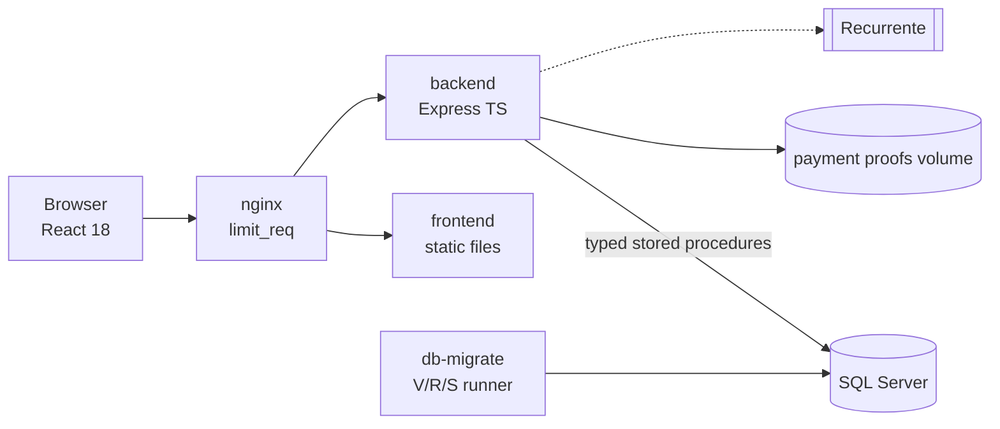
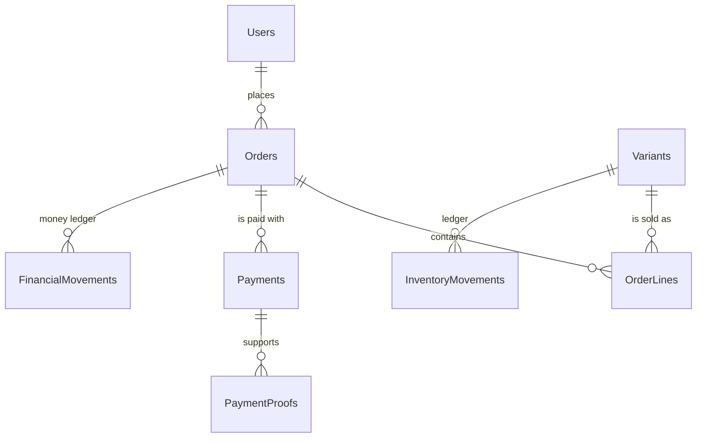
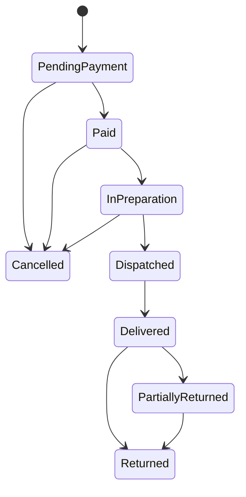

# ShopCart · Pastelería "Dulce Aroma"

🇬🇧 English version: [README.en.md](README.en.md)

Plataforma de comercio electrónico de nivel productivo para una pastelería, construida para el **Tech Challenge 360 · Reto ShopCart (Grupo Pentandra)**. Incluye catálogo, carrito, cupones, checkout con reserva de existencias, pagos por **depósito bancario** (comprobante y revisión) y por **tarjeta con Recurrente**, pedidos y devoluciones, tablero de ventas y bitácora.

Stack obligatorio: **SQL Server 2019+ (solo procedimientos almacenados) · Node 26 + TypeScript `strict` + Express · React 18 + TypeScript**. Fechas de entrega: **Fase 1 (base de datos y backend) lunes 2 de noviembre de 2026, 23:59** y **Fase 2 (frontend y proyecto completo) lunes 9 de noviembre de 2026, 23:59**.

## 1. El escenario

Una cadena de tiendas vende solo en sus puntos físicos y quiere vender en línea. Los clientes navegan el catálogo (pasteles, cupcakes, galletas, pan dulce, postres fríos y temporada), arman su carrito, aplican cupones, eligen dirección y fecha de entrega, pagan y siguen su pedido. El equipo interno prepara y despacha pedidos, controla existencias y analiza las ventas. Los montos están en quetzales y los precios incluyen IVA de 12 %.

El negocio tiene seis preocupaciones concretas y cada una tiene un mecanismo:

| Preocupación | Mecanismo |
|---|---|
| No vender la última unidad dos veces | `UPDATE` condicional atómico más `CHECK (ReservedStock <= OnHandStock)` |
| Respetar el precio que el cliente vio | Copia del precio en `OrderLines` y triggers de inmutabilidad |
| Sin pedidos ni cobros duplicados | `Idempotency-Key` más índices únicos |
| Ventas y abandonos sin reportes manuales | Vistas y funciones de tabla |
| Trazabilidad de cambios | `AuditLog` escrito dentro de cada procedimiento |
| Trazabilidad de inventario | Libro de movimientos con saldo resultante |

## 2. Cobertura de requisitos

| Requisito | Estado | Dónde se resuelve |
|---|---|---|
| RF-01 Autenticación y roles | Planificado (Etapa 5) | [Seguridad](docs/architecture/05-security.md) |
| RF-02 Catálogo | Planificado (Etapas 3 y 5) | [Catálogo de procedimientos](docs/database/stored-procedure-catalogue.md) |
| RF-03 Inventario y kardex | Planificado (Etapa 3) | [ADR-0007](docs/adr/0007-stock-reservation-as-expiring-counter.md) |
| RF-04 Carrito | Planificado (Etapa 4) | [ADR-0013](docs/adr/0013-cart-with-absolute-quantities.md) |
| RF-05 Cupones | Planificado (Etapa 4) | [Catálogo de procedimientos](docs/database/stored-procedure-catalogue.md) |
| RF-06 Checkout y pago | Planificado (Etapa 4) | [Diseño de alto nivel](docs/architecture/02-hld.md) |
| RF-07 Pedidos y devoluciones | Planificado (Etapa 4) | [Máquinas de estado](docs/architecture/04-state-machines.md) |
| RF-08 Tablero y reportes | Planificado (Etapa 6) | [ADR-0009](docs/adr/0009-definition-of-completed-order-for-reports.md) |
| RF-09 Bitácora | Planificado (Etapa 4) | [Modelo de datos](docs/database/er-diagram.md) |

## 3. Arquitectura

Monolito modular con cortes verticales; dentro de cada módulo la regla de dependencia es `presentation → application → domain ← infrastructure` y `dependency-cruiser` la verifica en CI.



Más detalle en [docs/architecture](docs/architecture/01-system-overview.md) y en los diagramas [C4](docs/architecture/c4/context.md).

## 4. Decisiones técnicas

Las decisiones están registradas como ADR (24 en total). Las que dan forma a todo:

| Decisión | ADR |
|---|---|
| Monolito modular con cortes verticales | [0001](docs/adr/0001-modular-monolith-with-vertical-slices.md) |
| Las reglas críticas viven en procedimientos y `CHECK` | [0002](docs/adr/0002-critical-rules-in-stored-procedures-and-checks.md) |
| Runner de migraciones propio, solo hacia adelante | [0003](docs/adr/0003-own-forward-only-migration-runner-in-node.md) |
| Idempotencia en dos niveles | [0004](docs/adr/0004-idempotency-at-two-levels.md) |
| El servidor nunca cobra tarjetas | [0005](docs/adr/0005-server-never-takes-cards.md) |
| El pedido nace en `PendingPayment` | [0014](docs/adr/0014-order-created-as-pending-payment.md) |
| Redondeo half-even y aritmética entera | [0019](docs/adr/0019-half-even-rounding-and-integer-arithmetic.md) |
| Importes como cadenas decimales en la API | [0020](docs/adr/0020-amounts-as-decimal-strings-in-the-api.md) |
| Inglés británico en todo, comentarios en español | [0024](docs/adr/0024-language-and-spelling-conventions.md) |

Los supuestos que el enunciado deja abiertos están en [open-questions](docs/progress/open-questions.md).

## 5. Modelo de datos y ciclo de vida

El diagrama completo y el orden de migraciones están en [docs/database/er-diagram.md](docs/database/er-diagram.md). Resumen de las relaciones principales:



Ciclo de vida del pedido (el del pago está en [docs/architecture/04-state-machines.md](docs/architecture/04-state-machines.md)):



## 6. Inicio rápido

Requisitos: Node.js 26, Docker Desktop (Windows con WSL2) o Docker Engine con el plugin compose (Linux), y Git.

```bash
git clone <repository-url>
cd shopcart
npm install
npm run up
```

`npm run up` crea `.env` con secretos locales generados si no existe, construye las imágenes y espera a que los servicios estén saludables. La tienda queda en `http://localhost:8080`. Para detener todo:

```bash
npm run down
```

Perfiles opcionales: `payments-sandbox` (simulador de Recurrente), `quality` (SonarQube) y `observability`. Más ayuda en el [runbook](docs/operations/runbook.md) y en [Windows y Linux](docs/operations/environment-windows-linux.md).

## 7. Comandos

| Comando | Qué hace |
|---|---|
| `npm run up` / `down` / `logs` | Levanta, detiene y sigue los logs del entorno |
| `npm run lint` | ESLint, Prettier, cspell, ortografía británica, sincronía de README y nombres SQL |
| `npm run typecheck` | Verificación de tipos |
| `npm test` | Pruebas unitarias e integración |
| `npm run arch:check` | Reglas de dependencias y su autoprueba |
| `npm run db:migrate` / `db:verify` / `seed` | Migraciones, verificación de deriva y semillas (Etapa 2) |
| `npm run sql:lint` / `sql:test` / `sql:coverage` | Lint SQL, pruebas tSQLt (solo CI) y cobertura de procedimientos |
| `npm run api:generate` | Cliente TypeScript generado desde OpenAPI (Etapa 7) |
| `npm run sonar` | Análisis de calidad opcional (Etapa 9) |

## 8. Credenciales de prueba

Las cuentas de prueba las crea la semilla de la Etapa 2. Los correos usan el dominio reservado `.test` y no son secretos:

| Rol | Correo |
|---|---|
| Administrador | `admin@shopcart.test` |
| Operador | `operator@shopcart.test` |
| Cliente | `customer1@shopcart.test` y `customer2@shopcart.test` |

Las contraseñas **no están en el repositorio**: `npm run up` las genera al azar en su archivo `.env` local, en las variables `SEED_ADMIN_PASSWORD`, `SEED_OPERATOR_PASSWORD` y `SEED_CUSTOMER_PASSWORD` (los dos clientes comparten la última). Para obtener contraseñas nuevas, detenga el entorno con `docker compose down --volumes`, borre `.env` y ejecute `npm run up` otra vez. Más detalle en [docs/operations/test-accounts.md](docs/operations/test-accounts.md).

## 9. Pagos con tarjeta

El pago con tarjeta usa el checkout alojado de **Recurrente** y requiere credenciales (`RECURRENTE_PUBLIC_KEY`, `RECURRENTE_SECRET_KEY`) o el simulador del perfil `payments-sandbox`. **Sin credenciales solo se ofrece depósito bancario**, tanto en la interfaz como en el backend (`422 PAYMENT_METHOD_UNAVAILABLE`). Detalles en [payments/availability-rule](docs/payments/availability-rule.md).

## 10. Mapa del repositorio

| Ruta | Contenido |
|---|---|
| `backend/` | API Express + TypeScript organizada por módulos |
| `frontend/` | React 18 + Vite + Tailwind |
| `db/` | Migraciones `V`, objetos `R`, semillas `S`, pruebas tSQLt, lint y runner |
| `docker/`, `docker-compose.yml` | nginx, inicialización de SQL Server y perfiles |
| `docs/` | ADR, arquitectura, base de datos, API, pagos, calidad, operación y avance |
| `tools/` | Scripts de verificación y simulador de Recurrente |

## 11. Documentación

Índice completo en [docs/README.md](docs/README.md). Contrato de la API en [docs/api/openapi/openapi.yaml](docs/api/openapi/openapi.yaml). Guía de colaboración en [CONTRIBUTING.md](CONTRIBUTING.md) y política de seguridad en [SECURITY.md](SECURITY.md).

## 12. Estado de la entrega

Las Etapas 0 (cimientos) y 1 (documentación y convenciones) están completas. La Etapa 2 (runner de migraciones y tablas) es la siguiente. El detalle está en [ROADMAP](docs/progress/ROADMAP.md) y [STATUS](docs/progress/STATUS.md).
