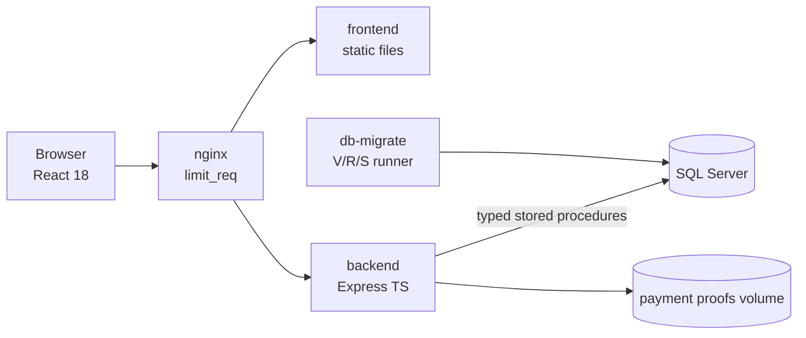
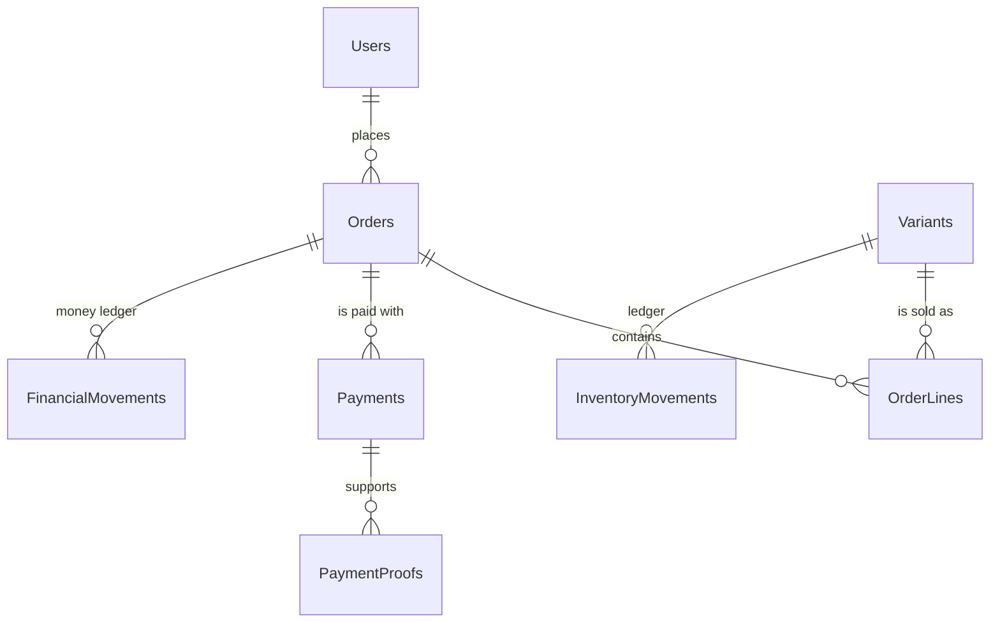
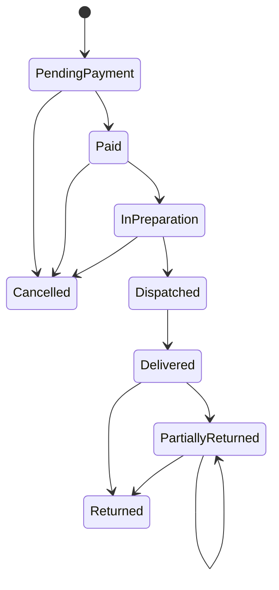

# ShopCart · Pastelería

🇬🇧 English version: [README.en.md](README.en.md)

Plataforma de comercio electrónico de nivel productivo para una pastelería, construida para el **Tech Challenge 360 · Reto ShopCart (Grupo Pentandra)**. Incluye catálogo, carrito, cupones, checkout con reserva de existencias durante 15 minutos, pago por **depósito bancario** simulado de punta a punta (comprobante, revisión, rechazo y reintento), pedidos y devoluciones, tablero de ventas y bitácora de auditoría.

Stack obligatorio: **SQL Server 2019+ (solo procedimientos almacenados) · Node 26 + TypeScript `strict` + Express · React 18 + TypeScript**. Fechas de entrega: **Fase 1 (base de datos y backend) lunes 2 de noviembre de 2026, 23:59** y **Fase 2 (frontend y proyecto completo) lunes 9 de noviembre de 2026, 23:59**.

**Estado:** la Fase 1 está completa y se puede verificar en minutos con una colección de Postman (sección 8). El frontend es de la Fase 2 y todavía no está hecho (sección 14).

## 1. El escenario

Una cadena de tiendas vende solo en sus puntos físicos y quiere vender en línea. Los clientes navegan el catálogo (pasteles, cupcakes, galletas, pan dulce, postres fríos y temporada), arman su carrito, aplican cupones, eligen dirección y fecha de entrega, pagan y siguen su pedido. El equipo interno prepara y despacha los pedidos, controla las existencias y analiza las ventas. Los montos son en quetzales y los precios publicados incluyen el IVA del 12 %.

El negocio tiene seis preocupaciones concretas y cada una tiene un mecanismo:

| Preocupación | Mecanismo |
|---|---|
| No vender la última unidad dos veces | `UPDATE` condicional atómico más `CHECK (ReservedStock <= OnHandStock)` |
| Respetar el precio que el cliente vio | Copia del precio en `OrderLines` y triggers de inmutabilidad |
| Sin pedidos ni cobros duplicados | `Idempotency-Key` más índices únicos |
| Ventas y abandonos sin reportes manuales | Vistas y funciones de tabla |
| Trazabilidad de cambios | `AuditLog` escrito dentro de cada procedimiento |
| Trazabilidad de inventario | Libro de movimientos con saldo resultante |

## 2. Cobertura de requisitos

Los nueve módulos del enunciado están construidos en la base de datos y el backend. Lo que falta de cada uno es solo su pantalla, que pertenece a la Fase 2.

| Requisito | Fase 1 (base de datos y API) | Dónde se resuelve |
|---|---|---|
| RF-01 Autenticación y roles | Completo | [Seguridad](docs/architecture/05-security.md) |
| RF-02 Catálogo | Completo | [Catálogo de procedimientos](docs/database/stored-procedure-catalogue.md) |
| RF-03 Inventario y kardex | Completo | [ADR-0007](docs/adr/0007-stock-reservation-as-expiring-counter.md) |
| RF-04 Carrito | Completo | [ADR-0013](docs/adr/0013-cart-with-absolute-quantities.md) |
| RF-05 Cupones | Completo | [Catálogo de procedimientos](docs/database/stored-procedure-catalogue.md) |
| RF-06 Checkout y pago | Completo (pago simulado) | [Pagos](docs/payments/overview.md) |
| RF-07 Pedidos y devoluciones | Completo | [Máquinas de estado](docs/architecture/04-state-machines.md) |
| RF-08 Tablero y reportes | Completo (las gráficas son de la Fase 2) | [ADR-0009](docs/adr/0009-definition-of-completed-order-for-reports.md) |
| RF-09 Bitácora | Completo | [Modelo de datos](docs/database/er-diagram.md) |

Los 21 criterios de aceptación del enunciado están en el [mapa de criterios](docs/quality/acceptance-criteria-map.md): para cada uno dice qué lo hace cumplir y qué prueba lo demuestra. Las pruebas son 537 de base de datos (tSQLt), 16 escenarios de concurrencia con conexiones reales, 17 flujos HTTP contra SQL Server y 523 pruebas unitarias.

## 3. Arquitectura

Monolito modular con cortes verticales; dentro de cada módulo la regla de dependencia es `presentation → application → domain ← infrastructure` y `dependency-cruiser` la verifica en CI.



**Cómo se organizan los controladores y las rutas.** Cada módulo de `backend/src/modules/<módulo>/` tiene las mismas cuatro carpetas, y una petición las recorre en orden:

| Capa | Dónde | Qué hace |
|---|---|---|
| Rutas y controladores | `presentation/*.routes.ts` | Valida el cuerpo con zod, aplica seguridad, límite de tasa e idempotencia, llama al puerto y arma la respuesta. No tiene lógica de negocio |
| Aplicación | `application/` | Los puertos (interfaces) que la capa de presentación usa |
| Dominio | `domain/` | Reglas puras, sin Express ni SQL |
| Infraestructura | `infrastructure/sql-*-repository.ts` | Único lugar que llama a un procedimiento almacenado, con parámetros tipados |

Ejemplo, `PUT /api/v1/cart/items/{id}`: `cart.routes.ts` valida la cantidad (1 a 99) y toma el usuario del token, llama a `CartRepository.setItem` y `sql-cart-repository.ts` ejecuta `SP_Cart_SetItemQuantity`, que es quien comprueba la existencia. Todo se une en un solo lugar, `backend/src/composition-root.ts`. La lógica que necesita ser atómica vive en los procedimientos almacenados ([ADR-0002](docs/adr/0002-critical-rules-in-stored-procedures-and-checks.md)); el backend orquesta y nunca calcula importes.

El contrato está en [docs/api/openapi/openapi.yaml](docs/api/openapi/openapi.yaml) y tiene **73 operaciones**:

| Módulo | Operaciones | Módulo | Operaciones |
|---|---|---|---|
| Autenticación | 5 | Pedidos | 7 |
| Catálogo (público y administración) | 15 | Pagos, depósitos y reembolsos | 14 |
| Carrito | 6 | Inventario | 3 |
| Direcciones | 3 | Cupones | 4 |
| Checkout | 3 | Usuarios | 2 |
| Bitácora y sistema | 4 | Tablero | 5 |
| Salud | 2 | | |

Más detalle en [docs/architecture](docs/architecture/01-system-overview.md) y en los diagramas [C4](docs/architecture/c4/context.md).

## 4. Decisiones técnicas

Las decisiones están registradas como ADR (25 en total). Las que dan forma a todo:

| Decisión | ADR |
|---|---|
| Monolito modular con cortes verticales | [0001](docs/adr/0001-modular-monolith-with-vertical-slices.md) |
| Las reglas críticas viven en procedimientos y `CHECK` | [0002](docs/adr/0002-critical-rules-in-stored-procedures-and-checks.md) |
| Runner de migraciones propio, solo hacia adelante | [0003](docs/adr/0003-own-forward-only-migration-runner-in-node.md) |
| Idempotencia en dos niveles | [0004](docs/adr/0004-idempotency-at-two-levels.md) |
| El servidor nunca cobra tarjetas | [0005](docs/adr/0005-server-never-takes-cards.md) |
| El pedido nace en `PendingPayment` | [0014](docs/adr/0014-order-created-as-pending-payment.md) |
| Redondeo half-even y aritmética entera | [0019](docs/adr/0019-half-even-rounding-and-integer-arithmetic.md) |
| Importes como cadenas decimales en la API | [0020](docs/adr/0020-amounts-as-decimal-strings-in-the-api.md) |
| Inglés británico en todo, comentarios en español | [0024](docs/adr/0024-language-and-spelling-conventions.md) |

## 5. Decisiones abiertas y supuestos

El enunciado deja algunas decisiones a propósito. Estas son las posturas tomadas; el registro completo está en [decision-log](docs/progress/decision-log.md) y [open-questions](docs/progress/open-questions.md).

| Tema | Qué se decidió |
|---|---|
| Pasarela de pagos | No hay pasarela. El pago es un **depósito bancario** simulado: el cliente sube el comprobante, el personal lo revisa y lo aprueba (éxito) o lo rechaza con un motivo (rechazo), y el cliente abre otro intento, hasta tres (reintento). Lo confirmó el evaluador por escrito el 27 de octubre. El código de tarjeta queda inactivo por defecto |
| Existencias y reserva | Al iniciar el pago se reservan las unidades 15 minutos. El pedido se crea en una sola transacción que toma la reserva; el movimiento de salida del kardex se escribe cuando se aprueba el pago ([ADR-0007](docs/adr/0007-stock-reservation-as-expiring-counter.md)). Un pedido abandonado no deja ruido en el kardex |
| Devoluciones | Totales o parciales por línea, **varias por pedido** (lo confirmó el evaluador). Las registra el operador o el administrador; el cliente no. El enunciado no define un plazo de devolución y no se inventó uno |
| Cancelación | Mientras el pedido no se haya despachado. Libera la reserva o devuelve las unidades al kardex y deja un reembolso pendiente |
| Envío | No existe: el enunciado no lo pide. Los pedidos guardan envío `0.00` |
| IVA | 12 % incluido en el precio; cada pedido guarda la base imponible y el IVA |
| Zona horaria | Guatemala (UTC-6). Los reportes agrupan por la fecha de pago en hora local |
| Cuentas de personal | No se crean por la API: se siembran. El registro público solo crea clientes, para que un error no pueda crear un administrador |
| Sesión | Access token JWT de 15 minutos; refresh token opaco con rotación y detección de reutilización; bloqueo progresivo de la cuenta |
| Dinero | `DECIMAL(18,2)` en tablas, `BIGINT` en centavos en los cálculos, redondeo half-even una sola vez y cadenas decimales en la API |

**Estándar de nomenclatura.** El enunciado define el formato (`SP_Módulo_Proceso`, `VW_`, `FU_`, llaves `ID<Entidad>`, primera letra de cada palabra en mayúscula) y da ejemplos en español, como `SP_Pedidos_CrearPedido`. Se cumple el formato en todos los objetos, y los nombres están en inglés británico por decisión del equipo ([ADR-0024](docs/adr/0024-language-and-spelling-conventions.md)): `SP_Orders_CreateOrder`, `IDProduct`. El [glosario](docs/glossary.md) da la equivalencia de cada término del enunciado.

## 6. Modelo de datos y ciclo de vida

El diagrama completo y el orden de migraciones están en [docs/database/er-diagram.md](docs/database/er-diagram.md). La base tiene 40 tablas, 83 procedimientos almacenados, 17 funciones de tabla, 6 vistas y 11 triggers. Resumen de las relaciones principales:



Ciclo de vida del pedido (el del pago está en [docs/architecture/04-state-machines.md](docs/architecture/04-state-machines.md)). Las transiciones permitidas son filas de la tabla `OrderStatusTransitions`: un trigger rechaza cualquier otra, aunque falle el backend. Varias devoluciones parciales dejan el pedido en `PartiallyReturned`; cuando ya no queda nada por devolver pasa a `Returned`.



## 7. Inicio rápido

Requisitos: Node.js 26, Docker Desktop (Windows con WSL2) o Docker Engine con el plugin compose (Linux), y Git.

```bash
git clone https://github.com/RedeArmy/bakery-shopcart-ecommerce.git
cd bakery-shopcart-ecommerce
npm install
npm run up
```

`npm run up` crea `.env` con secretos locales generados si no existe, construye las imágenes, aplica las migraciones y las semillas, y espera a que los servicios estén saludables (la primera vez tarda unos minutos). La API queda en `http://localhost:8080/api/v1` y su estado en `http://localhost:8080/health/ready`; la interfaz de la tienda es un marcador hasta la Fase 2. Para detener todo:

```bash
npm run down
```

Para empezar de cero, incluida la base de datos, use `docker compose down --volumes`. Perfiles opcionales: `quality` (SonarQube) y `observability`. Más ayuda en el [runbook](docs/operations/runbook.md) y en [Windows y Linux](docs/operations/environment-windows-linux.md).

## 8. Cómo verificar la entrega

**Con Postman (lo más rápido).** La carpeta [docs/api/postman](docs/api/postman/README.md) tiene una colección de 44 peticiones y 76 aserciones y su entorno:

1. Ejecute `npm run up` y abra el archivo `.env` que se creó: copie `SEED_ADMIN_PASSWORD` y `SEED_CUSTOMER_PASSWORD`.
2. En Postman, importe `ShopCart.postman_collection.json` y `ShopCart.local.postman_environment.json`, elija el entorno y pegue las dos contraseñas en `adminPassword` y `customerPassword`.
3. Ejecute la colección con **Run**, en el orden de las carpetas.

La primera carpeta que importa es la de **autenticación**: registra un cliente, inicia sesión, lee el perfil, rechaza un token ausente o manipulado y una contraseña incorrecta, y comprueba la rotación del refresh token. Las demás recorren el catálogo, el carrito, los cupones, el checkout con su idempotencia, la propiedad de los datos, el ciclo de vida del pedido y la bitácora. Cada ejecución crea sus propios datos, así que se puede repetir; espere un minuto entre ejecuciones porque el inicio de sesión admite cinco intentos por minuto. Desde una terminal:

```bash
npx newman run docs/api/postman/ShopCart.postman_collection.json -e docs/api/postman/ShopCart.local.postman_environment.json --env-var "adminPassword=<SEED_ADMIN_PASSWORD>" --env-var "customerPassword=<SEED_CUSTOMER_PASSWORD>"
```

Para explorar las 73 operaciones, importe `docs/api/openapi/openapi.yaml` en Postman: genera una petición por operación.

**Con las pruebas automáticas.** Las pruebas de base de datos y de concurrencia corren contra un SQL Server desechable:

| Qué se prueba | Comando |
|---|---|
| Unitarias del backend, del runner y de los scripts | `npm test` |
| 537 pruebas de base de datos (tSQLt) | `npm run sql:test:up` y después `npm run sql:test` |
| 16 escenarios de concurrencia con conexiones reales | `npm run sql:concurrency` |
| Flujos HTTP contra SQL Server (17) | `npm run test:integration -w backend`, con el servidor de pruebas migrado ([comandos](docs/quality/sql-testing-tsqlt.md#concurrency-http-and-performance-suites)) |
| Cobertura de procedimientos por pruebas (83 de 83) | `npm run sql:coverage` |
| Tiempos de listados y reportes con 50 000 pedidos | `npm run sql:bench` |

## 9. Comandos

| Comando | Qué hace |
|---|---|
| `npm run up` / `down` / `logs` | Levanta, detiene y sigue los logs del entorno |
| `npm run lint` | ESLint, Prettier, cspell, ortografía británica, sincronía de README y nombres SQL |
| `npm run typecheck` | Verificación de tipos |
| `npm test` | Pruebas unitarias de todos los paquetes |
| `npm run arch:check` | Reglas de dependencias y su autoprueba |
| `npm run db:migrate` / `db:verify` / `seed` | Migraciones, verificación de deriva y cuentas de demostración |
| `npm run sql:lint` / `sql:test` / `sql:coverage` | Lint SQL, pruebas tSQLt y cobertura de procedimientos |
| `npm run sql:test:up` / `sql:test:down` | Levanta y apaga el SQL Server desechable de las pruebas |
| `npm run sql:concurrency` / `sql:bench` | Escenarios de concurrencia y banco de rendimiento |
| `npm run api:generate` / `sonar` | Cliente TypeScript desde OpenAPI (Fase 2) y análisis de calidad opcional; aún no implementados |

## 10. Credenciales de prueba

Las cuentas de prueba las crea el paso de semilla de `db-migrate` cuando `SEED_DEMO_DATA` es `true`, que es lo que deja `npm run up`. Los correos usan el dominio reservado `.test` y no son secretos:

| Rol | Correo |
|---|---|
| Administrador | `admin@shopcart.test` |
| Operador | `operator@shopcart.test` |
| Cliente | `customer1@shopcart.test` y `customer2@shopcart.test` |

Las contraseñas **no están en el repositorio**: `npm run up` las genera al azar en su archivo `.env` local, en las variables `SEED_ADMIN_PASSWORD`, `SEED_OPERATOR_PASSWORD` y `SEED_CUSTOMER_PASSWORD` (los dos clientes comparten la última), y la base de datos solo guarda su hash argon2id. Para obtener contraseñas nuevas, detenga el entorno con `docker compose down --volumes`, borre `.env` y ejecute `npm run up` otra vez. Más detalle en [docs/operations/test-accounts.md](docs/operations/test-accounts.md).

## 11. Pagos

El pago es un **depósito bancario** que se simula de punta a punta, sin pasarela. El cliente confirma el pedido y elige una cuenta bancaria; tiene una ventana para pagar y sube el comprobante (JPEG, PNG o PDF de hasta 5 MB, validado por sus bytes iniciales). El pago pasa por estos estados:

| Estado del pago | Qué significa |
|---|---|
| `Pending` | Esperando el comprobante |
| `UnderReview` | Comprobante recibido; el personal lo revisa |
| `Approved` | **Éxito:** el pedido pasa a `Paid` y la existencia sale del kardex |
| `Rejected` | **Rechazo:** con motivo; el cliente puede abrir otro intento, hasta tres |
| `Expired` | La ventana terminó sin pago: el pedido se cancela y la reserva se libera sola |

La regla de cuándo se ofrece el depósito según la fecha de entrega está en [payments/availability-rule](docs/payments/availability-rule.md) y el flujo completo en [payments/bank-deposit](docs/payments/bank-deposit.md). El pago con tarjeta (Recurrente) no se requiere para esta entrega: el evaluador confirmó que basta simular el pago. Su código existe pero queda inactivo mientras no haya credenciales, y sin ellas solo se ofrece el depósito, tanto en la interfaz como en el backend (`422 PAYMENT_METHOD_UNAVAILABLE`).

## 12. Mapa del repositorio

| Ruta | Contenido |
|---|---|
| `backend/` | API Express + TypeScript organizada por módulos |
| `frontend/` | React 18 + Vite + Tailwind |
| `db/` | Migraciones `V`, objetos `R`, semillas `S`, pruebas tSQLt, banco de rendimiento, lint y runner |
| `docker/`, `docker-compose.yml` | nginx, inicialización de SQL Server y perfiles |
| `docs/` | ADR, arquitectura, base de datos, API (con la colección de Postman), pagos, calidad, operación y avance |
| `tools/` | Scripts de verificación y simulador de Recurrente |

## 13. Documentación

Índice completo en [docs/README.md](docs/README.md). Contrato de la API en [docs/api/openapi/openapi.yaml](docs/api/openapi/openapi.yaml). Mapa de criterios de aceptación en [docs/quality/acceptance-criteria-map.md](docs/quality/acceptance-criteria-map.md). Rendimiento de la base de datos en [docs/operations/performance.md](docs/operations/performance.md). Guía de colaboración en [CONTRIBUTING.md](CONTRIBUTING.md) y política de seguridad en [SECURITY.md](SECURITY.md).

## 14. Estado de la entrega

**Fase 1, base de datos y backend: completa.** 12 migraciones, 83 procedimientos, la API de 73 operaciones, la autenticación con rotación de tokens, el pago simulado, los trabajos de fondo (vencimiento de reservas y pagos, purga de datos, conciliación de importes y existencias) y las pruebas descritas en la sección 8. El historial de cambios y las decisiones están en [STATUS](docs/progress/STATUS.md) y [ROADMAP](docs/progress/ROADMAP.md).

**Datos de demostración.** Las cuatro cuentas de prueba existen al levantar el entorno. El catálogo, los cupones y la cuenta bancaria de demostración todavía no están sembrados: la colección de Postman crea los suyos, y el administrador puede crearlos con la API.

**Fase 2, frontend: pendiente.** Rutas protegidas y menús por rol, formularios con validación, tablas con paginación y filtros del lado del servidor, gráficas del tablero, estados de carga, vacío y error, renovación transparente del token e interfaz responsive, con pruebas de extremo a extremo.
