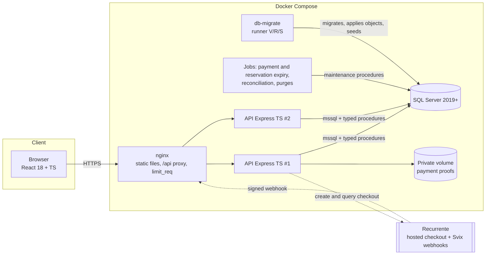
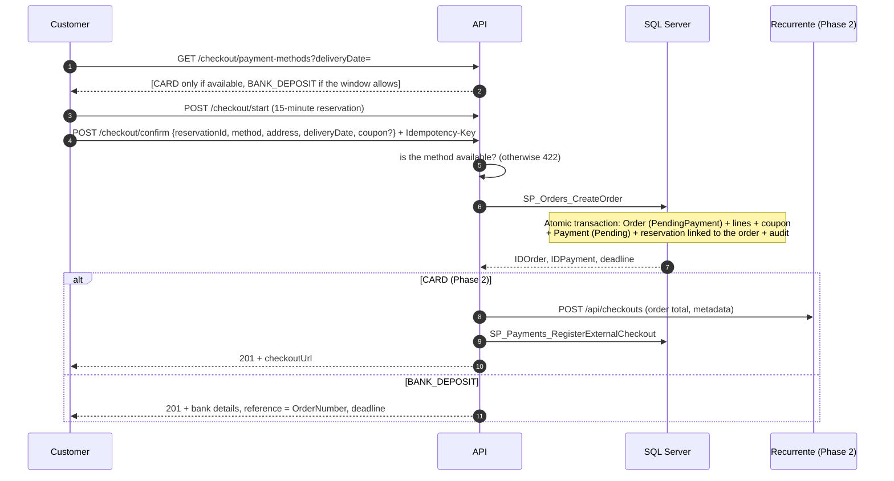
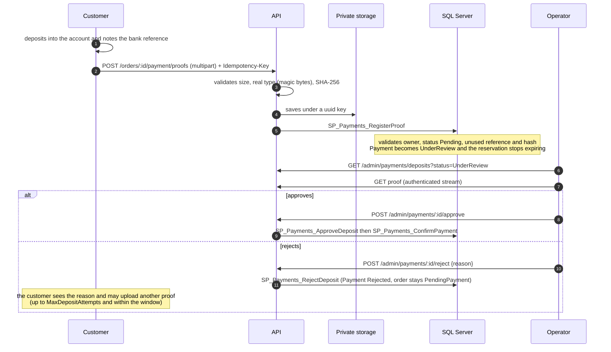
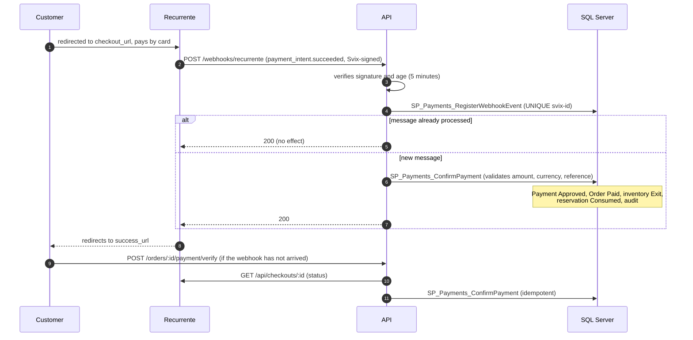

# 02 · High-level design

## Components

Without Recurrente credentials the gateway box is unused and only bank deposit is offered. Jobs run inside the API process; `sp_getapplock` makes them single-instance when several replicas run.

## Checkout: confirmation and method choice

## Bank deposit (Delivery Phase 1)

## Card with Recurrente (Delivery Phase 2)

## Architecture decisions behind the design

1. The database is the authority for critical rules; the backend validates first for good messages (ADR-0002).
2. A reservation is an expiring counter; the conditional `UPDATE` is the cheapest way to avoid overselling (ADR-0007).
3. Idempotency in two levels (ADR-0004).
4. Order snapshots protected by immutability triggers (SKU, name, attributes, price, discount, VAT).
5. The audit entry is written by the procedure inside the same transaction.
6. The API is stateless; the only stateful pieces are the jobs, protected by `sp_getapplock`.
7. Access by procedures is enforced by the engine: `EXECUTE` is granted and direct table access is denied.
8. Versioning is verifiable: every migration and object has a version, a checksum and a record (ADR-0012).
9. The server never charges a card (ADR-0005).
10. Money is calculated in integers inside the database; the frontend and backend do not calculate amounts (ADR-0019).

## Alternatives rejected

| Alternative | Reason |
|---|---|
| Reservation with `SERIALIZABLE` and a cursor | More contention and deadlock risk |
| Queue (Redis/RabbitMQ) in checkout | Infrastructure with no need at this volume |
| Event sourcing for inventory | The ledger already is a log of movements |
| Redis for reservations | Breaks atomicity with the order |
| GraphQL | REST with OpenAPI is what the brief asks |
| Flyway | Adds Java and another image; the own runner is simpler to defend |
| Unofficial Recurrente SDK | Less control; the own adapter is a few lines |
| Decrement stock at order creation (WooCommerce style) | An abandoned order would create an exit and a compensating entry in the ledger |
| `MONEY` / `FLOAT` | Lose precision; see [money handling](../database/money-handling.md) |
