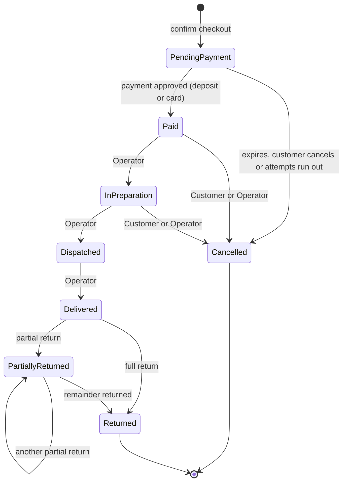
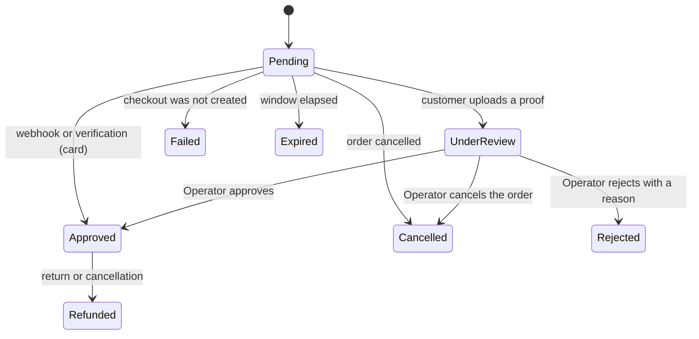

# 04 · State machines

Both machines are stored as data (`OrderStatusTransitions`, `PaymentStatusTransitions`), enforced by a procedure and by a trigger, and recorded in history tables. An invalid transition is rejected twice: by the procedure and by `TR_Orders_ValidateTransition` or `TR_Payments_ValidateTransition`.

## Order lifecycle

| ID | State | Meaning |
|---|---|---|
| 1 | `PendingPayment` | Created, waiting for payment or review |
| 2 | `Paid` | Payment approved, stock decremented |
| 3 | `InPreparation` | |
| 4 | `Dispatched` | |
| 5 | `Delivered` | |
| 6 | `Cancelled` | Before or after payment |
| 7 | `PartiallyReturned` | |
| 8 | `Returned` | |

Allowed transitions: `1→2`, `1→6`, `2→3`, `2→6`, `3→4`, `3→6`, `4→5`, `5→7`, `5→8`, `7→7`, `7→8`.

Once `Dispatched`, an order can no longer be cancelled; it can only be returned after `Delivered`.

Side effects by transition:

| Transition | Effects |
|---|---|
| `PendingPayment → Cancelled` | Payment `Cancelled`; reservation `Released` and `ReservedStock` decremented; coupon usage voided and `UsageCount` decremented. **No inventory movement**, because no physical exit happened |
| `Paid`/`InPreparation → Cancelled` | Inventory movement of type Return (`+Quantity`) per line, `OnHandStock` restored, pending `Refund` created |
| Returns (`Delivered`) | Per line: `Quantity <= Quantity − ReturnedQuantity`; refund from `FU_Orders_RefundableAmount`; stock restored in the ledger; state `PartiallyReturned` or `Returned` |

Every transition writes `OrderStatusHistory` (user, date, previous and new state) and the audit log.

## Payment lifecycle

| ID | State | Applies to |
|---|---|---|
| 1 | `Pending` | Card: checkout created. Deposit: waiting for a proof |
| 2 | `UnderReview` | Deposit with an uploaded proof |
| 3 | `Approved` | Both |
| 4 | `Rejected` | Deposit rejected by an Operator (terminal; a new attempt creates another `Payment`) |
| 5 | `Failed` | The Recurrente checkout could not be created |
| 6 | `Expired` | The payment window elapsed |
| 7 | `Refunded` | The money was returned |
| 8 | `Cancelled` | Order cancelled before payment, or by an Operator during review |

Allowed transitions: `1→2`, `1→3`, `1→5`, `1→6`, `1→8`, `2→3`, `2→4`, `2→8`, `3→7`.

A payment `UnderReview` does **not** expire by time: an Operator resolves it.

## Guarantees in the data

| Guarantee | Mechanism |
|---|---|
| One open attempt per order | `UX_Payments_OneOpenAttempt` on `IDOrder` where status is 1 or 2 |
| One approved payment per order | `UX_Payments_OneApproved` |
| One accounting charge per payment | `UX_FinancialMovements_OneChargePerPayment` |
| One inventory exit per order and variant | `UX_InventoryMovements_OneExitPerOrder` |
| The same bank slip cannot back two live payments | `UX_PaymentDeposits_Reference` (filtered on `IsCurrent = 1`) |
| Amounts never change | `TR_Orders_AmountsImmutable`, `TR_OrderLines_PricesImmutable`, `TR_Payments_AmountImmutable` |
