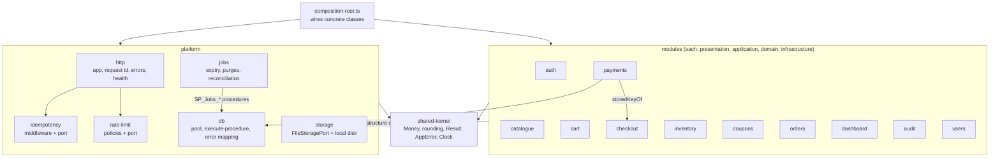

# C4 · Backend components

Modules do not call each other. The only import between two modules goes through an `index.ts`: `payments` uses `storedKeyOf` from `checkout`. What couples them is the database: `checkout` reserves the stock and creates the order by calling `SP_Inventory_ReserveStock` and `SP_Orders_CreateOrder` through its own repository.
