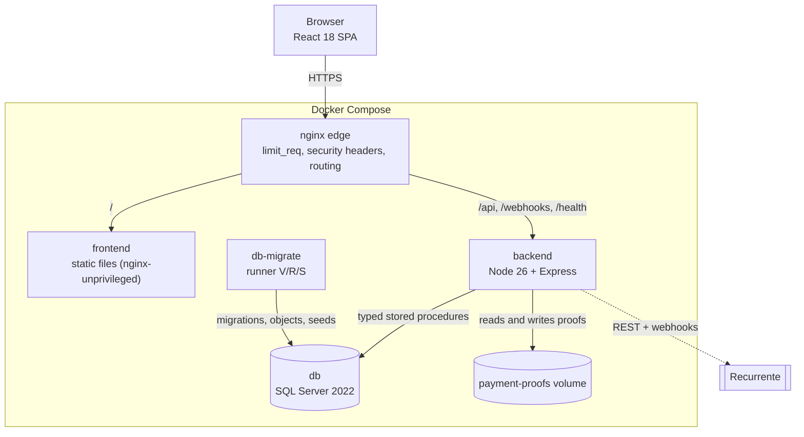

# C4 · Containers

Compose profiles: default (`db`, `db-migrate`, `backend`, `frontend`, `nginx`), `payments-sandbox` (Recurrente simulator), `quality` (SonarQube) and `observability` (OpenTelemetry collector).
