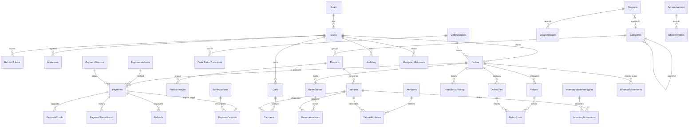

# Entity-relationship diagram

Conventions: plural `PascalCase` tables, `ID<Entity>` keys (the foreign key uses the same name as the key it references), constraints prefixed `PK_ FK_ UQ_ CK_ DF_ IX_ UX_`, timestamps `DATETIME2(3)` in UTC named `…At`, money `DECIMAL(18,2)`, quantities `INT`. Never `FLOAT`, `REAL` or `MONEY`.



## Migration order

| Migration | Content |
|---|---|
| `V0001` | `Roles`, `Users`, `RefreshTokens` |
| `V0002` | `Categories`, `Products`, `ProductImages`, `Attributes`, `Variants`, `VariantAttributes`, `Addresses` |
| `V0003` | `InventoryMovementTypes`, `InventoryMovements` |
| `V0004` | `Carts`, `CartItems`, `Coupons` |
| `V0005` | `OrderStatuses`, `OrderStatusTransitions`, `Orders`, `OrderLines`, `OrderStatusHistory`, `CouponUsages` and the deferred foreign keys (`InventoryMovements.IDOrder`, `Carts.IDCoupon`) |
| `V0006` | `Reservations`, `ReservationLines` |
| `V0007` | `PaymentMethods`, `PaymentStatuses`, `PaymentStatusTransitions`, `BankAccounts`, `Payments`, `PaymentStatusHistory`, `PaymentDeposits`, `PaymentProofs`, `ReceivedWebhooks`, `Returns`, `ReturnLines`, `Refunds`, `FinancialMovements` |
| `V0008` | `IdempotentRequests`, `AuditLog`, `Configuration`, `SchemaVersion`, `ObjectVersions`, `DdlHistory` |
| `V0009` | Triggers and permissions |
| `R*` | Functions, views and procedures with a version header |
| `S*` | Idempotent seeds |

## Key tables

```sql
-- V0002 · Variants: stock, price (VAT included) and the anti-oversell safety net
CREATE TABLE dbo.Variants (
  IDVariant     INT IDENTITY(1,1) NOT NULL CONSTRAINT PK_Variants PRIMARY KEY,
  IDProduct     INT NOT NULL CONSTRAINT FK_Variants_Products REFERENCES dbo.Products(IDProduct),
  SKU           NVARCHAR(40) NOT NULL CONSTRAINT UQ_Variants_SKU UNIQUE,
  Price         DECIMAL(18,2) NOT NULL CONSTRAINT CK_Variants_Price CHECK (Price > 0),   -- incluye IVA
  OnHandStock   INT NOT NULL CONSTRAINT DF_Variants_OnHand DEFAULT 0 CONSTRAINT CK_Variants_OnHand CHECK (OnHandStock >= 0),
  ReservedStock INT NOT NULL CONSTRAINT DF_Variants_Reserved DEFAULT 0 CONSTRAINT CK_Variants_Reserved CHECK (ReservedStock >= 0),
  IsActive      BIT NOT NULL CONSTRAINT DF_Variants_IsActive DEFAULT 1,
  RowVer        ROWVERSION,
  CONSTRAINT CK_Variants_ReservedVsOnHand CHECK (ReservedStock <= OnHandStock)           -- red de seguridad anti-sobreventa
);
```

```sql
-- V0005 · Orders: frozen amounts and their internal coherence
CREATE TABLE dbo.Orders (
  IDOrder        INT IDENTITY(1,1) NOT NULL CONSTRAINT PK_Orders PRIMARY KEY,
  OrderNumber    NVARCHAR(20) NOT NULL CONSTRAINT UQ_Orders_OrderNumber UNIQUE,         -- PED-2026-000123: referencia del depósito
  IDUser         INT NOT NULL CONSTRAINT FK_Orders_Users REFERENCES dbo.Users(IDUser),
  IDOrderStatus  TINYINT NOT NULL CONSTRAINT FK_Orders_OrderStatuses REFERENCES dbo.OrderStatuses(IDOrderStatus),
  IDCoupon       INT NULL CONSTRAINT FK_Orders_Coupons REFERENCES dbo.Coupons(IDCoupon),
  RequestedDeliveryDate DATE NOT NULL,
  Subtotal       DECIMAL(18,2) NOT NULL CHECK (Subtotal >= 0),
  Discount       DECIMAL(18,2) NOT NULL CHECK (Discount >= 0),
  Shipping       DECIMAL(18,2) NOT NULL CHECK (Shipping >= 0),
  Total          DECIMAL(18,2) NOT NULL CHECK (Total >= 0),
  TaxableBase    DECIMAL(18,2) NOT NULL,
  Vat            DECIMAL(18,2) NOT NULL,
  CreatedAt      DATETIME2(3) NOT NULL DEFAULT SYSUTCDATETIME(),
  PaidAt         DATETIME2(3) NULL,
  CONSTRAINT CK_Orders_Total CHECK (Total = (CASE WHEN Subtotal - Discount < 0 THEN 0 ELSE Subtotal - Discount END) + Shipping),
  CONSTRAINT CK_Orders_Vat CHECK (TaxableBase + Vat = Total),
  CONSTRAINT CK_Orders_PaidAt CHECK (IDOrderStatus IN (1, 6) OR PaidAt IS NOT NULL)
);
```

```sql
-- V0007 · Payments: one open attempt and one approved payment per order, enforced in data
CREATE UNIQUE INDEX UX_Payments_OneOpenAttempt ON dbo.Payments (IDOrder) WHERE IDPaymentStatus IN (1, 2);
CREATE UNIQUE INDEX UX_Payments_OneApproved ON dbo.Payments (IDOrder) WHERE IDPaymentStatus = 3;
CREATE UNIQUE INDEX UX_Payments_ExternalReference ON dbo.Payments (ExternalReference) WHERE ExternalReference IS NOT NULL;
```

The complete DDL is built in Stage 2 following the design (§7.2); each table above is listed there with all its columns and constraints. Seed configuration keys: `ReservationMinutes=15`, `DepositReservationHours=24`, `MinDepositHours=2`, `RejectionGraceHours=12`, `MaxDepositAttempts=3`, `AbandonedCartHours=24`, `ShippingCost=25.00`, `FreeShippingFrom=300.00`, `VatRate=12`, `IdempotencyKeyHours=24`.

## Immutability and permissions

- `AuditLog` and `FinancialMovements` are insert-only (`INSTEAD OF UPDATE, DELETE` triggers that raise 50422).
- `TR_Orders_AmountsImmutable`, `TR_OrderLines_PricesImmutable` and `TR_Payments_AmountImmutable` block changes to amounts; only `ReturnedQuantity` can change on a line.
- `shopcart_app` has `GRANT EXECUTE` and `DENY SELECT, INSERT, UPDATE, DELETE` on the schema (`R0900__permissions.sql`). Insert-only tables (`AuditLog`, `InventoryMovements`, `FinancialMovements`, `OrderStatusHistory`, `PaymentStatusHistory`, `PaymentProofs`, `ReceivedWebhooks`) accept no update or delete; old webhooks are purged by a dedicated procedure.

## Performance indexes

`IX_Orders_Status_CreatedAt`, `IX_Orders_User`, `IX_Orders_PaidAt`, `IX_InventoryMovements_Variant_CreatedAt`, `IX_Reservations_Expiry`, `IX_Payments_Status_Expiry`, `IX_FinancialMovements_Order`, `IX_AuditLog_Module_CreatedAt`, `IX_IdempotentRequests_Expiry`, `IX_PaymentProofs_Hash`. Pagination uses `OFFSET … FETCH` with deterministic `ORDER BY`; reports aggregate in SQL. The seed has about 60 products, 5 000 orders and 20 000 movements, and the execution plans of the three main reports are documented.
