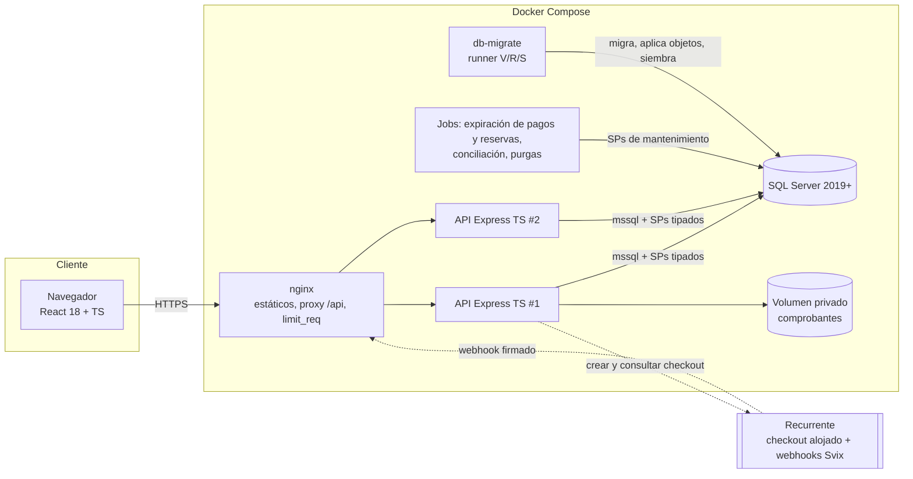
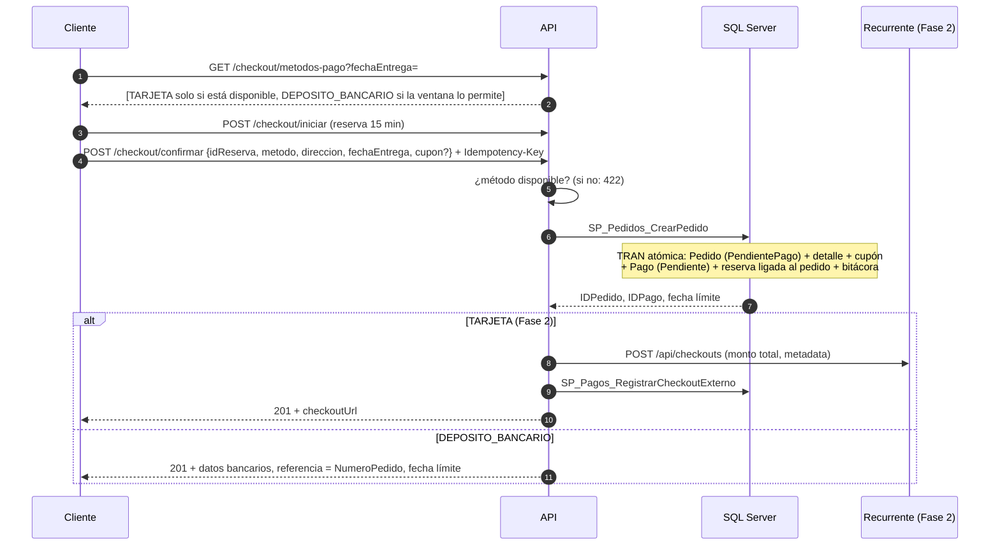
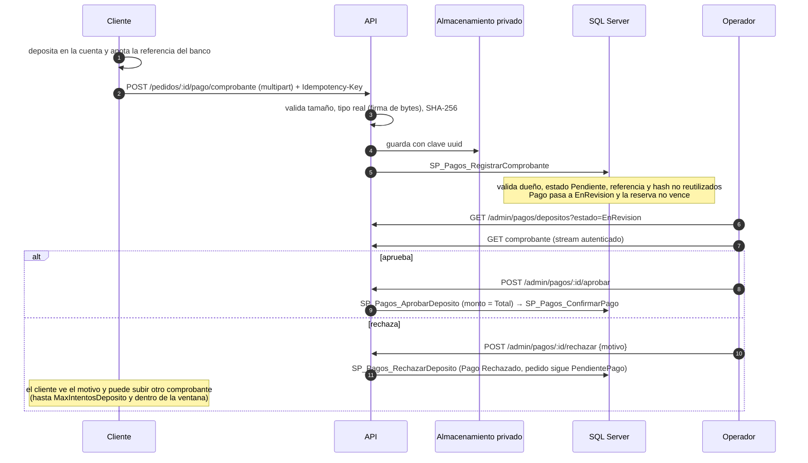
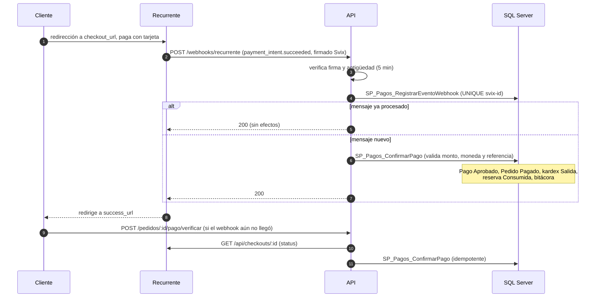
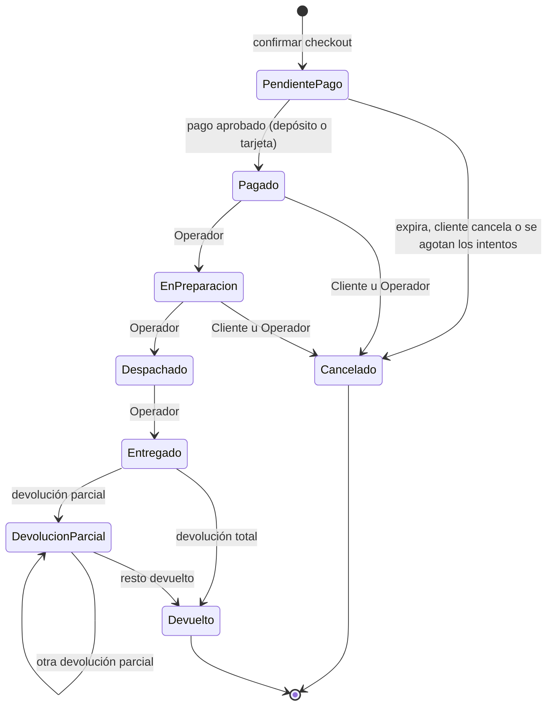
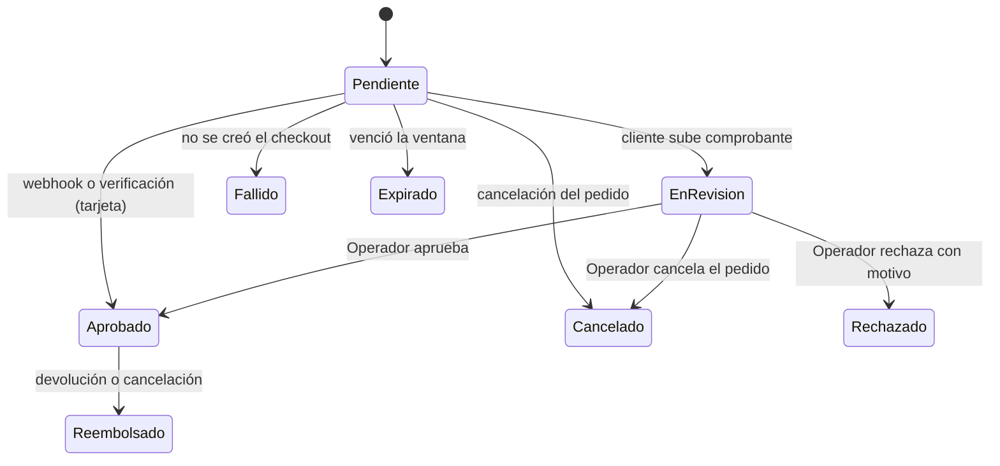
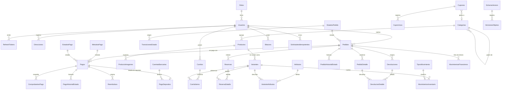

# ShopCart — Pastelería "Dulce Aroma"
## Documento de diseño e implementación v3 (único y consolidado)

> **Este documento reemplaza por completo a `DISENO_SHOPCART_v2.md` y a sus Anexos A (Pagos) y B (Dinero).** Ya no hay reglas de precedencia: lo que dice v3 es lo vigente.
> Alcance: **solo Reto ShopCart (Grupo Pentandra)**. La prueba de Cemaco está en pausa.
> Stack obligatorio: **SQL Server 2019+ (solo Stored Procedures) · Node 24 + TypeScript strict + Express · React 18 + TypeScript**.
> Fechas: **Fase 1 (BD + backend) lun 2-nov 23:59 · Fase 2 (frontend + proyecto completo) lun 9-nov 23:59**. Redactado el mié 28-oct-2026.

### Decisiones confirmadas el 28-oct

| Tema | Decisión |
|---|---|
| Modelo del pedido con depósito | **`PendientePago`** (el pedido nace antes de pagarse). Validado contra la práctica de WooCommerce, Shopify y Odoo (§12.9) |
| Redondeo | **Half-even (bancario)**, en una sola función |
| Alcance de pagos | **Depósito bancario completo en Fase 1; tarjeta (Recurrente) en Fase 2** |
| Ventana del depósito | **24 h con tope por fecha de entrega**; si quedan menos de 2 h, no se ofrece depósito |
| Cambio de método en un pedido pendiente | **No en Fase 1** (el cliente cancela y vuelve a comprar) |
| Equipo de desarrollo | **Windows o Linux x64** (SQL Server nativo en Docker; comandos con `npm run`) |
| Sin credenciales de Recurrente | Solo se ofrece **depósito bancario** |

### Índice

1. Análisis del enunciado
2. Alcance por niveles y por fases
3. System design
4. Dominio: pastelería
5. HLD
6. LLD · Arquitectura del backend
7. LLD · Base de datos
8. LLD · Versionado de BD y SPs
9. LLD · Idempotencia transversal
10. LLD · Rate limiting
11. LLD · API y contrato OpenAPI
12. LLD · Pagos (depósito bancario y Recurrente)
13. LLD · Manejo del dinero a nivel bancario
14. LLD · Frontend
15. Docker, orquestación y entorno (Windows/Linux x64)
16. Calidad: CI, SonarQube, pruebas (incluye §16.6, pruebas de SQL con tSQLt) y telemetría
17. ADRs previstos
18. Plan de ejecución
19. Checklist de entrega
20. Preguntas probables en la defensa

---

## 1. Análisis del enunciado

### 1.1 Qué se evalúa

| Criterio | Pts | Lectura de un senior |
|---|---|---|
| Modelo de datos e integridad | 20 | El más técnico: constraints, transacciones, índices, migraciones, estándar de nombres (`SP_`, `VW_`, `FU_`, `ID<Nombre>`) |
| Lógica de negocio | 20 | Casos borde: última unidad, doble clic, cupón concurrente, devolución parcial, redondeo |
| Defensa técnica | 20 | Explicar decisiones y modificar código en vivo. Una arquitectura que no puedas explicar y cambiar en minutos es un riesgo |
| Backend | 15 | Capas, validación, errores, seguridad, documentación de API |
| Frontend | 15 | Rol, estados de carga/vacío/error, refresh transparente, responsive |
| Entorno y docs | 10 | README, semillas, decisiones, commits progresivos |

### 1.2 Limitaciones del documento y su implicación

| Limitación | Implicación |
|---|---|
| Node 24 + TS strict + **Express** | Sin NestJS ni Fastify. Inyección de dependencias manual en un `composition-root.ts` |
| Acceso a datos **solo por SPs**, sin ORM ni SQL en el backend | Repositorios = adaptadores finos sobre `execSp`. Todo SQL (migraciones, objetos, semilla, pruebas de BD) vive en `db/`, **fuera de `backend/src`** |
| Scripts SQL numerados, escritos por mí | Runner propio con checksums. Flyway descartado (añade Java y otra imagen) |
| Nomenclatura `SP_`, `VW_`, `FU_`, `ID<Nombre>` | Lint automático sobre `db/` en CI. **Una función escalar también se escribe como función de tabla en línea (`FU_`)** |
| Individual, 15 días, Fase 1 en 5 días | Cada capa extra compite con tiempo de SPs y pruebas de concurrencia, que puntúan más |
| Sin lógica de negocio en controladores ni componentes | Casos de uso en `application/`. Controladores y componentes solo adaptan |
| SQL injection penaliza | Parámetros tipados. SQL dinámico solo con `sp_executesql` |
| Extras solo cuentan con lo obligatorio completo | Rate limiting extendido, SSE, Excel y otros, al final |
| Lo presentado debe correr en el ambiente entregado | Camino principal `docker compose up` mínimo y robusto. El ambiente por defecto **no tiene credenciales de Recurrente** y ofrece solo depósito |
| **Montos con `DECIMAL`/`INTEGER`; sin `FLOAT` ni `REAL`** | Tablas `DECIMAL(18,2)`; cálculos en centavos enteros (§13) |
| Dudas por escrito al evaluador | Se envía la consulta sobre `PendientePago` (§12.9) |

> **Nota**: el enunciado no menciona pasarelas de pago. Recurrente y el depósito bancario son un **diferenciador**; no deben poner en riesgo lo obligatorio.

### 1.3 Las 6 preocupaciones de negocio y su mecanismo

| Preocupación | Mecanismo |
|---|---|
| No sobrevender la última unidad | `UPDATE` condicional atómico + `CHECK (Reservada <= Fisica)` |
| Respetar el precio visto | Snapshot en `PedidoDetalle` + triggers de inmutabilidad |
| Sin pedidos ni cobros duplicados | `Idempotency-Key` + `UNIQUE` en BD; un solo intento de pago abierto y un solo pago aprobado por pedido; webhooks deduplicados |
| Ventas y abandonos sin reportes manuales | Vistas y funciones de tabla |
| Trazabilidad de cambios | `Bitacora` escrita dentro de cada SP, inmutable por trigger y `DENY` |
| Trazabilidad de inventario | Kardex con saldo resultante y vista de conciliación |

### 1.4 Decisiones y su postura (cada una se documenta como ADR)

| # | Decisión | Postura | Trade-off |
|---|---|---|---|
| D1 | Arquitectura | **Monolito modular**, vertical slices, hexagonal dentro de cada slice | Microservicios romperían la atomicidad del checkout |
| D2 | Métodos de pago | **Depósito bancario** (propio, siempre disponible) y **tarjeta vía Recurrente** (solo con credenciales válidas) | La tarjeta no corre en el ambiente entregado sin llaves; se demuestra con simulador o llaves de prueba |
| D3 | Estados del pedido | `PendientePago → Pagado → EnPreparacion → Despachado → Entregado`; `Cancelado`; `DevolucionParcial`; `Devuelto` | Tabla de transiciones en BD, no solo en código |
| D4 | Cuándo baja la existencia física | **Al aprobar el pago** (kardex de Salida). Antes solo hay **reserva** | El kardex refleja solo movimientos físicos; un pedido abandonado no deja ruido |
| D5 | "Pedido completado" en reportes | `FechaPago IS NOT NULL` y no `Cancelado`, **menos devoluciones**; se agrupa por `FechaPago`. Ticket promedio = total vendido / pedidos pagados | Los pedidos `PendientePago` no cuentan como venta |
| D6 | Vencimiento de reservas y pagos | Job en Node cada 60 s con `sp_getapplock`, más chequeo perezoso en el SP | Sin SQL Agent; escala a varias réplicas |
| D7 | Envío | Tarifa plana Q25, gratis desde Q300 (en `Configuracion`) | Sin cálculo por zona |
| D8 | IVA | Precios incluyen 12 %. `IvaCent = DivPar(TotalCent × 12, 112)`; `Base = Total − IVA` | La resta evita descuadres de centavos |
| D9 | Reparto de descuentos | **Método del mayor resto** con desempate por `IDLinea`; suma exacta | Reemplaza el "residuo a la última línea", que sesga siempre la misma línea |
| D10 | Búsqueda de texto | `LIKE` sobre columnas indexadas | Full-Text Search como mejora futura |
| D11 | Carrito de invitado | Por token. **Checkout exige login**. Se fusiona al iniciar sesión | Sin pagos anónimos |
| D12 | Existencia | Unidades por variante (sin lotes de horno) | Capacidad diaria por fecha como mejora |
| D13 | Personalización | `Dedicatoria` por línea y `FechaEntregaSolicitada` con `DiasAnticipacion` por producto | Realismo sin romper el modelo |
| D14 | Migraciones | **Runner propio en Node/TS** con `SchemaVersion` y checksums, forward-only | Sin Flyway ni `sqlcmd`; funciona igual en Windows y Linux |
| D15 | Idempotencia | Middleware genérico + `UNIQUE` en BD. Carrito con cantidad absoluta | Defensa en dos niveles |
| D16 | Rate limiting | Nginx (borde) + Express (ruta y usuario) + bloqueo de cuenta en BD | Almacén en memoria; adaptador Redis opcional |
| D17 | Dónde viven las invariantes | **Atomicidad (stock, cupón, pedido, pago, transiciones) en SP y `CHECK`**. Validación previa y orquestación en TypeScript | El SP manda; el servicio da mejores mensajes |
| D18 | **El pedido nace en `PendientePago`** | Se crea atómicamente al confirmar el checkout y pasa a `Pagado` al aprobarse el pago | Cambia la semántica de RF-06 ("compra confirmada"); se consulta al evaluador |
| D19 | Estado de pago **separado** del de pedido | `Pagos.IDEstadoPago` con su propia máquina y trigger | El "en revisión" del depósito no ensucia el ciclo del pedido |
| D20 | Ventana de reserva y pago | Reserva al iniciar: 15 min. Tarjeta: 15 min desde confirmar. **Depósito: `MIN(24 h, entrega − días de anticipación)`**; si quedan < 2 h no se ofrece. Con comprobante en revisión **no vence** | El depósito no cabe en 15 min; un pastel urgente no retiene existencia 24 h |
| D21 | Confirmación del pago con tarjeta (Fase 2) | **Tres vías**: webhook firmado, verificación al volver del checkout y job de conciliación | El sandbox de Recurrente **no envía webhooks** y un webhook puede perderse |
| D22 | Monto enviado a Recurrente | **Una sola línea** por el total del pedido, GTQ, en centavos enteros | Evita reconciliar descuentos, envío e IVA contra el detalle de Recurrente |
| D23 | Reglas del depósito | Se aprueba solo si `MontoDepositado = Total`; la referencia bancaria y el hash del archivo no pueden reutilizarse | Anti-fraude básico y barato |
| D24 | Cliente de Recurrente | **Adaptador propio** con `fetch` y verificación Svix propia | Los SDK disponibles no son oficiales; menos dependencias |
| D25 | Comprobantes | Archivo en volumen privado tras `IFileStorage`; metadatos en BD; descarga solo autenticada | Intercambiable por S3 |
| D26 | Redondeo | **Half-even (bancario)**, una vez por operación, sobre enteros, en `FU_Dinero_DivisionMitadPar` | Cambiar la política es un cambio localizado |
| D27 | Importes en la API | Cadena decimal con 2 decimales (`"145.00"`) y moneda, nunca número JSON | Evita `double` en clientes |
| D28 | Cambio de método de pago | **No en Fase 1**: se cancela y se vuelve a comprar. Endpoints de cambio en Fase 2 | Ahorra medio día en la semana más ajustada |
| D29 | Entorno | **Windows o Linux x64**. Comandos con `npm run`; runner Node; checksums con normalización `CRLF → LF` | `make` no viene en Windows |
| D30 | Alcance de pagos | **Fase 1: depósito completo. Fase 2: tarjeta, webhook, conciliación, simulador** | Protege lo obligatorio |

### 1.5 Pendientes que no bloquean

| Pendiente | Cómo se maneja |
|---|---|
| Respuesta del evaluador sobre `PendientePago` | Se envía hoy la consulta (§12.9). Fallback: "pedido solo al pagar" con una solicitud de depósito aparte; la decisión se revisa antes de escribir `SP_Pedidos_CrearPedido` |
| Detalles de la API de Recurrente por validar | Primer día de Fase 2 con llaves de prueba (§12.5) |
| Regla de redondeo fiscal | Si algún día se emite factura electrónica, se contrasta con su especificación |
| Flujo de Kemik | No encontré documentación pública; no se afirma nada. Se puede verificar con una compra de prueba hasta la pantalla de pago |

---

## 2. Alcance por niveles y por fases

### Nivel 1 — obligatorio, sin negociar
- Los 9 módulos con todos sus criterios de aceptación.
- Modelo con constraints, triggers y scripts versionados con runner.
- Auth con JWT corto y refresh con rotación. Aislamiento por cliente (IDOR).
- Idempotencia transversal. Rate limiting mínimo en `/auth/*`.
- **Depósito bancario completo** (único método de pago de la Fase 1).
- Pruebas de **concurrencia**, **idempotencia**, **IDOR** y del flujo de depósito.
- Manejo centralizado de errores, validación con zod, Swagger.
- README con ER, diagramas de estados, decisiones y credenciales de prueba.
- Commits progresivos con Conventional Commits.

### Nivel 2 — diferenciadores de bajo riesgo
- **OpenAPI contract-first** con cliente TS generado para el frontend.
- **ADRs** cortos por decisión.
- **CI**: lint, `tsc --strict`, tests, `dependency-cruiser`, `gitleaks`, lint SQL (nomenclatura, versión de cabecera y tipos prohibidos).
- **Testcontainers** con SQL Server real y **tSQLt** para pruebas unitarias de SPs, funciones y triggers (§16.6).
- **Telemetría básica**: logs JSON con `requestId`, `/health/live`, `/health/ready`, métricas de negocio simples.
- **Docker multi-stage**, usuario no root, healthchecks.
- **SonarQube** como perfil opcional.
- Versionado completo de BD y SPs.
- **Recurrente (tarjeta)**: adaptador, webhook, verificación, conciliación y simulador (Fase 2).

### Nivel 3 — solo con 1 y 2 cerrados
SSE del dashboard, exportación a Excel/PDF, caché de reportes, resto de políticas de rate limit, adaptador Redis, OpenTelemetry con Grafana, Playwright, k6, outbox transaccional, cambio de método de pago, reembolsos automáticos por API, cuentas bancarias administrables.

### Recortado a propósito
Kubernetes, microservicios, CQRS con buses, event sourcing y Flyway. Cuestan tiempo, no puntúan en esta rúbrica y aumentan el riesgo de "no corre en el ambiente entregado".

### Reparto por fase

| Fase 1 (lun 2-nov) | Fase 2 (lun 9-nov) |
|---|---|
| Todo el esquema de BD, incluidas las tablas de pago y los estados | Frontend completo (incluye depósito y cola de revisión) |
| SPs de los 9 módulos y del depósito | Adaptador de Recurrente, webhook, verificación y conciliación |
| Backend en slices, auth, idempotencia, rate limit de `/auth/*` | Simulador de Recurrente (`payments-sandbox`) |
| Carga de comprobante, cola de revisión, aprobar y rechazar | Cambio de método de pago y reembolsos |
| Jobs de expiración, pruebas, README, ADRs | SonarQube, Schemathesis, extras |

---

## 3. System design

### 3.1 Requerimientos no funcionales

| NFR | Meta |
|---|---|
| Rendimiento | Listados y reportes p95 < 1 s con la semilla (≈ 60 productos, ≈ 5 000 pedidos) |
| Concurrencia | 0 sobreventas con 100 compradores simultáneos de 1 unidad |
| Integridad | Toda operación multi-tabla atómica (`SET XACT_ABORT ON`) |
| Seguridad | JWT corto, refresh rotado, hash de contraseña, CORS, Helmet, parámetros tipados, rate limiting, comprobantes privados |
| Portabilidad | `docker compose up` en máquina limpia (Windows o Linux), sin pasos manuales |
| Trazabilidad | Bitácora, kardex, historial de estados de pedido y de pago, versionado de esquema |

### 3.2 Capacidad (supuestos)

~3 000 usuarios activos/día, ~400 pedidos/día (pico ×10), ~30 checkouts/min, ~100 RPS de lectura de catálogo en pico, ~440 k filas de kardex/año. **Una instancia de SQL Server y 2 réplicas de API bastan.** Lo difícil es la corrección bajo concurrencia, no el volumen.

### 3.3 Decisiones de arquitectura

1. **La BD es la autoridad de las reglas críticas.** El backend valida antes para dar mensajes claros; la regla final vive en la BD.
2. **Reserva como contador** (`ExistenciaReservada`) con vencimiento; el `UPDATE` condicional es la forma más barata de evitar overselling.
3. **Idempotencia en dos niveles**: middleware (respuesta repetida) y restricciones `UNIQUE` (red de seguridad).
4. **Snapshots** en el pedido: SKU, nombre, atributos, precio, descuento e IVA; protegidos por triggers de inmutabilidad.
5. **Bitácora transaccional**: la escribe el SP dentro de la misma transacción.
6. **API stateless**. La única pieza con estado son los jobs, protegidos con `sp_getapplock`.
7. **Acceso por SPs forzado por el motor**: el login de la app tiene `EXECUTE` y `DENY` de lectura/escritura directa sobre tablas.
8. **Versionado verificable**: cada migración y cada objeto tiene versión, checksum y registro.
9. **El servidor nunca cobra**: con tarjeta, el cobro ocurre en la página de Recurrente; el servidor solo crea el checkout y confirma. Con depósito, el dinero entra al banco y lo valida una persona.
10. **El dinero se calcula en enteros** dentro de la BD; el frontend y el backend no calculan montos.

### 3.4 Alternativas descartadas

| Alternativa | Motivo |
|---|---|
| Reserva con `SERIALIZABLE` y cursor | Más contención y riesgo de deadlock |
| Cola (Redis/RabbitMQ) en el checkout | Infraestructura sin necesidad a este volumen |
| Event sourcing de inventario | El kardex ya es un log de movimientos |
| Redis para reservas | Rompe la atomicidad con el pedido |
| GraphQL | REST + OpenAPI es lo pedido |
| Flyway | Añade Java y otra imagen; el runner propio es más simple de defender |
| SDK no oficial de Recurrente | Menos control; el adaptador propio son pocas líneas |
| Descontar existencia al crear el pedido (como WooCommerce) | Un pedido abandonado generaría salida y entrada compensatoria en el kardex |
| `MONEY` / `FLOAT` | Pierden precisión; ver §13 |

---

## 4. Dominio: Pastelería "Dulce Aroma"

**Categorías**: Pasteles · Cupcakes · Galletas · Pan dulce · Postres fríos · Temporada.
**Atributos de variante**: `Tamaño` (6 / 12 / 24 porciones, unidad, caja) y `Sabor` (vainilla, chocolate, tres leches, red velvet, zanahoria).

| Producto | Variantes (SKU) | Precio Q | Anticipación |
|---|---|---|---|
| Pastel Tres Leches | 6 porc. `PAS-3L-06`, 12 porc. `PAS-3L-12` | 145 / 260 | 1 día |
| Pastel Chocolate | 12 porc. `PAS-CHO-12`, 24 porc. `PAS-CHO-24` | 275 / 480 | 2 días |
| Cupcakes Red Velvet | Caja de 6 `CUP-RV-06` | 90 | 1 día |
| Galletas de avena | Bolsa de 12 `GAL-AVE-12` | 45 | 0 |

**Cupones de seed**: `BIENVENIDO10` (10 %, mínimo Q100, 1 uso por cliente), `PASTELES25` (Q25, solo categoría Pasteles), `AGOTADO` y `VENCIDO` (para probar los mensajes específicos de RF-05).
**Cuentas bancarias de seed**: dos cuentas ficticias (una monetaria y una de ahorro), claramente marcadas como de ejemplo.

---

## 5. HLD

### 5.1 Componentes



Con credenciales ausentes, la caja de Recurrente no se usa y el sistema ofrece solo depósito. Los jobs corren dentro del proceso de API; `sp_getapplock` asegura ejecución única con varias réplicas.

### 5.2 Checkout: confirmación y elección de método



### 5.3 Depósito bancario (Fase 1)



### 5.4 Tarjeta con Recurrente (Fase 2)



### 5.5 Ciclo de vida del pedido

| ID | Estado | Significado |
|---|---|---|
| 1 | `PendientePago` | Creado, esperando pago o revisión |
| 2 | `Pagado` | Pago aprobado, existencia descontada |
| 3 | `EnPreparacion` | |
| 4 | `Despachado` | |
| 5 | `Entregado` | |
| 6 | `Cancelado` | Antes o después de pagar |
| 7 | `DevolucionParcial` | |
| 8 | `Devuelto` | |

Transiciones permitidas: `1→2`, `1→6`, `2→3`, `2→6`, `3→4`, `3→6`, `4→5`, `5→7`, `5→8`, `7→7`, `7→8`.



Una vez `Despachado` el pedido ya no se cancela; solo se devuelve tras `Entregado`.

### 5.6 Ciclo de vida del pago

| ID | Estado | Aplica a |
|---|---|---|
| 1 | `Pendiente` | Tarjeta: checkout creado. Depósito: esperando comprobante |
| 2 | `EnRevision` | Depósito con comprobante cargado |
| 3 | `Aprobado` | Ambos |
| 4 | `Rechazado` | Depósito rechazado por un Operador (terminal; un nuevo intento crea otro `Pago`) |
| 5 | `Fallido` | No se pudo crear el checkout en Recurrente |
| 6 | `Expirado` | Venció la ventana de pago |
| 7 | `Reembolsado` | Se devolvió el dinero |
| 8 | `Cancelado` | Pedido cancelado antes de pagar, o por Operador durante la revisión |

Transiciones permitidas: `1→2`, `1→3`, `1→5`, `1→6`, `1→8`, `2→3`, `2→4`, `2→8`, `3→7`.



Un pago `EnRevision` **no expira por tiempo**: lo resuelve un Operador.

### 5.7 Seguridad

- Contraseñas con **argon2id** (`@node-rs/argon2`; respaldo `bcryptjs`).
- Access JWT de 15 min. Refresh opaco de 7 días, **guardado como hash SHA-256**, con rotación y detección de reutilización (se revoca toda la familia).
- Autorización por rol en middleware **y** pertenencia dentro del SP. El `IDUsuario` sale **siempre del token**.
- Helmet, CORS con lista blanca, límite de tamaño de body, rate limiting, bloqueo de cuenta por intentos fallidos.
- Secretos solo en variables de entorno. `.env.example` sin valores reales y `gitleaks` en CI. Las llaves de Recurrente nunca aparecen en logs ni respuestas.
- Comprobantes: validación por firma de bytes, almacenamiento privado, descarga autenticada con `nosniff`.

---

## 6. LLD · Arquitectura del backend

### 6.1 Vertical slice por módulo, hexagonal dentro del slice

La regla de dependencia es `presentation → application → domain ← infrastructure`. Se verifica en CI con **dependency-cruiser**.

| Tratamiento | Slices |
|---|---|
| **Completo** (dominio, casos de uso, puertos y adaptadores) | Checkout, Inventario y reservas, Cupones, Pedidos y devoluciones, **Pagos** |
| **Ligero** (controlador → servicio → repositorio) | Auth, Catálogo, Categorías, Carrito, Dashboard, Bitácora, Usuarios |

### 6.2 Estructura del repositorio

```
shopcart/
├─ package.json                  # scripts raíz multiplataforma: up, down, test, lint, db:migrate, db:verify, seed, sonar
├─ docker-compose.yml            # perfiles: (default) · payments-sandbox · observability · quality · scale
├─ .gitattributes                # * text=auto eol=lf
├─ .env.example
├─ README.md
├─ docs/
│  ├─ adr/                       # ADR-001 ... ADR-0NN
│  ├─ openapi/openapi.yaml       # contrato (fuente de verdad)
│  ├─ c4/                        # contexto, contenedores, componentes (Mermaid)
│  └─ DISENO_SHOPCART_v3.md
├─ db/
│  ├─ migrations/                # V0001__...sql (inmutables)
│  ├─ objects/                   # R0101__SP_...sql, R0050__FU_...sql (CREATE OR ALTER + versión)
│  ├─ seed/                      # S0001__...sql (idempotentes con MERGE)
│  ├─ tests/                     # tsqlt/ (unitarias SQL) y scripts/ (run-tsqlt, sp-coverage), ver §16.6
│  ├─ lint/                      # nomenclatura, versión de cabecera, tipos prohibidos
│  └─ runner/                    # run-migrations.ts (Node) + Dockerfile
├─ tools/
│  └─ recurrente-simulator/      # Fase 2: simulador de la API de Recurrente
├─ backend/
│  ├─ src/
│  │  ├─ shared-kernel/          # Money, rounding, Result<T,E>, AppError, Clock (puerto)
│  │  ├─ platform/
│  │  │  ├─ config/              # env.ts (zod), payments.ts
│  │  │  ├─ db/                  # pool.ts, execSp.ts, mapSqlError.ts
│  │  │  ├─ http/                # app.ts, requestId, errorHandler, security
│  │  │  ├─ idempotency/         # middleware + puerto IdempotencyStore
│  │  │  ├─ ratelimit/           # middleware + puerto RateLimitStore + policies.ts
│  │  │  ├─ storage/             # IFileStorage + LocalDiskStorage
│  │  │  ├─ telemetry/           # logger (pino), metrics, health
│  │  │  └─ jobs/                # expirarPagos, conciliarTarjeta, sondaPasarela, purgas
│  │  ├─ modules/
│  │  │  ├─ pagos/               # domain · application · infrastructure · presentation
│  │  │  ├─ checkout/ inventario/ cupones/ pedidos/       # slices completos
│  │  │  └─ auth/ catalogo/ carrito/ dashboard/ bitacora/ usuarios/ sistema/
│  │  ├─ composition-root.ts
│  │  └─ server.ts               # arranque + graceful shutdown + verificación de versión de esquema
│  ├─ tests/ {unit, integration, concurrency, contract}
│  └─ tsconfig.json              # "strict": true
└─ frontend/                     # ver §14
```

### 6.3 Reparto de responsabilidades

| Capa | Responsabilidad |
|---|---|
| TypeScript, dominio | Value objects (`Money`, `Cantidad`, `Sku`), validaciones previas, orquestación del caso de uso, mapeo de errores, integración con pasarela y almacenamiento |
| SQL, SP y `CHECK` | **Invariantes que exigen atomicidad**: stock, cupón, creación del pedido, aprobación del pago, transiciones de estado, límite de devolución |
| Puertos | `IInventarioRepository`, `IPedidoRepository`, `IPagoRepository`, `ICuponRepository`, `IPaymentGateway`, `IFileStorage`, `IClock`, `IIdempotencyStore`, `IRateLimitStore` |

El dominio no sabe que existe SQL Server. Se documenta en un ADR por qué hay reglas en la BD.

### 6.4 Código clave

**Punto único de acceso a datos**

```ts
// platform/db/execSp.ts — único módulo que habla con la BD; siempre parámetros tipados
export async function execSp<T>(spName: string, params: SpParam[] = [], outputs: SpParam[] = []) {
  const pool = await getPool();
  const req = pool.request();
  for (const p of params) req.input(p.name, p.type, p.value);
  for (const o of outputs) req.output(o.name, o.type);
  try {
    // Reintenta únicamente ante deadlock (1205): el SP es atómico, es seguro repetirlo
    const r = await withDeadlockRetry(() => req.execute<T>(spName));
    return { rows: r.recordset ?? [], output: r.output };
  } catch (e) {
    throw mapSqlError(e);
  }
}
```

**Mapeo de errores de negocio (códigos `THROW` ≥ 50000)**

| Código SQL | HTTP | Significado |
|---|---|---|
| 50400 | 400 | Parámetro inválido |
| 50404 | 404 | No existe, o no pertenece al usuario (no se filtra existencia) |
| 50409 | 409 | Conflicto: sin existencia, cupón agotado, reserva vencida, referencia ya usada |
| 50422 | 422 | Regla de negocio: transición inválida, cupón vencido o bajo mínimo, devolución excedida, monto que no coincide, comprobante reutilizado |
| 1205 | reintento | Deadlock |

**Composition root (DI manual)**

```ts
// composition-root.ts
export function buildContainer(env: Env) {
  const clock = new SystemClock();
  const storage = new LocalDiskStorage(env.COMPROBANTES_DIR);
  const gateway = hasRecurrenteKeys(env) ? new RecurrenteGateway(recurrenteCfg(env)) : null;   // Fase 2
  const methods = new PaymentMethodsRegistry(env, gateway, logger);
  const pagoRepo = new SqlPagoRepository();            // adaptador: llama SPs
  const confirmarCheckout = new ConfirmarCheckout(new SqlCheckoutRepository(), pagoRepo, methods, gateway, clock);
  const subirComprobante = new SubirComprobante(pagoRepo, storage);
  return { confirmarCheckout, subirComprobante, methods /* ... */ };
}
```

**Caso de uso con `Result` (sin excepciones para errores de negocio esperados)**

```ts
// modules/pagos/application/ConfirmarCheckout.ts
export class ConfirmarCheckout {
  /** Crea el pedido PendientePago y su pago. La idempotencia ya fue resuelta por el middleware. */
  async execute(cmd: ConfirmarCheckoutCmd): Promise<Result<CheckoutConfirmado, DomainError>> {
    // Doble validación: la UI oculta métodos no disponibles, pero el backend también decide
    if (!this.methods.isAvailable(cmd.metodo)) return err(new MetodoPagoNoDisponible(cmd.metodo));

    // El monto lo calcula la BD: el cliente nunca envía importes
    const pedido = await this.checkoutRepo.crearPedido(cmd);

    if (cmd.metodo === 'TARJETA') {
      try {
        const chk = await this.gateway!.createCheckout({ /* total, metadata, urls */ });
        await this.pagoRepo.registrarCheckoutExterno(pedido.idPago, chk.id, chk.checkoutUrl);
        return ok({ ...pedido, checkoutUrl: chk.checkoutUrl });
      } catch {
        await this.pagoRepo.registrarFalloCreacion(pedido.idPago);   // el pedido sigue PendientePago
        return err(new PasarelaNoDisponible());
      }
    }
    return ok(pedido);   // depósito: datos bancarios y fecha límite
  }
}
```

---

## 7. LLD · Base de datos

**Convenciones**: tablas en PascalCase plural; PK `ID<Entidad>`; la FK usa el mismo nombre que la PK que referencia. Constraints con prefijo `PK_ FK_ UQ_ CK_ DF_ IX_ UX_`. Fechas `DATETIME2(3)` UTC. Dinero `DECIMAL(18,2)`; cantidades `INT`. **Nunca `FLOAT`, `REAL` ni `MONEY`.**

### 7.1 Diagrama entidad-relación



### 7.2 Orden de migraciones y DDL

| Migración | Contenido |
|---|---|
| `V0001` | `Roles`, `Usuarios`, `RefreshTokens` |
| `V0002` | `Categorias`, `Productos`, `ProductoImagenes`, `Atributos`, `Variantes`, `VarianteAtributos`, `Direcciones` |
| `V0003` | `TiposMovimiento`, `MovimientosInventario` |
| `V0004` | `Carritos`, `CarritoItems`, `Cupones` |
| `V0005` | `EstadosPedido`, `TransicionesEstado`, `Pedidos`, `PedidoDetalle`, `PedidoHistorialEstado`, `CuponUsos` y las FK diferidas (`MovimientosInventario.IDPedido`, `Carritos.IDCupon`) |
| `V0006` | `Reservas`, `ReservaDetalle` |
| `V0007` | `MetodosPago`, `EstadosPago`, `TransicionesEstadoPago`, `CuentasBancarias`, `Pagos`, `PagoHistorialEstado`, `PagoDepositos`, `ComprobantesPago`, `WebhooksRecibidos`, `Devoluciones`, `DevolucionDetalle`, `Reembolsos`, `MovimientosFinancieros` |
| `V0008` | `SolicitudesIdempotentes`, `Bitacora`, `Configuracion`, `SchemaVersion`, `VersionesObjetos`, `HistorialDDL` |
| `V0009` | Triggers y permisos |
| `R*` | Funciones, vistas y SPs (con versión en la cabecera) |
| `S*` | Semillas idempotentes |

```sql
-- V0001 · Seguridad
CREATE TABLE dbo.Roles (
  IDRol  TINYINT NOT NULL CONSTRAINT PK_Roles PRIMARY KEY,           -- 1 Cliente, 2 Operador, 3 Administrador
  Nombre NVARCHAR(30) NOT NULL CONSTRAINT UQ_Roles_Nombre UNIQUE
);
CREATE TABLE dbo.Usuarios (
  IDUsuario        INT IDENTITY(1,1) NOT NULL CONSTRAINT PK_Usuarios PRIMARY KEY,
  IDRol            TINYINT NOT NULL CONSTRAINT FK_Usuarios_Roles REFERENCES dbo.Roles(IDRol),
  Correo           NVARCHAR(256) NOT NULL CONSTRAINT UQ_Usuarios_Correo UNIQUE,
  PasswordHash     NVARCHAR(255) NOT NULL,
  Nombre           NVARCHAR(120) NOT NULL,
  Telefono         NVARCHAR(20) NULL,
  Activo           BIT NOT NULL CONSTRAINT DF_Usuarios_Activo DEFAULT 1,       -- se desactiva, no se borra
  IntentosFallidos TINYINT NOT NULL CONSTRAINT DF_Usuarios_Intentos DEFAULT 0,
  BloqueadoHasta   DATETIME2(3) NULL,
  FechaCreacion    DATETIME2(3) NOT NULL CONSTRAINT DF_Usuarios_Fecha DEFAULT SYSUTCDATETIME()
);
CREATE TABLE dbo.RefreshTokens (
  IDRefreshToken   BIGINT IDENTITY(1,1) NOT NULL CONSTRAINT PK_RefreshTokens PRIMARY KEY,
  IDUsuario        INT NOT NULL CONSTRAINT FK_RefreshTokens_Usuarios REFERENCES dbo.Usuarios(IDUsuario),
  IDFamilia        UNIQUEIDENTIFIER NOT NULL,                 -- revoca toda la cadena ante reutilización
  TokenHash        CHAR(64) NOT NULL CONSTRAINT UQ_RefreshTokens_Hash UNIQUE,
  FechaExpiracion  DATETIME2(3) NOT NULL,
  FechaRevocacion  DATETIME2(3) NULL,
  IDReemplazadoPor BIGINT NULL
);

-- V0002 · Catálogo y direcciones
CREATE TABLE dbo.Categorias (
  IDCategoria      INT IDENTITY(1,1) NOT NULL CONSTRAINT PK_Categorias PRIMARY KEY,
  IDCategoriaPadre INT NULL CONSTRAINT FK_Categorias_Padre REFERENCES dbo.Categorias(IDCategoria),
  Nombre           NVARCHAR(80) NOT NULL CONSTRAINT UQ_Categorias_Nombre UNIQUE,
  Descripcion      NVARCHAR(300) NULL,
  Activa           BIT NOT NULL CONSTRAINT DF_Categorias_Activa DEFAULT 1
);
CREATE TABLE dbo.Productos (
  IDProducto       INT IDENTITY(1,1) NOT NULL CONSTRAINT PK_Productos PRIMARY KEY,
  IDCategoria      INT NOT NULL CONSTRAINT FK_Productos_Categorias REFERENCES dbo.Categorias(IDCategoria),
  Nombre           NVARCHAR(150) NOT NULL,
  Descripcion      NVARCHAR(1000) NULL,
  DiasAnticipacion TINYINT NOT NULL CONSTRAINT DF_Productos_Dias DEFAULT 0,
  Activo           BIT NOT NULL CONSTRAINT DF_Productos_Activo DEFAULT 1,
  RowVer           ROWVERSION                                  -- concurrencia optimista en edición
);
CREATE TABLE dbo.ProductoImagenes (
  IDProductoImagen INT IDENTITY(1,1) NOT NULL CONSTRAINT PK_ProductoImagenes PRIMARY KEY,
  IDProducto       INT NOT NULL CONSTRAINT FK_ProdImg_Productos REFERENCES dbo.Productos(IDProducto),
  Url              NVARCHAR(500) NOT NULL,
  Orden            TINYINT NOT NULL DEFAULT 0,
  EsPrincipal      BIT NOT NULL DEFAULT 0
);
CREATE TABLE dbo.Variantes (
  IDVariante          INT IDENTITY(1,1) NOT NULL CONSTRAINT PK_Variantes PRIMARY KEY,
  IDProducto          INT NOT NULL CONSTRAINT FK_Variantes_Productos REFERENCES dbo.Productos(IDProducto),
  SKU                 NVARCHAR(40) NOT NULL CONSTRAINT UQ_Variantes_SKU UNIQUE,
  Precio              DECIMAL(18,2) NOT NULL CONSTRAINT CK_Variantes_Precio CHECK (Precio > 0),   -- incluye IVA
  ExistenciaFisica    INT NOT NULL CONSTRAINT DF_Variantes_Fis DEFAULT 0 CONSTRAINT CK_Variantes_Fis CHECK (ExistenciaFisica >= 0),
  ExistenciaReservada INT NOT NULL CONSTRAINT DF_Variantes_Res DEFAULT 0 CONSTRAINT CK_Variantes_Res CHECK (ExistenciaReservada >= 0),
  Activa              BIT NOT NULL CONSTRAINT DF_Variantes_Activa DEFAULT 1,
  RowVer              ROWVERSION,
  CONSTRAINT CK_Variantes_ResVsFis CHECK (ExistenciaReservada <= ExistenciaFisica)  -- red de seguridad anti-sobreventa
);
CREATE TABLE dbo.Atributos (
  IDAtributo INT IDENTITY(1,1) NOT NULL CONSTRAINT PK_Atributos PRIMARY KEY,
  Nombre     NVARCHAR(40) NOT NULL CONSTRAINT UQ_Atributos_Nombre UNIQUE
);
CREATE TABLE dbo.VarianteAtributos (
  IDVariante INT NOT NULL CONSTRAINT FK_VarAtr_Variantes REFERENCES dbo.Variantes(IDVariante),
  IDAtributo INT NOT NULL CONSTRAINT FK_VarAtr_Atributos REFERENCES dbo.Atributos(IDAtributo),
  Valor      NVARCHAR(60) NOT NULL,
  CONSTRAINT PK_VarianteAtributos PRIMARY KEY (IDVariante, IDAtributo)
);
CREATE TABLE dbo.Direcciones (
  IDDireccion  INT IDENTITY(1,1) NOT NULL CONSTRAINT PK_Direcciones PRIMARY KEY,
  IDUsuario    INT NOT NULL CONSTRAINT FK_Direcciones_Usuarios REFERENCES dbo.Usuarios(IDUsuario),
  Alias        NVARCHAR(40) NOT NULL,
  Destinatario NVARCHAR(120) NOT NULL, Telefono NVARCHAR(20) NOT NULL,
  Linea1       NVARCHAR(200) NOT NULL, Linea2 NVARCHAR(200) NULL,
  Municipio    NVARCHAR(80) NOT NULL, Departamento NVARCHAR(80) NOT NULL,
  Referencia   NVARCHAR(200) NULL,
  Activa       BIT NOT NULL CONSTRAINT DF_Direcciones_Activa DEFAULT 1
);
```

```sql
-- V0003 · Kardex de inventario
CREATE TABLE dbo.TiposMovimiento (
  IDTipoMovimiento TINYINT NOT NULL CONSTRAINT PK_TiposMovimiento PRIMARY KEY,   -- 1 Entrada, 2 Salida, 3 Ajuste, 4 Devolucion
  Nombre NVARCHAR(30) NOT NULL CONSTRAINT UQ_TiposMov_Nombre UNIQUE
);
CREATE TABLE dbo.MovimientosInventario (
  IDMovimiento     BIGINT IDENTITY(1,1) NOT NULL CONSTRAINT PK_MovimientosInventario PRIMARY KEY,
  IDVariante       INT NOT NULL CONSTRAINT FK_Mov_Variantes REFERENCES dbo.Variantes(IDVariante),
  IDTipoMovimiento TINYINT NOT NULL CONSTRAINT FK_Mov_Tipos REFERENCES dbo.TiposMovimiento(IDTipoMovimiento),
  Cantidad         INT NOT NULL CONSTRAINT CK_Mov_Cantidad CHECK (Cantidad <> 0),   -- con signo
  SaldoResultante  INT NOT NULL CONSTRAINT CK_Mov_Saldo CHECK (SaldoResultante >= 0),
  Motivo           NVARCHAR(250) NOT NULL,
  IDUsuario        INT NOT NULL CONSTRAINT FK_Mov_Usuarios REFERENCES dbo.Usuarios(IDUsuario),
  IDPedido         INT NULL,                                                       -- FK diferida a V0005
  Fecha            DATETIME2(3) NOT NULL CONSTRAINT DF_Mov_Fecha DEFAULT SYSUTCDATETIME()
);
CREATE INDEX IX_Mov_Variante_Fecha ON dbo.MovimientosInventario (IDVariante, Fecha) INCLUDE (Cantidad, SaldoResultante);
-- Solo UNA salida por (pedido, variante). Se limita a Salida porque las devoluciones parciales sí pueden repetirse.
CREATE UNIQUE INDEX UX_Mov_SalidaPorPedido ON dbo.MovimientosInventario (IDPedido, IDVariante)
  WHERE IDTipoMovimiento = 2 AND IDPedido IS NOT NULL;
```

```sql
-- V0004 · Carrito y cupones
CREATE TABLE dbo.Carritos (
  IDCarrito      INT IDENTITY(1,1) NOT NULL CONSTRAINT PK_Carritos PRIMARY KEY,
  IDUsuario      INT NULL CONSTRAINT FK_Carritos_Usuarios REFERENCES dbo.Usuarios(IDUsuario),
  TokenInvitado  UNIQUEIDENTIFIER NULL CONSTRAINT UQ_Carritos_Token UNIQUE,
  IDCupon        INT NULL,                                                         -- FK diferida a Cupones en este mismo script
  Estado         NVARCHAR(12) NOT NULL CONSTRAINT CK_Carritos_Estado CHECK (Estado IN ('Activo','Convertido','Descartado')),
  FechaCreacion  DATETIME2(3) NOT NULL DEFAULT SYSUTCDATETIME(),
  FechaActividad DATETIME2(3) NOT NULL DEFAULT SYSUTCDATETIME(),
  CONSTRAINT CK_Carritos_Dueno CHECK (IDUsuario IS NOT NULL OR TokenInvitado IS NOT NULL)
);
CREATE UNIQUE INDEX UX_Carritos_UsuarioActivo ON dbo.Carritos (IDUsuario) WHERE Estado = 'Activo' AND IDUsuario IS NOT NULL;
CREATE TABLE dbo.CarritoItems (
  IDCarritoItem INT IDENTITY(1,1) NOT NULL CONSTRAINT PK_CarritoItems PRIMARY KEY,
  IDCarrito     INT NOT NULL CONSTRAINT FK_CarItems_Carritos REFERENCES dbo.Carritos(IDCarrito),
  IDVariante    INT NOT NULL CONSTRAINT FK_CarItems_Variantes REFERENCES dbo.Variantes(IDVariante),
  Cantidad      INT NOT NULL CONSTRAINT CK_CarItems_Cant CHECK (Cantidad BETWEEN 1 AND 99),
  Dedicatoria   NVARCHAR(60) NULL,
  CONSTRAINT UQ_CarItems_Linea UNIQUE (IDCarrito, IDVariante)       -- el precio NO se guarda: se lee vigente
);
CREATE TABLE dbo.Cupones (
  IDCupon              INT IDENTITY(1,1) NOT NULL CONSTRAINT PK_Cupones PRIMARY KEY,
  Codigo               NVARCHAR(30) NOT NULL CONSTRAINT UQ_Cupones_Codigo UNIQUE,
  Tipo                 NVARCHAR(12) NOT NULL CONSTRAINT CK_Cupones_Tipo CHECK (Tipo IN ('Porcentaje','MontoFijo')),
  Valor                DECIMAL(18,2) NOT NULL CONSTRAINT CK_Cupones_Valor CHECK (Valor > 0),
  MontoMinimo          DECIMAL(18,2) NOT NULL DEFAULT 0 CHECK (MontoMinimo >= 0),
  FechaInicio          DATETIME2(3) NOT NULL,
  FechaFin             DATETIME2(3) NOT NULL,
  LimiteUsosTotal      INT NULL CHECK (LimiteUsosTotal > 0),
  LimiteUsosPorCliente INT NULL CHECK (LimiteUsosPorCliente > 0),
  UsosActuales         INT NOT NULL DEFAULT 0,
  IDCategoria          INT NULL CONSTRAINT FK_Cupones_Categorias REFERENCES dbo.Categorias(IDCategoria),   -- NULL = todo el carrito
  Activo               BIT NOT NULL DEFAULT 1,
  CONSTRAINT CK_Cupones_Fechas CHECK (FechaFin > FechaInicio),
  CONSTRAINT CK_Cupones_Porc   CHECK (Tipo <> 'Porcentaje' OR Valor <= 100),
  CONSTRAINT CK_Cupones_Usos   CHECK (LimiteUsosTotal IS NULL OR UsosActuales <= LimiteUsosTotal)
);
ALTER TABLE dbo.Carritos ADD CONSTRAINT FK_Carritos_Cupones FOREIGN KEY (IDCupon) REFERENCES dbo.Cupones(IDCupon);
```

```sql
-- V0005 · Pedidos, estados y cupones usados
CREATE TABLE dbo.EstadosPedido (
  IDEstadoPedido TINYINT NOT NULL CONSTRAINT PK_EstadosPedido PRIMARY KEY,
  Nombre NVARCHAR(30) NOT NULL CONSTRAINT UQ_EstadosPedido_Nombre UNIQUE
);   -- 1 PendientePago, 2 Pagado, 3 EnPreparacion, 4 Despachado, 5 Entregado, 6 Cancelado, 7 DevolucionParcial, 8 Devuelto
CREATE TABLE dbo.TransicionesEstado (
  IDEstadoOrigen  TINYINT NOT NULL CONSTRAINT FK_Trans_Origen  REFERENCES dbo.EstadosPedido(IDEstadoPedido),
  IDEstadoDestino TINYINT NOT NULL CONSTRAINT FK_Trans_Destino REFERENCES dbo.EstadosPedido(IDEstadoPedido),
  CONSTRAINT PK_TransicionesEstado PRIMARY KEY (IDEstadoOrigen, IDEstadoDestino)
);
CREATE TABLE dbo.Pedidos (
  IDPedido        INT IDENTITY(1,1) NOT NULL CONSTRAINT PK_Pedidos PRIMARY KEY,
  NumeroPedido    NVARCHAR(20) NOT NULL CONSTRAINT UQ_Pedidos_Numero UNIQUE,      -- PED-2026-000123; es la referencia del depósito
  IDUsuario       INT NOT NULL CONSTRAINT FK_Pedidos_Usuarios REFERENCES dbo.Usuarios(IDUsuario),
  IDEstadoPedido  TINYINT NOT NULL CONSTRAINT FK_Pedidos_Estados REFERENCES dbo.EstadosPedido(IDEstadoPedido),
  IDCupon         INT NULL CONSTRAINT FK_Pedidos_Cupones REFERENCES dbo.Cupones(IDCupon),
  CodigoCupon     NVARCHAR(30) NULL,
  DirDestinatario NVARCHAR(120) NOT NULL, DirTelefono NVARCHAR(20) NOT NULL,
  DirLinea1 NVARCHAR(200) NOT NULL, DirMunicipio NVARCHAR(80) NOT NULL, DirDepartamento NVARCHAR(80) NOT NULL,
  FechaEntregaSolicitada DATE NOT NULL,
  Subtotal      DECIMAL(18,2) NOT NULL CHECK (Subtotal >= 0),
  Descuento     DECIMAL(18,2) NOT NULL CHECK (Descuento >= 0),
  Envio         DECIMAL(18,2) NOT NULL CHECK (Envio >= 0),
  Total         DECIMAL(18,2) NOT NULL CHECK (Total >= 0),
  BaseImponible DECIMAL(18,2) NOT NULL, IVA DECIMAL(18,2) NOT NULL,
  FechaCreacion DATETIME2(3) NOT NULL DEFAULT SYSUTCDATETIME(),
  FechaPago     DATETIME2(3) NULL,
  CONSTRAINT CK_Pedidos_Total CHECK (Total = (CASE WHEN Subtotal - Descuento < 0 THEN 0 ELSE Subtotal - Descuento END) + Envio),
  CONSTRAINT CK_Pedidos_IVA   CHECK (BaseImponible + IVA = Total),
  CONSTRAINT CK_Pedidos_FechaPago CHECK (IDEstadoPedido IN (1, 6) OR FechaPago IS NOT NULL)
);
CREATE INDEX IX_Pedidos_Usuario ON dbo.Pedidos (IDUsuario, FechaCreacion DESC);
CREATE INDEX IX_Pedidos_Estado_Fecha ON dbo.Pedidos (IDEstadoPedido, FechaCreacion) INCLUDE (Total, IDUsuario);
CREATE INDEX IX_Pedidos_FechaPago ON dbo.Pedidos (FechaPago) INCLUDE (Total, IDEstadoPedido) WHERE FechaPago IS NOT NULL;
CREATE TABLE dbo.PedidoDetalle (
  IDPedidoDetalle  INT IDENTITY(1,1) NOT NULL CONSTRAINT PK_PedidoDetalle PRIMARY KEY,
  IDPedido         INT NOT NULL CONSTRAINT FK_PedDet_Pedidos REFERENCES dbo.Pedidos(IDPedido),
  IDVariante       INT NOT NULL CONSTRAINT FK_PedDet_Variantes REFERENCES dbo.Variantes(IDVariante),
  IDCategoria      INT NOT NULL,
  SKU NVARCHAR(40) NOT NULL, NombreProducto NVARCHAR(150) NOT NULL, Atributos NVARCHAR(200) NOT NULL,   -- snapshots
  Cantidad         INT NOT NULL CHECK (Cantidad > 0),
  PrecioUnitario   DECIMAL(18,2) NOT NULL CHECK (PrecioUnitario > 0),
  DescuentoLinea   DECIMAL(18,2) NOT NULL DEFAULT 0 CHECK (DescuentoLinea >= 0),
  TotalLinea       DECIMAL(18,2) NOT NULL,
  CantidadDevuelta INT NOT NULL DEFAULT 0,
  Dedicatoria      NVARCHAR(60) NULL,
  CONSTRAINT CK_PedDet_Total CHECK (TotalLinea = Cantidad * PrecioUnitario - DescuentoLinea),
  CONSTRAINT CK_PedDet_Devuelta CHECK (CantidadDevuelta BETWEEN 0 AND Cantidad)       -- no devolver más de lo vendido
);
CREATE TABLE dbo.PedidoHistorialEstado (
  IDPedidoHistorial BIGINT IDENTITY(1,1) NOT NULL CONSTRAINT PK_PedidoHistorial PRIMARY KEY,
  IDPedido INT NOT NULL CONSTRAINT FK_PedHist_Pedidos REFERENCES dbo.Pedidos(IDPedido),
  IDEstadoAnterior TINYINT NULL, IDEstadoNuevo TINYINT NOT NULL,
  IDUsuario INT NULL, Fecha DATETIME2(3) NOT NULL DEFAULT SYSUTCDATETIME(), Comentario NVARCHAR(250) NULL
);
CREATE TABLE dbo.CuponUsos (
  IDCuponUso     INT IDENTITY(1,1) NOT NULL CONSTRAINT PK_CuponUsos PRIMARY KEY,
  IDCupon        INT NOT NULL CONSTRAINT FK_CuponUsos_Cupones REFERENCES dbo.Cupones(IDCupon),
  IDUsuario      INT NOT NULL CONSTRAINT FK_CuponUsos_Usuarios REFERENCES dbo.Usuarios(IDUsuario),
  IDPedido       INT NOT NULL CONSTRAINT FK_CuponUsos_Pedidos REFERENCES dbo.Pedidos(IDPedido),
  MontoDescuento DECIMAL(18,2) NOT NULL CHECK (MontoDescuento >= 0),
  Anulado        BIT NOT NULL CONSTRAINT DF_CuponUsos_Anulado DEFAULT 0,    -- 1 si el pedido se cancela ANTES de pagar
  Fecha          DATETIME2(3) NOT NULL DEFAULT SYSUTCDATETIME(),
  CONSTRAINT UQ_CuponUsos_Pedido UNIQUE (IDPedido)                          -- un cupón por pedido
);
ALTER TABLE dbo.MovimientosInventario ADD CONSTRAINT FK_Mov_Pedidos FOREIGN KEY (IDPedido) REFERENCES dbo.Pedidos(IDPedido);

-- V0006 · Reservas
CREATE TABLE dbo.Reservas (
  IDReserva       INT IDENTITY(1,1) NOT NULL CONSTRAINT PK_Reservas PRIMARY KEY,
  IDCarrito       INT NOT NULL CONSTRAINT FK_Reservas_Carritos REFERENCES dbo.Carritos(IDCarrito),
  IDUsuario       INT NOT NULL CONSTRAINT FK_Reservas_Usuarios REFERENCES dbo.Usuarios(IDUsuario),
  IDPedido        INT NULL CONSTRAINT FK_Reservas_Pedidos REFERENCES dbo.Pedidos(IDPedido),   -- se liga al confirmar el checkout
  Estado          NVARCHAR(12) NOT NULL CONSTRAINT CK_Reservas_Estado CHECK (Estado IN ('Activa','Consumida','Liberada','Vencida')),
  FechaCreacion   DATETIME2(3) NOT NULL DEFAULT SYSUTCDATETIME(),
  FechaExpiracion DATETIME2(3) NOT NULL
);
CREATE INDEX IX_Reservas_Vencimiento ON dbo.Reservas (Estado, FechaExpiracion);
CREATE TABLE dbo.ReservaDetalle (
  IDReserva  INT NOT NULL CONSTRAINT FK_ResDet_Reservas REFERENCES dbo.Reservas(IDReserva),
  IDVariante INT NOT NULL CONSTRAINT FK_ResDet_Variantes REFERENCES dbo.Variantes(IDVariante),
  Cantidad   INT NOT NULL CONSTRAINT CK_ResDet_Cant CHECK (Cantidad > 0),
  CONSTRAINT PK_ReservaDetalle PRIMARY KEY (IDReserva, IDVariante)
);
```

```sql
-- V0007 · Pagos, depósitos, comprobantes, reembolsos y libro de dinero
CREATE TABLE dbo.MetodosPago (
  IDMetodoPago TINYINT NOT NULL CONSTRAINT PK_MetodosPago PRIMARY KEY,      -- 1 Tarjeta, 2 DepositoBancario
  Codigo NVARCHAR(30) NOT NULL CONSTRAINT UQ_MetodosPago_Codigo UNIQUE,     -- TARJETA, DEPOSITO_BANCARIO
  Nombre NVARCHAR(60) NOT NULL
);
CREATE TABLE dbo.EstadosPago (
  IDEstadoPago TINYINT NOT NULL CONSTRAINT PK_EstadosPago PRIMARY KEY,
  Nombre NVARCHAR(30) NOT NULL CONSTRAINT UQ_EstadosPago_Nombre UNIQUE
);   -- 1 Pendiente, 2 EnRevision, 3 Aprobado, 4 Rechazado, 5 Fallido, 6 Expirado, 7 Reembolsado, 8 Cancelado
CREATE TABLE dbo.TransicionesEstadoPago (
  IDEstadoOrigen  TINYINT NOT NULL CONSTRAINT FK_TransPago_Origen  REFERENCES dbo.EstadosPago(IDEstadoPago),
  IDEstadoDestino TINYINT NOT NULL CONSTRAINT FK_TransPago_Destino REFERENCES dbo.EstadosPago(IDEstadoPago),
  CONSTRAINT PK_TransicionesEstadoPago PRIMARY KEY (IDEstadoOrigen, IDEstadoDestino)
);
CREATE TABLE dbo.CuentasBancarias (
  IDCuentaBancaria INT IDENTITY(1,1) NOT NULL CONSTRAINT PK_CuentasBancarias PRIMARY KEY,
  Banco         NVARCHAR(80)  NOT NULL,
  TipoCuenta    NVARCHAR(12)  NOT NULL CONSTRAINT CK_CuentasBan_Tipo CHECK (TipoCuenta IN ('Monetaria','Ahorro')),
  NumeroCuenta  NVARCHAR(30)  NOT NULL,
  Titular       NVARCHAR(120) NOT NULL,
  Moneda        CHAR(3)       NOT NULL CONSTRAINT DF_CuentasBan_Mon DEFAULT 'GTQ' CONSTRAINT CK_CuentasBan_Mon CHECK (Moneda = 'GTQ'),
  Instrucciones NVARCHAR(300) NULL,
  Activa        BIT NOT NULL CONSTRAINT DF_CuentasBan_Activa DEFAULT 1,
  CONSTRAINT UQ_CuentasBan_Numero UNIQUE (Banco, NumeroCuenta)
);
CREATE TABLE dbo.Pagos (
  IDPago            INT IDENTITY(1,1) NOT NULL CONSTRAINT PK_Pagos PRIMARY KEY,
  IDPedido          INT NOT NULL CONSTRAINT FK_Pagos_Pedidos REFERENCES dbo.Pedidos(IDPedido),
  IDMetodoPago      TINYINT NOT NULL CONSTRAINT FK_Pagos_Metodos REFERENCES dbo.MetodosPago(IDMetodoPago),
  IDEstadoPago      TINYINT NOT NULL CONSTRAINT FK_Pagos_Estados REFERENCES dbo.EstadosPago(IDEstadoPago),
  Monto             DECIMAL(18,2) NOT NULL CONSTRAINT CK_Pagos_Monto CHECK (Monto > 0),
  Moneda            CHAR(3) NOT NULL CONSTRAINT DF_Pagos_Moneda DEFAULT 'GTQ' CONSTRAINT CK_Pagos_Moneda CHECK (Moneda = 'GTQ'),
  LlaveIdempotencia NVARCHAR(64) NOT NULL CONSTRAINT UQ_Pagos_Llave UNIQUE,
  ReferenciaExterna NVARCHAR(80) NULL,            -- id del checkout de Recurrente (ch_...)
  UrlPagoExterna    NVARCHAR(500) NULL,
  ComisionProveedor DECIMAL(18,2) NULL CONSTRAINT CK_Pagos_Comision CHECK (ComisionProveedor IS NULL OR ComisionProveedor >= 0),
  FechaExpiracion   DATETIME2(3) NOT NULL,
  FechaCreacion     DATETIME2(3) NOT NULL CONSTRAINT DF_Pagos_Fecha DEFAULT SYSUTCDATETIME(),
  FechaResolucion   DATETIME2(3) NULL,
  CONSTRAINT CK_Pagos_ExternaSoloTarjeta CHECK (IDMetodoPago = 1 OR (ReferenciaExterna IS NULL AND UrlPagoExterna IS NULL))
);
CREATE UNIQUE INDEX UX_Pagos_IntentoAbierto ON dbo.Pagos (IDPedido) WHERE IDEstadoPago IN (1, 2);   -- un solo intento abierto por pedido
CREATE UNIQUE INDEX UX_Pagos_Aprobado ON dbo.Pagos (IDPedido) WHERE IDEstadoPago = 3;               -- un solo pago aprobado: bloquea el doble cobro en datos
CREATE UNIQUE INDEX UX_Pagos_ReferenciaExterna ON dbo.Pagos (ReferenciaExterna) WHERE ReferenciaExterna IS NOT NULL;
CREATE INDEX IX_Pagos_Estado_Expiracion ON dbo.Pagos (IDEstadoPago, FechaExpiracion) INCLUDE (IDPedido, IDMetodoPago);
CREATE TABLE dbo.PagoHistorialEstado (
  IDPagoHistorial  BIGINT IDENTITY(1,1) NOT NULL CONSTRAINT PK_PagoHistorial PRIMARY KEY,
  IDPago           INT NOT NULL CONSTRAINT FK_PagoHist_Pagos REFERENCES dbo.Pagos(IDPago),
  IDEstadoAnterior TINYINT NULL, IDEstadoNuevo TINYINT NOT NULL,
  IDUsuario        INT NULL,                     -- NULL cuando lo hace el sistema (webhook, job)
  Origen           NVARCHAR(20) NOT NULL CONSTRAINT CK_PagoHist_Origen CHECK (Origen IN ('Cliente','Operador','Webhook','Conciliacion','Job')),
  Fecha            DATETIME2(3) NOT NULL DEFAULT SYSUTCDATETIME(),
  Comentario       NVARCHAR(250) NULL
);
CREATE TABLE dbo.PagoDepositos (
  IDPago             INT NOT NULL CONSTRAINT PK_PagoDepositos PRIMARY KEY CONSTRAINT FK_PagoDep_Pagos REFERENCES dbo.Pagos(IDPago),
  IDCuentaBancaria   INT NOT NULL CONSTRAINT FK_PagoDep_Cuentas REFERENCES dbo.CuentasBancarias(IDCuentaBancaria),
  NumeroReferencia   NVARCHAR(40) NULL,          -- número de boleta o transacción del banco
  FechaDeposito      DATE NULL,
  MontoDepositado    DECIMAL(18,2) NULL CONSTRAINT CK_PagoDep_Monto CHECK (MontoDepositado IS NULL OR MontoDepositado > 0),
  Vigente            BIT NOT NULL CONSTRAINT DF_PagoDep_Vigente DEFAULT 1,   -- 0 al rechazarse: libera la referencia para corregirla
  MotivoRechazo      NVARCHAR(250) NULL,
  IDUsuarioRevisor   INT NULL CONSTRAINT FK_PagoDep_Revisor REFERENCES dbo.Usuarios(IDUsuario),
  FechaRevision      DATETIME2(3) NULL
);
CREATE UNIQUE INDEX UX_PagoDep_Referencia ON dbo.PagoDepositos (IDCuentaBancaria, NumeroReferencia)
  WHERE Vigente = 1 AND NumeroReferencia IS NOT NULL;      -- la misma boleta no respalda dos pagos vigentes
CREATE TABLE dbo.ComprobantesPago (
  IDComprobante       INT IDENTITY(1,1) NOT NULL CONSTRAINT PK_ComprobantesPago PRIMARY KEY,
  IDPago              INT NOT NULL CONSTRAINT FK_Comprob_Pagos REFERENCES dbo.Pagos(IDPago),
  NombreOriginal      NVARCHAR(255) NOT NULL,
  ClaveAlmacenamiento NVARCHAR(100) NOT NULL CONSTRAINT UQ_Comprob_Clave UNIQUE,   -- uuid opaco; nunca el nombre del cliente
  TipoMime            NVARCHAR(50)  NOT NULL CONSTRAINT CK_Comprob_Mime CHECK (TipoMime IN ('image/jpeg','image/png','application/pdf')),
  TamanoBytes         INT NOT NULL CONSTRAINT CK_Comprob_Tam CHECK (TamanoBytes BETWEEN 1 AND 5242880),
  HashSha256          CHAR(64) NOT NULL,
  IDUsuario           INT NOT NULL CONSTRAINT FK_Comprob_Usuarios REFERENCES dbo.Usuarios(IDUsuario),
  FechaCarga          DATETIME2(3) NOT NULL DEFAULT SYSUTCDATETIME()
);
CREATE INDEX IX_Comprob_Hash ON dbo.ComprobantesPago (HashSha256);
CREATE TABLE dbo.WebhooksRecibidos (                 -- Fase 2: deduplicación y auditoría
  IDWebhook     BIGINT IDENTITY(1,1) NOT NULL CONSTRAINT PK_WebhooksRecibidos PRIMARY KEY,
  Proveedor     NVARCHAR(20) NOT NULL CONSTRAINT CK_Webhooks_Prov CHECK (Proveedor IN ('Recurrente')),
  MensajeID     NVARCHAR(100) NOT NULL,                  -- svix-id
  TipoEvento    NVARCHAR(60) NOT NULL,
  Payload       NVARCHAR(MAX) NOT NULL CONSTRAINT CK_Webhooks_Json CHECK (ISJSON(Payload) = 1),
  Resultado     NVARCHAR(80) NULL,
  FechaRecibido DATETIME2(3) NOT NULL DEFAULT SYSUTCDATETIME(),
  CONSTRAINT UQ_Webhooks_Mensaje UNIQUE (Proveedor, MensajeID)
);
CREATE TABLE dbo.Devoluciones (
  IDDevolucion INT IDENTITY(1,1) NOT NULL CONSTRAINT PK_Devoluciones PRIMARY KEY,
  IDPedido INT NOT NULL CONSTRAINT FK_Dev_Pedidos REFERENCES dbo.Pedidos(IDPedido),
  Tipo NVARCHAR(8) NOT NULL CHECK (Tipo IN ('Total','Parcial')),
  Motivo NVARCHAR(250) NOT NULL, MontoReembolso DECIMAL(18,2) NOT NULL CHECK (MontoReembolso > 0),
  IDUsuario INT NOT NULL, Fecha DATETIME2(3) NOT NULL DEFAULT SYSUTCDATETIME()
);
CREATE TABLE dbo.DevolucionDetalle (
  IDDevolucion INT NOT NULL CONSTRAINT FK_DevDet_Dev REFERENCES dbo.Devoluciones(IDDevolucion),
  IDPedidoDetalle INT NOT NULL CONSTRAINT FK_DevDet_PedDet REFERENCES dbo.PedidoDetalle(IDPedidoDetalle),
  Cantidad INT NOT NULL CHECK (Cantidad > 0), MontoReembolso DECIMAL(18,2) NOT NULL,
  CONSTRAINT PK_DevolucionDetalle PRIMARY KEY (IDDevolucion, IDPedidoDetalle)
);
CREATE TABLE dbo.Reembolsos (
  IDReembolso   INT IDENTITY(1,1) NOT NULL CONSTRAINT PK_Reembolsos PRIMARY KEY,
  IDPago        INT NOT NULL CONSTRAINT FK_Reemb_Pagos REFERENCES dbo.Pagos(IDPago),
  IDDevolucion  INT NULL CONSTRAINT FK_Reemb_Devol REFERENCES dbo.Devoluciones(IDDevolucion),
  Monto         DECIMAL(18,2) NOT NULL CONSTRAINT CK_Reemb_Monto CHECK (Monto > 0),
  Motivo        NVARCHAR(250) NOT NULL,                  -- incluye 'Pago tardío sobre pedido cancelado' y 'Doble pago detectado'
  Estado        NVARCHAR(12) NOT NULL CONSTRAINT CK_Reemb_Estado CHECK (Estado IN ('Pendiente','Procesado','Fallido')),
  ReferenciaExterna NVARCHAR(80) NULL,                   -- id del reembolso en Recurrente, o nº de transferencia manual
  FechaCreacion DATETIME2(3) NOT NULL DEFAULT SYSUTCDATETIME(), FechaProceso DATETIME2(3) NULL
);
-- Libro de dinero: el "kardex" del dinero. Solo se anexa; nunca se edita ni se borra.
CREATE TABLE dbo.MovimientosFinancieros (
  IDMovimientoFinanciero BIGINT IDENTITY(1,1) NOT NULL CONSTRAINT PK_MovFin PRIMARY KEY,
  IDPedido     INT NOT NULL CONSTRAINT FK_MovFin_Pedidos REFERENCES dbo.Pedidos(IDPedido),
  IDPago       INT NULL CONSTRAINT FK_MovFin_Pagos REFERENCES dbo.Pagos(IDPago),
  IDReembolso  INT NULL CONSTRAINT FK_MovFin_Reemb REFERENCES dbo.Reembolsos(IDReembolso),
  Tipo         NVARCHAR(12) NOT NULL CONSTRAINT CK_MovFin_Tipo CHECK (Tipo IN ('Cobro','Reembolso','Comision')),
  Monto        DECIMAL(18,2) NOT NULL,                   -- con signo: Cobro +, Reembolso −, Comisión −
  Moneda       CHAR(3) NOT NULL CONSTRAINT DF_MovFin_Mon DEFAULT 'GTQ' CONSTRAINT CK_MovFin_Mon CHECK (Moneda = 'GTQ'),
  IDUsuario    INT NULL, Fecha DATETIME2(3) NOT NULL CONSTRAINT DF_MovFin_Fecha DEFAULT SYSUTCDATETIME(),
  CONSTRAINT CK_MovFin_Signo CHECK ((Tipo = 'Cobro' AND Monto > 0) OR (Tipo IN ('Reembolso','Comision') AND Monto < 0))
);
CREATE UNIQUE INDEX UX_MovFin_CobroPorPago ON dbo.MovimientosFinancieros (IDPago) WHERE Tipo = 'Cobro';   -- un solo cobro por pago
CREATE INDEX IX_MovFin_Pedido ON dbo.MovimientosFinancieros (IDPedido) INCLUDE (Tipo, Monto);
```

```sql
-- V0008 · Idempotencia, bitácora, configuración
CREATE TABLE dbo.SolicitudesIdempotentes (
  IDSolicitud        BIGINT IDENTITY(1,1) NOT NULL CONSTRAINT PK_SolIdem PRIMARY KEY,
  Alcance            NVARCHAR(64) NOT NULL,          -- 'U:<IDUsuario>' o 'G:<tokenInvitado>'
  Metodo             NVARCHAR(7)  NOT NULL,
  Ruta               NVARCHAR(200) NOT NULL,
  LlaveIdempotencia  NVARCHAR(64) NOT NULL,
  HashPeticion       CHAR(64) NOT NULL,               -- misma llave con otro cuerpo => 422
  Estado             NVARCHAR(12) NOT NULL CHECK (Estado IN ('EnProceso','Completada','Fallida')),
  CodigoHttp         SMALLINT NULL,
  CuerpoRespuesta    NVARCHAR(MAX) NULL,
  FechaCreacion      DATETIME2(3) NOT NULL DEFAULT SYSUTCDATETIME(),
  FechaInicioProceso DATETIME2(3) NOT NULL DEFAULT SYSUTCDATETIME(),
  FechaExpiracion    DATETIME2(3) NOT NULL,           -- 24 h
  CONSTRAINT UQ_SolIdem_Llave UNIQUE (Alcance, Metodo, Ruta, LlaveIdempotencia)
);
CREATE INDEX IX_SolIdem_Expiracion ON dbo.SolicitudesIdempotentes (FechaExpiracion);
CREATE TABLE dbo.Bitacora (
  IDBitacora    BIGINT IDENTITY(1,1) NOT NULL CONSTRAINT PK_Bitacora PRIMARY KEY,
  Modulo        NVARCHAR(30) NOT NULL,            -- Productos, Precios, Existencias, Cupones, Pedidos, Pagos
  Entidad       NVARCHAR(50) NOT NULL, IDEntidad NVARCHAR(40) NOT NULL,
  Accion        NVARCHAR(20) NOT NULL CHECK (Accion IN ('Crear','Modificar','Desactivar','CambioEstado')),
  ValorAnterior NVARCHAR(MAX) NULL CHECK (ValorAnterior IS NULL OR ISJSON(ValorAnterior) = 1),
  ValorNuevo    NVARCHAR(MAX) NULL CHECK (ValorNuevo    IS NULL OR ISJSON(ValorNuevo)    = 1),
  IDUsuario     INT NULL, Fecha DATETIME2(3) NOT NULL DEFAULT SYSUTCDATETIME(),
  IDCorrelacion UNIQUEIDENTIFIER NULL
);
CREATE INDEX IX_Bitacora_Modulo_Fecha ON dbo.Bitacora (Modulo, Fecha DESC);
CREATE TABLE dbo.Configuracion (
  Clave NVARCHAR(50) NOT NULL CONSTRAINT PK_Configuracion PRIMARY KEY,
  Valor NVARCHAR(100) NOT NULL
);
-- MinutosReserva=15, HorasReservaDeposito=24, MinHorasDeposito=2, HorasGraciaRechazo=12, MaxIntentosDeposito=3,
-- HorasCarritoAbandonado=24, CostoEnvio=25.00, EnvioGratisDesde=300.00, TasaIVA=12, HorasLlaveIdempotencia=24
```

`SchemaVersion`, `VersionesObjetos` y `HistorialDDL` se definen en §8.

### 7.3 Triggers y permisos

```sql
-- Bitácora y libro de dinero: solo-inserción
CREATE TRIGGER dbo.TR_Bitacora_Inmutable ON dbo.Bitacora INSTEAD OF UPDATE, DELETE AS
BEGIN THROW 50422, 'La bitácora no puede modificarse ni eliminarse.', 1; END;
CREATE TRIGGER dbo.TR_MovFin_Inmutable ON dbo.MovimientosFinancieros INSTEAD OF UPDATE, DELETE AS
BEGIN THROW 50422, 'El libro de dinero es de solo anexar; use un movimiento compensatorio.', 1; END;

-- Transición de estado de pedido válida: segunda línea de defensa tras el SP
CREATE TRIGGER dbo.TR_Pedidos_ValidarTransicion ON dbo.Pedidos AFTER UPDATE AS
BEGIN
  IF UPDATE(IDEstadoPedido) AND EXISTS (
      SELECT 1 FROM inserted i JOIN deleted d ON d.IDPedido = i.IDPedido
      WHERE i.IDEstadoPedido <> d.IDEstadoPedido
        AND NOT EXISTS (SELECT 1 FROM dbo.TransicionesEstado t
                        WHERE t.IDEstadoOrigen = d.IDEstadoPedido AND t.IDEstadoDestino = i.IDEstadoPedido))
    THROW 50422, 'Transición de estado de pedido no permitida.', 1;
END;

-- Transición de estado de pago válida
CREATE TRIGGER dbo.TR_Pagos_ValidarTransicion ON dbo.Pagos AFTER UPDATE AS
BEGIN
  IF UPDATE(IDEstadoPago) AND EXISTS (
      SELECT 1 FROM inserted i JOIN deleted d ON d.IDPago = i.IDPago
      WHERE i.IDEstadoPago <> d.IDEstadoPago
        AND NOT EXISTS (SELECT 1 FROM dbo.TransicionesEstadoPago t
                        WHERE t.IDEstadoOrigen = d.IDEstadoPago AND t.IDEstadoDestino = i.IDEstadoPago))
    THROW 50422, 'Transición de estado de pago no permitida.', 1;
END;

-- Montos congelados: ni un SP defectuoso puede alterarlos
CREATE TRIGGER dbo.TR_Pedidos_MontosInmutables ON dbo.Pedidos AFTER UPDATE AS
BEGIN
  IF UPDATE(Subtotal) OR UPDATE(Descuento) OR UPDATE(Envio) OR UPDATE(Total) OR UPDATE(BaseImponible) OR UPDATE(IVA)
    THROW 50422, 'Los montos de un pedido son inmutables; use una devolución o un reembolso.', 1;
END;
CREATE TRIGGER dbo.TR_PedidoDetalle_PreciosInmutables ON dbo.PedidoDetalle AFTER UPDATE AS
BEGIN
  IF UPDATE(PrecioUnitario) OR UPDATE(Cantidad) OR UPDATE(DescuentoLinea) OR UPDATE(TotalLinea)
    THROW 50422, 'El detalle de un pedido es inmutable.', 1;       -- solo CantidadDevuelta puede cambiar
END;
CREATE TRIGGER dbo.TR_Pagos_MontoInmutable ON dbo.Pagos AFTER UPDATE AS
BEGIN
  IF UPDATE(Monto) OR UPDATE(Moneda) THROW 50422, 'El monto de un pago es inmutable.', 1;
END;
```

**Permisos** (`R0900__Permisos.sql`): login `shopcart_app` con `GRANT EXECUTE ON SCHEMA::dbo` y `DENY SELECT, INSERT, UPDATE, DELETE ON SCHEMA::dbo`. Un `SELECT` directo falla en el motor. Además, las tablas solo-inserción (`Bitacora`, `MovimientosInventario`, `MovimientosFinancieros`, `PedidoHistorialEstado`, `PagoHistorialEstado`, `ComprobantesPago`, `WebhooksRecibidos`) no admiten `UPDATE` ni `DELETE`; la purga de webhooks viejos se hace con un SP dedicado.

### 7.4 Vistas y funciones

| Objeto | Propósito |
|---|---|
| `VW_Inventario_Disponible` | Disponible por variante (`Fisica − Reservada`) |
| `VW_Inventario_Conciliacion` | `ExistenciaFisica` vs `SUM(Cantidad)` del kardex. Debe dar 0 diferencias |
| `VW_Pedidos_Historial` | Pedido con su historial de estados |
| `VW_Pagos_DepositosPorRevisar` | Cola de revisión con antigüedad en horas |
| `VW_Pagos_ConciliacionTarjeta` | Pagos de tarjeta abiertos que pasaron su vencimiento nominal (Fase 2) |
| `VW_Conciliacion_Montos` | Verificaciones de dinero de §13.7. Debe dar 0 filas |
| `VW_Dashboard_VentasPorCategoria` | Ventas por categoría descontando devoluciones |
| `VW_Dashboard_Top10Productos` | Más vendidos (se filtra por periodo en el SP) |
| `VW_Carritos_Abandonados` | Carritos activos con ítems y actividad anterior al umbral de `Configuracion` |
| `FU_Catalogo_PrecioVigente(@IDVariante)` | Precio actual |
| `FU_Cupones_CalculoDescuento(@IDCarrito, @IDCupon)` | Descuento por línea con reparto por mayor resto |
| `FU_Dinero_DivisionMitadPar(@N, @D)` | **Única política de redondeo** (half-even) |
| `FU_Pagos_VentanaDeposito(@FechaEntrega, @DiasAnticipacion)` | Fecha límite del depósito: `MIN(24 h, entrega − anticipación)` y minutos disponibles |
| `FU_Dashboard_VentasPorPeriodo(@Desde, @Hasta, @Granularidad)` | Ventas por día, semana o mes en Q y número de pedidos, por `FechaPago` |
| `FU_Pedidos_MontoReembolsable(@IDPedidoDetalle, @Cantidad)` | Reembolso proporcional con cierre exacto en la última unidad |

```sql
-- R0060__FU_Pagos_VentanaDeposito.sql
-- La entrega se interpreta a las 00:00 hora de Guatemala; se resta la anticipación y se compara con ahora + 24 h.
CREATE OR ALTER FUNCTION dbo.FU_Pagos_VentanaDeposito (@FechaEntrega DATE, @DiasAnticipacion INT)
RETURNS TABLE AS RETURN
  SELECT FechaLimite = CASE WHEN t.TopeEntrega < t.Max24 THEN t.TopeEntrega ELSE t.Max24 END,
         MinutosDisponibles = DATEDIFF(MINUTE, t.Ahora, CASE WHEN t.TopeEntrega < t.Max24 THEN t.TopeEntrega ELSE t.Max24 END)
  FROM (SELECT Ahora = SYSUTCDATETIME(),
               Max24 = DATEADD(HOUR, (SELECT CAST(Valor AS INT) FROM dbo.Configuracion WHERE Clave = 'HorasReservaDeposito'), SYSUTCDATETIME()),
               TopeEntrega = DATEADD(DAY, -@DiasAnticipacion,
                   CAST(CAST(CAST(@FechaEntrega AS DATETIME2(3)) AT TIME ZONE 'Central America Standard Time' AT TIME ZONE 'UTC' AS DATETIMEOFFSET) AS DATETIME2(3)))) AS t;
-- El SP ofrece depósito solo si MinutosDisponibles >= MinHorasDeposito * 60.
```

### 7.5 Catálogo de Stored Procedures

| Módulo | SPs |
|---|---|
| Auth (RF-01) | `SP_Usuarios_Registrar`, `SP_Usuarios_ObtenerPorCorreo`, `SP_Usuarios_CambiarEstado`, `SP_Usuarios_Listar`, `SP_Usuarios_RegistrarIntentoFallido`, `SP_Tokens_Guardar`, `SP_Tokens_Rotar`, `SP_Tokens_RevocarFamilia` |
| Catálogo (RF-02) | `SP_Categorias_Crear/Actualizar/Desactivar/Listar`, `SP_Productos_Crear/Actualizar/Desactivar/Obtener/Buscar`, `SP_Variantes_Crear/Actualizar`, `SP_Variantes_CambiarPrecio`, `SP_Direcciones_Listar/Guardar` |
| Inventario (RF-03) | `SP_Inventario_RegistrarEntrada`, `SP_Inventario_AjustarExistencia`, `SP_Inventario_ReservarExistencia`, `SP_Inventario_LiberarReservaCarrito`, `SP_Inventario_LiberarReservasVencidas`, `SP_Inventario_ConsultarKardex` |
| Carrito (RF-04) | `SP_Carrito_Obtener`, `SP_Carrito_FijarCantidadItem`, `SP_Carrito_EliminarItem`, `SP_Carrito_FusionarInvitado`, `SP_Carrito_AplicarCupon`, `SP_Carrito_QuitarCupon` |
| Cupones (RF-05) | `SP_Cupones_Crear/Actualizar/Desactivar/Listar`, `SP_Cupones_Validar` |
| Checkout (RF-06) | `SP_Idempotencia_Iniciar/Completar/Fallar/PurgarExpiradas`, `SP_Pedidos_CrearPedido` |
| Pagos | `SP_CuentasBancarias_ListarActivas/Guardar`, `SP_Pagos_ObtenerMetodosVentana`, `SP_Pagos_ObtenerPorPedido`, `SP_Pagos_ConfirmarPago`, `SP_Pagos_RegistrarComprobante`, `SP_Pagos_ObtenerComprobante`, `SP_Pagos_ListarDepositosPendientes`, `SP_Pagos_AprobarDeposito`, `SP_Pagos_RechazarDeposito`, `SP_Pagos_ExpirarPendientes`, `SP_Pagos_RegistrarPagoHuerfano`, `SP_Reembolsos_Registrar/Listar/Marcar` |
| Pagos (Fase 2, tarjeta) | `SP_Pagos_RegistrarCheckoutExterno`, `SP_Pagos_RegistrarFalloCreacion`, `SP_Pagos_RegistrarEventoWebhook`, `SP_Pagos_ListarPendientesTarjetaParaConciliar`, `SP_Webhooks_Purgar` |
| Pedidos (RF-07) | `SP_Pedidos_CambiarEstado`, `SP_Pedidos_Cancelar`, `SP_Pedidos_Listar`, `SP_Pedidos_ObtenerDetalle`, `SP_Devoluciones_Registrar` |
| Dashboard (RF-08) | `SP_Dashboard_VentasPorPeriodo`, `SP_Dashboard_VentasPorCategoria`, `SP_Dashboard_Top10Productos`, `SP_Dashboard_CarritosAbandonados` |
| Bitácora (RF-09) | `SP_Bitacora_Registrar` (uso interno), `SP_Bitacora_Consultar` |
| Sistema | `SP_Sistema_ObtenerVersionEsquema`, `SP_Sistema_ListarVersionesObjetos` |

### 7.6 SPs críticos

#### `SP_Inventario_ReservarExistencia` — anti-sobreventa

```sql
CREATE OR ALTER PROCEDURE dbo.SP_Inventario_ReservarExistencia
  @IDUsuario INT, @IDCarrito INT, @IDReserva INT OUTPUT
AS
BEGIN
  SET NOCOUNT ON; SET XACT_ABORT ON;
  DECLARE @Minutos INT = (SELECT CAST(Valor AS INT) FROM dbo.Configuracion WHERE Clave = 'MinutosReserva');
  BEGIN TRAN;
    -- 1. Pertenencia (anti-IDOR dentro de la BD)
    IF NOT EXISTS (SELECT 1 FROM dbo.Carritos WHERE IDCarrito = @IDCarrito AND IDUsuario = @IDUsuario AND Estado = 'Activo')
      THROW 50404, 'Carrito no encontrado.', 1;
    IF NOT EXISTS (SELECT 1 FROM dbo.CarritoItems WHERE IDCarrito = @IDCarrito)
      THROW 50422, 'El carrito está vacío.', 1;

    -- 2. Liberar una reserva previa del mismo carrito (reintento de checkout)
    EXEC dbo.SP_Inventario_LiberarReservaCarrito @IDCarrito = @IDCarrito;

    -- 3. UN solo UPDATE condicional: o se aparta todo o nada.
    --    UPDLOCK serializa a quienes compiten por la misma variante; el segundo reevalúa con el valor ya actualizado.
    UPDATE v SET ExistenciaReservada = v.ExistenciaReservada + ci.Cantidad
    FROM dbo.Variantes v WITH (UPDLOCK, ROWLOCK)
    JOIN dbo.CarritoItems ci ON ci.IDVariante = v.IDVariante
    WHERE ci.IDCarrito = @IDCarrito AND v.Activa = 1
      AND (v.ExistenciaFisica - v.ExistenciaReservada) >= ci.Cantidad;

    IF @@ROWCOUNT <> (SELECT COUNT(*) FROM dbo.CarritoItems WHERE IDCarrito = @IDCarrito)
      THROW 50409, 'Una o más unidades ya no están disponibles. Alguien más compró la última.', 1;   -- rollback total

    INSERT dbo.Reservas (IDCarrito, IDUsuario, Estado, FechaExpiracion)
      VALUES (@IDCarrito, @IDUsuario, 'Activa', DATEADD(MINUTE, @Minutos, SYSUTCDATETIME()));
    SET @IDReserva = SCOPE_IDENTITY();
    INSERT dbo.ReservaDetalle (IDReserva, IDVariante, Cantidad)
      SELECT @IDReserva, IDVariante, Cantidad FROM dbo.CarritoItems WHERE IDCarrito = @IDCarrito;
  COMMIT;
END;
```

El `CHECK CK_Variantes_ResVsFis` es la red de seguridad si algún SP futuro fuera defectuoso. Deadlocks entre carritos multi-ítem: se mitigan con el `UPDATE` set-based y el reintento del backend ante el error 1205.

#### `SP_Pedidos_CrearPedido` — atómico, nace en `PendientePago`

Todo en una transacción (`XACT_ABORT ON`):

1. Validar reserva `Activa`, no vencida y del usuario (409 si venció).
2. Validar dirección propia y `FechaEntregaSolicitada >= hoy + MAX(DiasAnticipacion)` de los productos.
3. Recalcular montos desde `FU_Catalogo_PrecioVigente` y `FU_Cupones_CalculoDescuento`, en centavos enteros (§13). **El backend no envía importes.**
4. **Cupón concurrente**:
   ```sql
   UPDATE dbo.Cupones SET UsosActuales = UsosActuales + 1
   WHERE IDCupon = @IDCupon AND Activo = 1 AND SYSUTCDATETIME() BETWEEN FechaInicio AND FechaFin
     AND (LimiteUsosTotal IS NULL OR UsosActuales < LimiteUsosTotal);
   IF @@ROWCOUNT = 0 THROW 50409, 'El cupón se agotó.', 1;
   ```
   El límite por cliente se valida con `sp_getapplock('Cupon:<id>:<usuario>')` y un `COUNT` sobre `CuponUsos WHERE Anulado = 0`.
5. `INSERT Pedidos` en `PendientePago` con total `MAX(0, …) + envío`; `INSERT PedidoDetalle` con snapshots y reparto del descuento por mayor resto.
6. Fecha límite del pago: **tarjeta** `ahora + MinutosReserva`; **depósito** `FU_Pagos_VentanaDeposito`. Si `MinutosDisponibles < MinHorasDeposito × 60`, error `422 DEPOSITO_NO_DISPONIBLE_PARA_FECHA`.
7. `INSERT Pagos` (`Pendiente`, con `LlaveIdempotencia`) y, si es depósito, `PagoDepositos` con la cuenta elegida.
8. La reserva se liga al pedido (`IDPedido`) y su `FechaExpiracion` se iguala a la del pago. **No hay movimiento de kardex ni descuento de existencia física.**
9. Carrito a `Convertido`; `PedidoHistorialEstado`, `PagoHistorialEstado` y `SP_Bitacora_Registrar`.
10. `COMMIT`. Cualquier `THROW` anterior revierte todo.

#### `SP_Pagos_ConfirmarPago` — núcleo idempotente

```sql
CREATE OR ALTER PROCEDURE dbo.SP_Pagos_ConfirmarPago
  @IDPago INT, @MontoRecibido DECIMAL(18,2), @Origen NVARCHAR(20),
  @IDUsuario INT = NULL, @ComisionProveedor DECIMAL(18,2) = NULL
AS
BEGIN
  SET NOCOUNT ON; SET XACT_ABORT ON;
  BEGIN TRAN;
    DECLARE @IDPedido INT, @Estado TINYINT, @Monto DECIMAL(18,2);
    -- 1. Bloquea el pago: dos confirmaciones simultáneas se serializan aquí
    SELECT @IDPedido = IDPedido, @Estado = IDEstadoPago, @Monto = Monto
    FROM dbo.Pagos WITH (UPDLOCK, ROWLOCK) WHERE IDPago = @IDPago;
    IF @IDPedido IS NULL THROW 50404, 'Pago no encontrado.', 1;

    -- 2. Idempotencia natural: ya aprobado => no hace nada y no falla
    IF @Estado = 3 BEGIN COMMIT; RETURN; END;

    -- 3. Pago sobre un pedido ya cancelado o expirado => se registra para reembolso (no se resucita el pedido)
    IF @Estado IN (6, 8) OR (SELECT IDEstadoPedido FROM dbo.Pedidos WHERE IDPedido = @IDPedido) = 6
    BEGIN
      EXEC dbo.SP_Pagos_RegistrarPagoHuerfano @IDPago = @IDPago, @MontoRecibido = @MontoRecibido;
      COMMIT; THROW 50409, 'El pedido ya no estaba vigente; se registró un reembolso pendiente.', 1;
    END;
    IF @Estado NOT IN (1, 2) THROW 50422, 'El pago no está en un estado que permita aprobarlo.', 1;

    -- 4. El monto recibido debe ser exactamente el del pedido
    IF @MontoRecibido <> @Monto THROW 50422, 'El monto recibido no coincide con el total del pedido.', 1;

    -- 5. Pago aprobado y pedido pagado (los triggers validan ambas transiciones)
    UPDATE dbo.Pagos SET IDEstadoPago = 3, FechaResolucion = SYSUTCDATETIME(), ComisionProveedor = @ComisionProveedor WHERE IDPago = @IDPago;
    UPDATE dbo.Pedidos SET IDEstadoPedido = 2, FechaPago = SYSUTCDATETIME() WHERE IDPedido = @IDPedido;

    -- 6. Descuenta existencia física y reservada; kardex de Salida con saldo resultante
    UPDATE v SET ExistenciaFisica = v.ExistenciaFisica - d.Cantidad,
                 ExistenciaReservada = v.ExistenciaReservada - d.Cantidad
    FROM dbo.Variantes v WITH (UPDLOCK, ROWLOCK)
    JOIN dbo.PedidoDetalle d ON d.IDVariante = v.IDVariante WHERE d.IDPedido = @IDPedido;
    -- INSERT dbo.MovimientosInventario (Salida, SaldoResultante = ExistenciaFisica posterior) por línea

    UPDATE dbo.Reservas SET Estado = 'Consumida' WHERE IDPedido = @IDPedido AND Estado = 'Activa';

    -- 7. Libro de dinero: el cobro y, si existe, la comisión del proveedor (solo se anexa)
    INSERT dbo.MovimientosFinancieros (IDPedido, IDPago, Tipo, Monto, IDUsuario) VALUES (@IDPedido, @IDPago, 'Cobro', @Monto, @IDUsuario);
    IF @ComisionProveedor > 0
      INSERT dbo.MovimientosFinancieros (IDPedido, IDPago, Tipo, Monto, IDUsuario) VALUES (@IDPedido, @IDPago, 'Comision', -@ComisionProveedor, @IDUsuario);

    -- 8. INSERT PagoHistorialEstado, PedidoHistorialEstado; EXEC SP_Bitacora_Registrar
  COMMIT;
END;
```

Propiedades que se defienden: un webhook repetido o una aprobación repetida es un no-op; una confirmación concurrente se serializa con `UPDLOCK`; un monto distinto nunca aprueba; `UX_Pagos_Aprobado` impide dos pagos aprobados por pedido incluso ante un bug; `UX_MovFin_CobroPorPago` impide dos cobros contables del mismo pago.

#### Depósito: comprobante, aprobar y rechazar

- **`SP_Pagos_RegistrarComprobante`**, en una transacción: el pago pertenece al usuario (404 si no); estado `Pendiente`; la referencia bancaria no está en otro pago vigente (409); el hash del archivo no existe en otro pago `EnRevision` o `Aprobado` (422 `COMPROBANTE_REUTILIZADO`); intentos previos `< MaxIntentosDeposito`. Inserta `ComprobantesPago`, completa `PagoDepositos`, pasa el pago a `EnRevision` y **suspende el vencimiento de la reserva**.
- **`SP_Pagos_AprobarDeposito`**: rol Operador o Administrador, pago `EnRevision`, `MontoDepositado = Monto`. Si el monto difiere, se rechaza con motivo; no hay aprobaciones parciales. Llama a `SP_Pagos_ConfirmarPago` con origen `Operador`. Dos operadores aprobando a la vez: el segundo recibe el no-op idempotente (o 422 si ya fue rechazado).
- **`SP_Pagos_RechazarDeposito`**: exige `@Motivo`. Pago a `Rechazado`, `PagoDepositos.Vigente = 0` (libera la referencia), pedido sigue `PendientePago`. La ventana de la reserva se reanuda con `MAX(actual, ahora + HorasGraciaRechazo)`. Si ya se alcanzó `MaxIntentosDeposito`, el pedido se cancela y se libera todo.

#### Cancelar y devoluciones

- **`SP_Pedidos_Cancelar`** (rol Cliente solo sobre su pedido, `PendientePago`, `Pagado` o `EnPreparacion`):
  - *`PendientePago`*: pago a `Cancelado`, reserva `Liberada` y `ExistenciaReservada` decrementada, cupón anulado y `UsosActuales` decrementado. **Sin kardex** (no hubo salida física).
  - *`Pagado` o `EnPreparacion`*: kardex de tipo Devolución (`+Cantidad`) por línea, `ExistenciaFisica` repuesta, `Reembolsos` en `Pendiente`.
- **`SP_Devoluciones_Registrar`**: por línea valida `Cantidad <= Cantidad − CantidadDevuelta`. El reembolso usa `FU_Pedidos_MontoReembolsable`; en la última unidad pendiente reembolsa `TotalLinea − reembolsado previo`, así la suma cuadra al centavo. Repone existencia en kardex y pasa a `DevolucionParcial` o `Devuelto`. Crea el `Reembolso` pendiente.
- Cada transición escribe `PedidoHistorialEstado` y `Bitacora`.

#### Expiración (job cada 60 s, con `sp_getapplock`)

1. **`SP_Pagos_ExpirarPendientes`**: pagos `Pendiente` con `FechaExpiracion` vencida → `Expirado`; su pedido `PendientePago` → `Cancelado`; reserva liberada; cupón anulado. Los pagos `EnRevision` **nunca** se expiran.
2. **Tarjeta (Fase 2)**: antes de expirar, el backend consulta `GET /api/checkouts/:id`; si Recurrente dice `paid`, confirma en lugar de expirar. Gracia de 2 minutos sobre el vencimiento.
3. **`SP_Inventario_LiberarReservasVencidas`**: libera reservas **sin pedido** (carritos que iniciaron pero no confirmaron):

```sql
EXEC @r = sp_getapplock @Resource = 'LiberarReservas', @LockMode = 'Exclusive', @LockOwner = 'Transaction', @LockTimeout = 0;
IF @r < 0 RETURN;
UPDATE v SET ExistenciaReservada = v.ExistenciaReservada - d.Cantidad
FROM dbo.Variantes v JOIN dbo.ReservaDetalle d ON d.IDVariante = v.IDVariante
JOIN dbo.Reservas r ON r.IDReserva = d.IDReserva
WHERE r.Estado = 'Activa' AND r.IDPedido IS NULL AND r.FechaExpiracion < SYSUTCDATETIME();
UPDATE dbo.Reservas SET Estado = 'Vencida' WHERE Estado = 'Activa' AND IDPedido IS NULL AND FechaExpiracion < SYSUTCDATETIME();
```

#### Casos borde cubiertos

| Caso | Tratamiento |
|---|---|
| Webhook o aprobación duplicada | `ConfirmarPago` idempotente; `UNIQUE (Proveedor, MensajeID)` |
| Monto o moneda distintos al esperado | No aprueba; anomalía en bitácora y, si hubo cobro, `Reembolsos` |
| Pago tardío (el pedido ya expiró) | `RegistrarPagoHuerfano` → reembolso pendiente visible al Administrador |
| Cliente paga con tarjeta y además sube un depósito | Un solo intento abierto por pedido; el segundo cobro queda como pago huérfano |
| `payment_intent.failed` | Solo se registra; **no** termina el pago: el cliente puede reintentar en la página de Recurrente hasta que venza |
| Falla al crear el checkout en Recurrente | `Pago → Fallido`; el pedido sigue `PendientePago` y el cliente puede cancelar y volver a comprar |
| Falla de BD tras guardar el archivo | El servicio borra el archivo (compensación); un job elimina archivos huérfanos |
| Archivo con extensión engañosa | Se valida por firma de bytes, no por nombre ni `Content-Type` del cliente |
| Depósito a punto de vencer la entrega | `FU_Pagos_VentanaDeposito` lo acota o no lo ofrece |

### 7.7 Dinero

La aritmética monetaria, el redondeo, el reparto y la conciliación están en **§13**. Aquí solo las reglas de tipo: importes `DECIMAL(18,2)`, cálculos en `BIGINT` de centavos, sin `FLOAT`, `REAL` ni `MONEY`.

### 7.8 Rendimiento (< 1 s)

Índices: `IX_Pedidos_Estado_Fecha`, `IX_Pedidos_Usuario`, `IX_Pedidos_FechaPago`, `IX_Mov_Variante_Fecha`, `IX_Reservas_Vencimiento`, `IX_Pagos_Estado_Expiracion`, `IX_MovFin_Pedido`, `IX_Bitacora_Modulo_Fecha`, `IX_SolIdem_Expiracion`, `IX_Comprob_Hash`. Paginación con `OFFSET … FETCH` y `ORDER BY` determinista. Los reportes agregan en SQL. La semilla incluye ≈ 60 productos, ≈ 5 000 pedidos y ≈ 20 000 movimientos. Se documentan los planes de ejecución de los 3 reportes principales.

---

## 8. LLD · Versionado de BD y SPs

### 8.1 Tres tipos de script, todos numerados

| Tipo | Ubicación y nombre | Regla |
|---|---|---|
| **Migración** (estructura y datos) | `db/migrations/V0001__Seguridad_CrearTablas.sql` | **Inmutable**: una vez aplicada nunca se edita. Los cambios van en una migración nueva |
| **Objeto programable** (SP, vista, función, trigger) | `db/objects/R0101__SP_Pedidos_CrearPedido.sql` | Un archivo por objeto con `CREATE OR ALTER`. Se reaplica cuando cambia y **exige subir la versión** de su cabecera |
| **Semilla** | `db/seed/S0001__Seed_Catalogo.sql` | Idempotente con `MERGE`, reproducible |

El prefijo numérico de los `R` fija el orden de dependencias entre objetos (por ejemplo, `FU_Dinero_DivisionMitadPar` antes de los SPs que la usan).

### 8.2 Tablas de control

```sql
CREATE TABLE dbo.SchemaVersion (
  IDSchemaVersion INT IDENTITY(1,1) CONSTRAINT PK_SchemaVersion PRIMARY KEY,
  Numero          INT NOT NULL,
  Tipo            CHAR(1) NOT NULL CHECK (Tipo IN ('V','R','S')),
  Descripcion     NVARCHAR(200) NOT NULL,
  Archivo         NVARCHAR(260) NOT NULL,
  Checksum        CHAR(64) NOT NULL,                 -- SHA-256 del contenido con fin de línea normalizado a LF
  EjecutadoPor    NVARCHAR(128) NOT NULL,
  FechaEjecucion  DATETIME2(3) NOT NULL DEFAULT SYSUTCDATETIME(),
  DuracionMs      INT NOT NULL,
  Exitoso         BIT NOT NULL
);
CREATE TABLE dbo.VersionesObjetos (
  IDVersionObjeto INT IDENTITY(1,1) CONSTRAINT PK_VersionesObjetos PRIMARY KEY,
  NombreObjeto    SYSNAME NOT NULL,
  TipoObjeto      CHAR(2) NOT NULL,                  -- P, V, IF, TR
  Version         NVARCHAR(20) NOT NULL,             -- SemVer del objeto
  Checksum        CHAR(64) NOT NULL,
  IDSchemaVersion INT NOT NULL CONSTRAINT FK_VerObj_Schema REFERENCES dbo.SchemaVersion(IDSchemaVersion),
  Cambio          NVARCHAR(300) NOT NULL,
  EsVigente       BIT NOT NULL,
  CONSTRAINT UQ_VersionesObjetos UNIQUE (NombreObjeto, Version)
);
CREATE TABLE dbo.HistorialDDL (                      -- poblada por un DDL trigger de la base de datos
  IDHistorialDDL BIGINT IDENTITY(1,1) CONSTRAINT PK_HistorialDDL PRIMARY KEY,
  Evento NVARCHAR(60), Objeto SYSNAME, Definicion NVARCHAR(MAX), Usuario SYSNAME,
  Fecha DATETIME2(3) DEFAULT SYSUTCDATETIME()
);
```

### 8.3 Cabecera obligatoria en cada objeto

```sql
/* =====================================================================
   Objeto   : dbo.SP_Pedidos_CrearPedido
   Version  : 1.2.0
   Cambio   : Reparto de descuento por mayor resto; ventana de depósito
   Autor    : <autor>   Fecha: 2026-10-30   Ticket: SC-042
   Compat   : Parámetros nuevos con DEFAULT; llamadas 1.x siguen válidas
   ===================================================================== */
```

### 8.4 Qué hace el runner (`db/runner`, Node + TypeScript, imagen propia)

1. Aplica en orden migraciones `V`, objetos `R` y semillas `S` pendientes, **cada script en su transacción**.
2. **Normaliza el fin de línea a LF antes de calcular el checksum**, para que el mismo script produzca el mismo SHA-256 en Windows y Linux.
3. Valida el checksum de las migraciones ya aplicadas. Si alguien editó una, **aborta** (detección de drift).
4. En un `R`: si el contenido cambió pero la versión de la cabecera no, **rechaza**. Si cambió y la versión subió, aplica, marca la anterior `EsVigente = 0` y registra la nueva.
5. Escribe la versión como `EXTENDED PROPERTY` del objeto, visible desde SSMS.
6. Es idempotente: corre en cada arranque de compose.

### 8.5 Controles adicionales

- **DDL trigger** que captura `CREATE/ALTER/DROP` de procedimientos, vistas y funciones, incluso hechos a mano, en `HistorialDDL`.
- **`npm run db:verify`** compara `OBJECT_DEFINITION` de cada objeto con su checksum registrado y detecta cambios fuera del runner. Se ejecuta en CI.
- **CI**: si un SP cambió en el diff pero no subió `Version`, falla el pipeline. El lint también verifica nomenclatura y tipos prohibidos.
- **Compatibilidad app ↔ esquema**: el backend declara `REQUIRED_SCHEMA_VERSION`. Al arrancar la compara con `SP_Sistema_ObtenerVersionEsquema`, y `/health/ready` falla si la BD está atrasada.
- **`GET /api/v1/admin/sistema/version`** devuelve la versión de la app, la del esquema y las versiones de los SPs.

### 8.6 Cambios que rompen compatibilidad

No se usan sufijos `_v2` en el nombre, para respetar `SP_Modulo_Proceso`.
- **Compatible**: parámetro nuevo con `DEFAULT`, sube la versión menor.
- **Incompatible** (expand/contract): se crea un SP nuevo con otro nombre de proceso, se migra el backend, se marca el viejo como obsoleto en la cabecera y una migración posterior lo elimina.
- **Rollback**: **forward-only**. Se corrige con una migración compensatoria y el objeto anterior se recupera del tag de Git o de `HistorialDDL`. Va en un ADR.

### 8.7 Versionado del resto

SemVer por Git tag, `CHANGELOG` generado desde Conventional Commits (`release-please`), imágenes Docker con el mismo tag, `info.version` del OpenAPI y prefijo `/api/v1`.

---

## 9. LLD · Idempotencia transversal

### 9.1 Política por operación

| Operación | Regla |
|---|---|
| `POST` y `PATCH` que mutan estado, dinero o inventario (`checkout/confirmar`, pedidos, devoluciones, ajustes y entradas, cupones, cambio de estado, **comprobante, aprobar, rechazar**, registro) | `Idempotency-Key` **obligatorio**; sin ella, 400 |
| `PUT` y `DELETE` | Opcional (idempotentes por semántica). Si llega, se respeta |
| **Carrito** | No requiere llave: usa **cantidad absoluta** (`PUT /carrito/items/{idVariante}`). Repetirlo produce el mismo resultado |
| `POST /pedidos/:id/pago/verificar` (Fase 2) | Sin llave: idempotente por diseño (`ConfirmarPago` es un no-op si ya está aprobado) |
| `POST /webhooks/recurrente` (Fase 2) | `svix-id` con `UNIQUE (Proveedor, MensajeID)` |
| `/auth/login`, `/auth/refresh`, `/auth/logout` | Excluidos. Refresh se protege con rotación y detección de reutilización; login con rate limiting y bloqueo de cuenta |
| `GET` | No aplica |

### 9.2 Funcionamiento

- Alcance de la llave: `(Alcance, Método, Ruta, Llave)`. Una llave de un usuario no choca con la de otro.
- Antes del caso de uso, `SP_Idempotencia_Iniciar` hace un `INSERT` atómico contra `UNIQUE`:

| Resultado | Respuesta |
|---|---|
| Llave nueva | Ejecuta la operación |
| Ya completada | Devuelve la **misma respuesta guardada** con `Idempotent-Replayed: true` (incluida la misma `checkoutUrl` o los mismos datos bancarios) |
| En proceso | 409 con `Retry-After` |
| Misma llave con otro cuerpo (hash distinto) | 422 |

- Se guardan las 2xx y las 4xx deterministas. **Las 5xx no se guardan**, para permitir reintentos.
- Una solicitud `EnProceso` de más de 60 s se considera abandonada y puede tomarla otra instancia.
- Las llaves expiran a las 24 h; el job de purga ejecuta `SP_Idempotencia_PurgarExpiradas`.
- Para el **comprobante** (multipart), el hash de la petición se calcula sobre los campos de texto más el SHA-256 del archivo, no sobre el cuerpo crudo.

### 9.3 Defensa en dos niveles

1. **Middleware**: respuesta repetida y mejor experiencia.
2. **Base de datos**: aunque el middleware fallara, `UQ_Pagos_Llave`, `UX_Pagos_IntentoAbierto`, `UX_Pagos_Aprobado`, `UX_Pagos_ReferenciaExterna`, `UX_PagoDep_Referencia`, `UQ_CuponUsos_Pedido`, `UX_MovFin_CobroPorPago` y `UX_Mov_SalidaPorPedido` impiden duplicados.

**El servidor nunca cobra.** Con tarjeta, el cobro ocurre en la página de Recurrente; el riesgo de doble cobro se controla con un único intento abierto, la deduplicación del webhook y la detección de pagos huérfanos. No hace falta compensación con reverso.

### 9.4 Esqueleto del middleware

```ts
// platform/idempotency/idempotency.middleware.ts
export const idempotency = (required = true): RequestHandler => async (req, res, next) => {
  const key = req.header('Idempotency-Key');
  if (!key) return required ? next(new AppError(400, 'IDEMPOTENCY_KEY_REQUIRED', 'Falta Idempotency-Key')) : next();

  const scope = req.user ? `U:${req.user.id}` : `G:${req.cartToken}`;
  const hash  = sha256(stableStringify(req.idempotencyPayload ?? req.body));   // multipart: campos + SHA-256 del archivo
  const r = await store.begin({ scope, method: req.method, route: req.route.path, key, hash });

  switch (r.status) {
    case 'REPLAY':      res.set('Idempotent-Replayed', 'true'); return res.status(r.http).json(r.body);
    case 'IN_PROGRESS': res.set('Retry-After', '2'); return next(new AppError(409, 'IN_PROGRESS', 'Solicitud en curso'));
    case 'KEY_REUSED':  return next(new AppError(422, 'KEY_REUSED', 'La llave se usó con otro contenido'));
    case 'NEW':         // intercepta la respuesta para guardarla; no guarda 5xx
      res.on('finish', () => { if (res.statusCode < 500) store.complete(scope, req.method, req.route.path, key, res.statusCode, res.locals.body); else store.fail(scope, req.method, req.route.path, key); });
      return next();
  }
};
```

---

## 10. LLD · Rate limiting

### 10.1 Dos capas más bloqueo de cuenta

| Capa | Dónde | Qué hace |
|---|---|---|
| Borde | nginx `limit_req` | Tope grueso por IP, uniforme entre réplicas |
| Aplicación | Express con puerto `RateLimitStore` | Políticas por ruta y por usuario (`platform/ratelimit/policies.ts`) |
| Cuenta | BD (`IntentosFallidos`, `BloqueadoHasta`) | Bloqueo progresivo tras intentos fallidos; funciona igual con varias réplicas |

### 10.2 Políticas (configurables por `.env`)

| Grupo | Clave | Límite |
|---|---|---|
| Global | IP | 300 / min |
| `login`, `register` | IP + correo | 5 / min y bloqueo progresivo |
| `refresh` | IP | 20 / min |
| Catálogo público | IP | 120 / min |
| `GET /checkout/metodos-pago` | IP | 120 / min |
| Carrito de invitado | Token de invitado | 30 / min |
| Escrituras autenticadas | IDUsuario | 60 / min |
| `checkout/confirmar` | IDUsuario | 5 / min |
| Carga de comprobante | IDUsuario | 5 / min |
| Descarga de comprobantes | IDUsuario | 30 / min |
| `aprobar` y `rechazar` | IDUsuario | 60 / min |
| `POST /webhooks/recurrente` (Fase 2) | IP | 120 / min (la autenticidad la da la firma) |
| `POST …/pago/verificar` (Fase 2) | IDUsuario | 10 / min |
| Dashboard y bitácora | IDUsuario | 30 / min |

### 10.3 Detalles

- Respuesta **429** con formato de error consistente, `Retry-After` y cabeceras `RateLimit-Limit`, `RateLimit-Remaining`, `RateLimit-Reset`.
- La clave es el `IDUsuario` si hay sesión; si no, la IP. `trust proxy` se configura **solo** para nginx, para impedir que se falsee `X-Forwarded-For`.
- `/health/*` exento. Cada 429 cuenta en una métrica y se registra con `requestId`.
- **Trade-off**: con almacén en memoria y 2 réplicas, el límite efectivo se multiplica por 2. Mitigación: nginx aplica el tope grueso de forma uniforme y los límites de auth están reforzados por el bloqueo en BD. Adaptador Redis opcional en el perfil `scale`.
- **Prioridad**: el puerto se diseña desde el inicio; `/auth/*` se implementa el sábado 31 (extra puntuable, costo bajo); el resto en el Nivel 3.

---

## 11. LLD · API y contrato OpenAPI

**Contract-first**: `docs/openapi/openapi.yaml` es la fuente de verdad. En runtime se valida request y response contra el contrato; en CI se prueba con **Schemathesis**; el frontend usa un cliente TypeScript generado con `openapi-typescript`. Prefijo `/api/v1`. Los importes usan el esquema `Money` (cadena decimal más moneda, §13.6).

| Método y ruta | Rol | Fase | Notas |
|---|---|---|---|
| `POST /auth/register`, `/auth/login`, `/auth/refresh`, `/auth/logout` | Público | 1 | Rate limit. Refresh con rotación |
| `GET /categorias`, `GET /productos?q=&categoria=&min=&max=&disponible=&orden=&page=&size=`, `GET /productos/:id` | Público | 1 | Paginación en servidor |
| `POST/PUT/DELETE /admin/categorias`, `/admin/productos`, `/admin/variantes` | Admin | 1 | `DELETE` desactiva si hay ventas |
| `PATCH /admin/variantes/:id/precio` | Admin | 1 | Idempotency-Key. Bitácora de precio |
| `GET /admin/inventario/kardex?variante=`, `POST /admin/inventario/entradas`, `POST /admin/inventario/ajustes` | Operador, Admin | 1 | Motivo obligatorio. Idempotency-Key |
| `GET /carrito`, `PUT /carrito/items/:idVariante`, `DELETE /carrito/items/:idVariante` | Público (token invitado) o Cliente | 1 | Cantidad absoluta. `X-Cart-Token` para invitados |
| `POST /carrito/cupon`, `DELETE /carrito/cupon` | Cliente | 1 | Un cupón por pedido |
| `GET/POST/PUT /direcciones` | Cliente | 1 | Solo propias |
| `GET /checkout/metodos-pago?fechaEntrega=` | Cliente | 1 | Solo lo disponible (§12.1) |
| `POST /checkout/iniciar` | Cliente | 1 | Reserva 15 min |
| `POST /checkout/confirmar` | Cliente | 1 | **Idempotency-Key obligatorio.** Crea el pedido `PendientePago`. Devuelve datos bancarios y fecha límite (depósito) o `checkoutUrl` (tarjeta, Fase 2) |
| `GET /pedidos`, `GET /pedidos/:id` | Cliente | 1 | Filtrado siempre por el `IDUsuario` del token |
| `GET /pedidos/:id/pago` | Cliente | 1 | Estado de pago, intentos, motivo de rechazo, fecha límite |
| `POST /pedidos/:id/pago/comprobante` | Cliente | 1 | `multipart/form-data`: `numeroReferencia`, `fechaDeposito`, `montoDepositado`, `archivo`. Idempotency-Key |
| `GET /pedidos/:id/pago/comprobantes/:idComprobante` | Cliente | 1 | Descarga autenticada |
| `POST /pedidos/:id/cancelar` | Cliente, Operador | 1 | Idempotency-Key |
| `POST /pedidos/:id/pago/verificar` | Cliente | 2 | Concilia con Recurrente al volver del checkout |
| `POST /pedidos/:id/pago/tarjeta`, `POST /pedidos/:id/pago/deposito` | Cliente | 2 | Cambiar de método (D28) |
| `POST /webhooks/recurrente` | Público (firma Svix) | 2 | Sin JWT ni `Idempotency-Key` (usa `svix-id`) |
| `GET /admin/pedidos?estado=&cliente=&desde=&hasta=&page=` | Operador, Admin | 1 | |
| `PATCH /admin/pedidos/:id/estado`, `POST /admin/pedidos/:id/devoluciones` | Operador, Admin | 1 | Idempotency-Key |
| `GET /admin/pagos/depositos?estado=&desde=&hasta=&page=` | Operador, Admin | 1 | Cola de revisión, paginación en servidor |
| `GET /admin/pagos/:id/comprobantes/:idComprobante` | Operador, Admin | 1 | Descarga |
| `POST /admin/pagos/:id/aprobar`, `POST /admin/pagos/:id/rechazar` | Operador, Admin | 1 | `rechazar` exige `{ motivo }`. Idempotency-Key |
| `GET/POST/PUT/DELETE /admin/cupones` | Admin | 1 | |
| `GET /admin/dashboard/ventas?granularidad=dia\|semana\|mes`, `/ventas-categoria`, `/top-productos`, `/carritos-abandonados` | Admin | 1 | Por `FechaPago` |
| `GET /admin/bitacora?modulo=&page=` | Admin | 1 | |
| `GET/PATCH /admin/usuarios` | Admin | 1 | Activar o desactivar |
| `GET/PUT /admin/cuentas-bancarias` | Admin | 1 | Cuentas visibles para depósito (la semilla las trae; el CRUD puede ser Nivel 3) |
| `GET /admin/reembolsos?estado=Pendiente`, `PATCH /admin/reembolsos/:id` | Admin | 1 | Pagos huérfanos y devoluciones por reintegrar |
| `GET /admin/pagos/estado-pasarela` | Admin | 2 | Configurada o no, modo, última sonda. **Sin llaves** |
| `GET /admin/sistema/version` | Admin | 1 | Versión de app, esquema y SPs |
| `GET /health/live`, `/health/ready` | Público | 1 | `ready` verifica BD y versión de esquema |

**Códigos HTTP**: 400 validación o falta de llave, 401 token ausente o expirado, 403 rol insuficiente, 404 inexistente o ajeno, 409 conflicto (inventario, cupón, solicitud en curso, referencia ya usada), 413 archivo demasiado grande, 415 tipo de archivo no permitido, 422 regla de negocio o llave reutilizada (`METODO_PAGO_NO_DISPONIBLE`, `DEPOSITO_NO_DISPONIBLE_PARA_FECHA`, `COMPROBANTE_REUTILIZADO`, `MONTO_NO_COINCIDE`), 429 rate limit, 502 pasarela.
**Formato de error único**: `{ "error": { "code", "message", "details", "requestId" } }`.

---

## 12. LLD · Pagos (depósito bancario y Recurrente)

### 12.1 Regla de disponibilidad de métodos

```
tarjetaDisponible =
     RECURRENTE_PUBLIC_KEY presente
 AND RECURRENTE_SECRET_KEY presente
 AND (llaves son pk_test_/sk_test_  OR  RECURRENTE_WEBHOOK_SECRET presente)
 AND PAYMENTS_CARD_ENABLED != "false"
 AND la sonda GET /api/test respondió 200 (última comprobación)

depositoDisponible = existe al menos una CuentaBancaria activa
                     AND FU_Pagos_VentanaDeposito deja >= MinHorasDeposito para la fecha de entrega elegida
```

- Un valor vacío en `.env` se trata como **no configurado**. **Sin credenciales, solo se ofrece depósito bancario.**
- Con llaves `live` y sin `RECURRENTE_WEBHOOK_SECRET`, la tarjeta se **deshabilita** y se registra un error: cobrar sin poder verificar webhooks es inseguro.
- La **sonda** corre al arrancar y cada 5 minutos. Si Recurrente rechaza las credenciales (401), la tarjeta se oculta sin tumbar la API; reaparece cuando vuelve a responder 200.
- La UI consulta `GET /checkout/metodos-pago`, pero **el backend también valida**: pedir `TARJETA` sin estar disponible responde `422 METODO_PAGO_NO_DISPONIBLE`.
- Si solo hay un método, el checkout lo muestra preseleccionado, sin selector.
- **En Fase 1 el adaptador de Recurrente no existe**, por lo que el registro devuelve solo depósito de forma natural.

### 12.2 Estructura del slice `pagos`

```
modules/pagos/
├─ domain/            MetodoPago, EstadoPago, Pago, errores; PUERTOS: IPaymentGateway, IFileStorage, IPagoRepository
├─ application/       ObtenerMetodosPago, ConfirmarCheckout, SubirComprobante, AprobarDeposito, RechazarDeposito, ExpirarPagos
│                     (Fase 2: ProcesarWebhookRecurrente, VerificarPagoTarjeta, ConciliarTarjeta)
├─ infrastructure/    SqlPagoRepository (SPs), LocalDiskStorage  (Fase 2: RecurrenteGateway, SvixVerifier)
└─ presentation/      rutas, controladores delgados, schemas zod, upload.middleware
```

```ts
// domain/ports.ts
export interface IPaymentGateway {
  createCheckout(i: {
    amount: Money; description: string; metadata: Record<string, string>;
    successUrl: string; cancelUrl: string; expiresAt: Date;
  }): Promise<{ id: string; checkoutUrl: string }>;
  getCheckout(id: string): Promise<{ id: string; status: 'paid' | 'pending' | 'expired' | 'unknown'; amount: Money | null }>;
  probe(): Promise<boolean>;                                  // GET /api/test
}
export interface IFileStorage {
  save(key: string, data: Buffer): Promise<void>;
  open(key: string): Promise<NodeJS.ReadableStream>;
  remove(key: string): Promise<void>;
}
```

### 12.3 Configuración y registro de métodos

```ts
// platform/config/payments.ts — vacío en .env = no configurado
const blank = (v: unknown) => (typeof v === 'string' && v.trim() === '' ? undefined : v);
export const paymentsEnv = z.object({
  RECURRENTE_PUBLIC_KEY:     z.preprocess(blank, z.string().regex(/^pk_(test|live)_/).optional()),
  RECURRENTE_SECRET_KEY:     z.preprocess(blank, z.string().regex(/^sk_(test|live)_/).optional()),
  RECURRENTE_WEBHOOK_SECRET: z.preprocess(blank, z.string().startsWith('whsec_').optional()),
  RECURRENTE_BASE_URL:       z.string().url().default('https://app.recurrente.com/api'),
  PAYMENTS_CARD_ENABLED:     z.enum(['true', 'false']).default('true'),
  APP_PUBLIC_URL:            z.string().url(),                     // success_url y cancel_url
  COMPROBANTES_DIR:          z.string().default('/data/comprobantes'),
  COMPROBANTE_MAX_BYTES:     z.coerce.number().int().positive().default(5 * 1024 * 1024),
});

// application/PaymentMethodsRegistry.ts
export class PaymentMethodsRegistry {
  private cardProbeOk = false;
  constructor(private env: PaymentsEnv, private gateway: IPaymentGateway | null, private logger: Logger) {}

  private credentialsComplete(): boolean {
    const { RECURRENTE_PUBLIC_KEY: pk, RECURRENTE_SECRET_KEY: sk, RECURRENTE_WEBHOOK_SECRET: wh } = this.env;
    if (!pk || !sk || this.env.PAYMENTS_CARD_ENABLED === 'false') return false;
    const live = pk.startsWith('pk_live_') || sk.startsWith('sk_live_');
    if (live && !wh) { this.logger.error('Recurrente en modo live sin RECURRENTE_WEBHOOK_SECRET: tarjeta deshabilitada'); return false; }
    return true;
  }
  /** Al arrancar y cada 5 min: una credencial inválida oculta la tarjeta sin tumbar la API. */
  async refresh() { this.cardProbeOk = !!this.gateway && this.credentialsComplete() && (await this.gateway.probe().catch(() => false)); }
  isCardAvailable() { return this.cardProbeOk; }
}
```

### 12.4 Adaptador Recurrente (Fase 2)

```ts
// infrastructure/RecurrenteGateway.ts — fetch con timeout; nunca se registran llaves en logs
export class RecurrenteGateway implements IPaymentGateway {
  constructor(private cfg: { baseUrl: string; publicKey: string; secretKey: string }) {}
  private headers() { return { 'X-PUBLIC-KEY': this.cfg.publicKey, 'X-SECRET-KEY': this.cfg.secretKey, 'Content-Type': 'application/json' }; }

  async createCheckout(i: CreateCheckoutInput) {
    const res = await fetch(`${this.cfg.baseUrl}/checkouts`, {
      method: 'POST', headers: this.headers(), signal: AbortSignal.timeout(10_000),   // sin reintento automático: crear otro checkout duplicaría
      body: JSON.stringify({
        items: [{ name: i.description, amount_in_cents: i.amount.toCents(), currency: 'GTQ', quantity: 1 }],  // D22: una línea; entero exacto
        success_url: i.successUrl, cancel_url: i.cancelUrl, metadata: i.metadata,
      }),
    });
    if (!res.ok) throw new AppError(502, 'PASARELA_ERROR', 'No se pudo iniciar el pago con tarjeta');
    const body = await res.json();
    return { id: body.id as string, checkoutUrl: body.checkout_url as string };
  }
  async getCheckout(id: string) {           // lectura idempotente: aquí sí se permiten reintentos con backoff
    const res = await fetchWithRetry(`${this.cfg.baseUrl}/checkouts/${encodeURIComponent(id)}`, { headers: this.headers() }, 3);
    const b = await res.json();
    return { id, status: b.status === 'paid' ? 'paid' : 'pending', amount: b.total_in_cents != null ? Money.fromCents(b.total_in_cents) : null } as const;
  }
  async probe() { return (await fetch(`${this.cfg.baseUrl}/test`, { headers: this.headers(), signal: AbortSignal.timeout(5_000) })).ok; }
}
```

### 12.5 Qué dice la documentación de Recurrente

**Verificado en la documentación pública**

| Tema | Detalle |
|---|---|
| URL base | `https://app.recurrente.com/api` |
| Autenticación | Cabeceras `X-PUBLIC-KEY` y `X-SECRET-KEY`. Prueba de credenciales: `GET /api/test` |
| Crear checkout | `POST /api/checkouts` con `items[{name, amount_in_cents, currency:"GTQ", quantity}]`, `success_url`, `cancel_url`. Responde con `checkout_url` |
| Consultar checkout | `GET /api/checkouts/:id` (con `X-SECRET-KEY`). Devuelve `status` (por ejemplo `paid`), `metadata`, `expires_at`, `payment`, `payment_method` |
| Sandbox vs producción | Misma URL; el prefijo de la llave decide (`pk_test_/sk_test_` o `pk_live_/sk_live_`). **Con llaves de prueba no se envían webhooks.** Tarjeta de prueba `4242 4242 4242 4242` |
| Webhooks | Entrega vía **Svix**: cabeceras `svix-id`, `svix-timestamp`, `svix-signature` (`v1,<base64-hmac>`); secreto `whsec_…` por endpoint |
| Eventos | `payment_intent.succeeded`, `payment_intent.failed`, `bank_transfer_intent.*`, `subscription.*`, `setup_intent.*` |
| Reintentos del webhook | Inmediato, 1 min, 5 min, 30 min, 2 h, 6 h si no hay 2xx |
| Payload `payment_intent.succeeded` | Incluye `checkout.id`, `checkout.status`, `checkout.metadata`, `amount_in_cents`, `currency`, `fee`, `customer` |
| Reembolsos | Existe `/api/refunds` |

**Por validar el primer día de Fase 2 con llaves de prueba (no asumir)**

1. Que `POST /api/checkouts` acepte `expires_at` como entrada. **El diseño no depende de ello**: el job consulta `GET /api/checkouts/:id` antes de expirar.
2. Nombres exactos de campos de la respuesta de creación más allá de `id` y `checkout_url`.
3. Cuerpo de `POST /api/refunds` y si se puede cerrar un checkout con `PUT /api/checkouts/:id`.
4. Si un `payment_intent.failed` deja el checkout reutilizable (el diseño asume que sí).

Los métodos de transferencia de Recurrente (`bank_transfer_intent.*`) **no se usan**: el depósito de este proyecto es propio.

### 12.6 Webhook (Fase 2) y orden de middlewares

```ts
// El cuerpo debe llegar SIN parsear: se monta ANTES de express.json()
app.post('/webhooks/recurrente', express.raw({ type: 'application/json', limit: '256kb' }), webhookController.handle);
app.use(express.json({ limit: '100kb' }));   // resto de la API

// infrastructure/SvixVerifier.ts
export function verifySvix(raw: Buffer, h: { id: string; ts: string; sig: string }, secret: string, toleranceSec = 300) {
  const age = Math.abs(Date.now() / 1000 - Number(h.ts));
  if (!Number.isFinite(age) || age > toleranceSec) throw new AppError(400, 'WEBHOOK_VENCIDO', 'Evento fuera de tolerancia');   // anti-replay
  const key = Buffer.from(secret.replace(/^whsec_/, ''), 'base64');
  const expected = createHmac('sha256', key).update(`${h.id}.${h.ts}.${raw.toString('utf8')}`).digest();
  const valid = h.sig.split(' ').some((part) => {                 // la cabecera puede traer varias firmas: "v1,xxx v1,yyy"
    const [version, b64] = part.split(',');
    const got = Buffer.from(b64 ?? '', 'base64');
    return version === 'v1' && got.length === expected.length && timingSafeEqual(got, expected);   // tiempo constante
  });
  if (!valid) throw new AppError(401, 'WEBHOOK_FIRMA_INVALIDA', 'Firma inválida');
}
```

Caso de uso `ProcesarWebhookRecurrente`:
1. Verificar firma. Si falla, **401** (Recurrente reintentará).
2. `SP_Pagos_RegistrarEventoWebhook`. Si el mensaje ya existía, **200** inmediato.
3. `payment_intent.succeeded`: localizar el pago por `checkout.id` (respaldo en `metadata`), validar `amount_in_cents/100 = Pago.Monto` y `currency = 'GTQ'`, llamar a `SP_Pagos_ConfirmarPago` (origen `Webhook`, con `fee` como comisión).
4. `payment_intent.failed` y cualquier otro evento: registrar y responder 200, sin cambiar estados.
5. Responder **2xx rápido**; un error interno responde 500 para provocar reintento (la idempotencia lo hace seguro).

### 12.7 Carga segura de comprobantes

| Control | Implementación |
|---|---|
| Límite de tamaño | `multer` con `limits.fileSize = COMPROBANTE_MAX_BYTES` (5 MB) y un solo archivo → 413 |
| Tipo real | Se leen los primeros bytes: JPEG `FF D8 FF`, PNG `89 50 4E 47`, PDF `25 50 44 46`. El `Content-Type` del cliente no se confía → 415 |
| Nombre | La clave de almacenamiento es un UUID. El nombre original solo se guarda como metadato y se sanea al mostrarse |
| Ubicación | Volumen privado nombrado, fuera del directorio estático, propiedad de un usuario no root |
| Anti-reutilización | SHA-256 del archivo y referencia bancaria única vigente |
| Descarga | Solo por API con autenticación: el dueño del pedido o un Operador/Administrador. Ajeno → 404 |
| Cabeceras de descarga | `Content-Type` desde la BD, `X-Content-Type-Options: nosniff`, `Cache-Control: private, no-store`, `Content-Security-Policy: sandbox`, `Content-Disposition` con nombre saneado |
| Compensación | Si falla la BD tras guardar el archivo, se borra; un job elimina archivos sin fila |

### 12.8 Jobs

| Job | Frecuencia | Fase | Qué hace |
|---|---|---|---|
| `expirarPagos` | 60 s | 1 | `SP_Pagos_ExpirarPendientes` y luego la liberación de reservas sin pedido |
| `purgas` | diario | 1 | Archivos huérfanos, `SP_Idempotencia_PurgarExpiradas`, `SP_Webhooks_Purgar` (30 días) |
| `conciliarTarjeta` | 2 min | 2 | Para pagos de tarjeta `Pendiente`, `GET /api/checkouts/:id`; si `paid`, confirma. Es la red de seguridad cuando el webhook no llega (y el único mecanismo con llaves de prueba) |
| `sondaPasarela` | 5 min | 2 | `registry.refresh()` |
| `conciliacionMontos` | diario | 1 | Revisa `VW_Conciliacion_Montos`; si hay filas, alerta y bitácora |

Todos usan `sp_getapplock` para ejecutar en una sola instancia.

### 12.9 Validación contra la práctica de la industria

Pregunta revisada: *¿el pedido debe existir antes de que el depósito se confirme?*

| Plataforma | Qué hace con una transferencia o depósito |
|---|---|
| **WooCommerce** (BACS) | Crea el pedido en **"On hold"**; **descuenta el stock al crearlo** y el comercio verifica el pago manualmente. Su temporizador de retención no aplica a pedidos en espera, así que no se cancelan solos: existen complementos para cancelar tras un plazo (por ejemplo 48 horas o 7 días) |
| **Shopify** (pago manual, "Bank Deposit") | El pedido queda **Pendiente** hasta que el comercio lo marca como pagado. Apps del ecosistema agregan **carga de comprobante, panel de conciliación y confirmar o rechazar**: el patrón de este diseño |
| **Odoo** | El pedido se queda en **"Cotización enviada"** (sin pagar) hasta confirmarlo manualmente |
| **Home Depot México** | Máximo de **6 horas** para pagar por transferencia |
| **Navigo (Île-de-France Mobilités)** | **10 días naturales**; después se cancela |
| **Amazon** | *Pending* hasta verificar el pago, con cancelación automática; los plazos que citan terceros van de días a 21 días (baja confianza) |
| **Kemik** | **No hay documentación pública que pude encontrar; no se afirma nada.** Verificable con una compra de prueba hasta la pantalla de pago |

**Conclusiones**
1. El pedido existe antes del pago en toda plataforma que acepta pagos offline. **Se confirma D18.**
2. WooCommerce descuenta el stock al crear el pedido; aquí se **reserva** al crear y se **descuenta al aprobar** (D4). Para el cliente el efecto es el mismo y el kardex queda limpio.
3. **La expiración automática es obligatoria**; aquí la hace el job `expirarPagos`.
4. Los plazos habituales van de 6 horas a 10 días. Para una pastelería se usa un plazo corto acotado por la entrega (D20).
5. El comprobante y la cola de revisión son el hueco que cubren apps de terceros: tenerlos integrados es un diferenciador.

**Pregunta al evaluador** (las respuestas se comparten con todos los participantes; conviene enviarla hoy):

> *"En el checkout, ¿es válido modelar un estado `PendientePago` previo a `Pagado` para soportar métodos de pago asíncronos (por ejemplo depósito bancario con comprobante), de modo que la creación del pedido siga siendo atómica y la existencia se mantenga reservada hasta confirmar el pago? ¿O el pedido debe crearse únicamente cuando el pago ya está confirmado?"*

Si responde que el pedido solo se crea al pagar, el fallback es una "solicitud de depósito" separada del pedido; la decisión se toma antes de escribir `SP_Pedidos_CrearPedido`.

---

## 13. LLD · Manejo del dinero a nivel bancario

> Restricción del reto: *montos y volúmenes con `DECIMAL` o `INTEGER` con precisión definida; no se permite `FLOAT` ni `REAL`.*
> **Objetivo: que no se pierda ni se cree un solo centavo.** Todo importe se calcula una vez, en enteros, con una política de redondeo explícita, y cada reparto suma exactamente el total.

### 13.1 Principios (lo que hace una institución financiera)

| # | Principio | Cómo se aplica aquí |
|---|---|---|
| 1 | **Nunca punto flotante** para dinero | `number` de JavaScript es un `double` IEEE-754: `0.1 + 0.2 ≠ 0.3`. Prohibido en cualquier cálculo monetario |
| 2 | **Aritmética de punto fijo o enteros en la unidad menor** (centavos) | Los cálculos de los SP se hacen en **centavos enteros (`BIGINT`)**; las tablas guardan `DECIMAL(18,2)` |
| 3 | **El dinero siempre lleva moneda** | `Money(cents, currency)`. Sumar monedas distintas lanza error. Hoy solo `GTQ`, con `CHECK (Moneda = 'GTQ')` |
| 4 | **Una política de redondeo explícita, única y documentada** | Half-even en una sola función (§13.3) |
| 5 | **Redondear lo menos posible y al final** | Precio × cantidad es exacto; no se redondean valores intermedios |
| 6 | **Conservación: la suma de las partes es el todo** | Reparto por mayor resto (§13.4); cierre exacto en la última unidad devuelta |
| 7 | **Los hechos monetarios son inmutables** | Triggers de inmutabilidad y libro de movimientos de solo anexar (§13.7) |
| 8 | **Conciliación continua** | `VW_Conciliacion_Montos` y job diario (§13.7) |
| 9 | **Los importes viajan como texto o entero, nunca como número JSON** | `"145.00"` en la API (§13.6) |
| 10 | **Cada cambio queda auditado** | Bitácora con valor anterior y nuevo como texto decimal |

### 13.2 Tipos y precisión

| Dato | Tipo | Justificación |
|---|---|---|
| Importes (precio, total, descuento, envío, IVA, reembolso) | `DECIMAL(18,2)` | Hasta 9 999 999 999 999 999,99. Escala 2 = centavo del quetzal (ISO 4217) |
| Cálculos dentro de SP | `BIGINT` en centavos | Aritmética entera exacta, sin reglas implícitas de escala |
| Porcentajes de cupón | `DECIMAL(18,2)` (0–100) y, dentro del SP, **puntos básicos** enteros (`pct × 100`) | `12,50 %` → `1250` |
| Tasa de IVA | Entero `12` en `Configuracion` | Se usa como fracción `12/112` |
| Cantidades | `INT` | |

**Prohibido en SQL (lint en CI sobre `db/`)**: `FLOAT`, `REAL`, **`MONEY`/`SMALLMONEY`** (solo 4 decimales; pierden precisión en multiplicaciones y divisiones intermedias), notación científica (`1e-2` es `FLOAT` en T-SQL) y `AVG()` sobre importes (devuelve escala 6 sin regla de redondeo; se calcula `SUM / COUNT` con `DivPar`).

**Trampas de `DECIMAL` en SQL Server que se evitan con enteros**: la escala del resultado de una división (mínimo 6 decimales, y truncamiento silencioso si la precisión supera 38), el orden de operaciones (dividir antes de multiplicar pierde precisión) y que `CAST` a menor escala redondea mientras `ROUND(x, 2, 1)` trunca. Por eso **toda la lógica monetaria de los SP se escribe en `BIGINT` de centavos**, con división entera y módulo.

### 13.3 Política de redondeo: half-even (bancario)

**Regla única: mitad al par, al centavo, una sola vez por operación, sobre enteros.** `DivPar(n, d)` es la división entera de `n` entre `d` redondeada al entero más cercano; en un empate exacto (la fracción es justo 0,5) elige el entero **par**.

| Cálculo | Fórmula en centavos enteros | Redondeo |
|---|---|---|
| Línea | `PrecioCent × Cantidad` | Ninguno (exacto) |
| Descuento por porcentaje | `DivPar(ElegibleCent × PctBp, 10000)` | Half-even una vez |
| Descuento de monto fijo | `MIN(ValorCent, ElegibleCent)` | Ninguno |
| **IVA incluido en el total** | `IvaCent = DivPar(TotalCent × 12, 112)` | Half-even una vez |
| Base imponible | `BaseCent = TotalCent − IvaCent` | Por resta: `Base + IVA = Total` siempre |
| Envío | Valor de `Configuracion` | Ninguno |
| Total | `MAX(0, Subtotal − Descuento) + Envío` | Ninguno |
| Ticket promedio | `DivPar(SumaCent, N)` | Half-even una vez (`N > 0`) |
| Reembolso proporcional de una línea | `DivPar(TotalLineaCent × q, Vendida)`; en la **última unidad** pendiente: `TotalLinea − reembolsado previo` | Half-even y cierre exacto |
| Comisión de Recurrente | `fee` viene en centavos enteros: se guarda `fee / 100` exacto | Ninguno |

**¿Por qué half-even?** Elimina el sesgo estadístico cuando se redondean **muchos valores que luego se suman**: reportes de ventas, comisiones, ticket promedio y reembolsos parciales. Con half-up, cada empate sube y el total acumulado se infla de forma sistemática; con half-even, los empates se reparten hacia arriba y hacia abajo. Es la regla por defecto del estándar IEEE 754 y la usada en contabilidad y banca.

**Compromiso a conocer**: para el cliente final puede parecer contraintuitivo (`10 %` de `Q1,25` = `Q0,125` → `Q0,12`, no `Q0,13`). Solo afecta a los **empates exactos** de medio centavo. Si en el futuro se emite un documento fiscal (por ejemplo FEL), la regla que exija ese régimen debe contrastarse con su especificación antes de reutilizar estos montos; como la política está en una sola función, ajustarla es un cambio localizado y versionado (ADR 019).

```sql
-- R0050__FU_Dinero_DivisionMitadPar.sql  (función de tabla en línea, según el estándar FU_)
-- Divide n entre d (n >= 0, d > 0) y redondea al entero más cercano; en empate exacto elige el par.
CREATE OR ALTER FUNCTION dbo.FU_Dinero_DivisionMitadPar (@N BIGINT, @D BIGINT)
RETURNS TABLE AS RETURN
  SELECT Resultado = q.Cociente
                   + CASE WHEN 2 * q.Resto > @D THEN 1                -- fracción > 0,5: sube
                          WHEN 2 * q.Resto = @D THEN q.Cociente % 2   -- empate exacto: sube solo si el cociente es impar (queda par)
                          ELSE 0 END                                  -- fracción < 0,5: baja
  FROM (SELECT Cociente = @N / @D, Resto = @N % @D) AS q;
-- Uso: CROSS APPLY dbo.FU_Dinero_DivisionMitadPar(@TotalCent * 12, 112) AS iva
```

```ts
// shared-kernel/rounding.ts — misma política en TypeScript (oráculo de pruebas y validaciones)
export function divRoundHalfEven(n: bigint, d: bigint): bigint {
  if (n < 0n || d <= 0n) throw new RangeError('Dominio: n >= 0 y d > 0');
  const q = n / d, twiceR = (n % d) * 2n;
  return twiceR > d ? q + 1n : twiceR < d ? q : q + (q % 2n);   // empate: al par
}
```

### 13.4 Reparto exacto (prorrateo) por el método del mayor resto

Un descuento de categoría se reparte entre líneas elegibles. **Repartir "el residuo a la última línea" sesga siempre a la misma línea**; la práctica estándar (patrón *Money allocation*) es el **método del mayor resto**, determinista y con suma exacta. Ejemplo: Q10,00 entre tres líneas iguales → `3,34 + 3,33 + 3,33 = 10,00`.

```sql
-- Dentro de SP_Pedidos_CrearPedido y FU_Cupones_CalculoDescuento
-- @Lineas(IDLinea INT, PesoCent BIGINT): importe elegible de cada línea, en centavos
-- Todo entero: la división y el módulo son exactos. Cota: totales < Q10,000,000 => producto < 1e18 < 9.22e18 (BIGINT)
WITH Base AS (
  SELECT IDLinea, PesoCent,
         Prod = @DescuentoCent * PesoCent,
         Suma = SUM(PesoCent) OVER ()
  FROM @Lineas
), Piso AS (
  SELECT IDLinea, PisoCent = Prod / Suma, Resto = Prod % Suma FROM Base      -- división entera exacta
), Rango AS (
  SELECT IDLinea, PisoCent,
         Faltan = @DescuentoCent - SUM(PisoCent) OVER (),                    -- siempre < nº de líneas
         Pos    = ROW_NUMBER() OVER (ORDER BY Resto DESC, IDLinea ASC)       -- desempate determinista
  FROM Piso
)
SELECT IDLinea,
       DescuentoCent = PisoCent + CASE WHEN Pos <= Faltan THEN 1 ELSE 0 END  -- Σ = @DescuentoCent exacto
FROM Rango;
```

Un `CHECK` de tope (`Total < 10^9` centavos) protege la cota de desbordamiento; superarla responde `422`.

### 13.5 Ejemplo completo, centavo por centavo

Pedido de ejemplo (precios ilustrativos): línea **A** Q145,00 ×1, línea **B** Q45,00 ×1, línea **C** Q55,45 ×1, con un cupón del 10 % sobre todo el carrito.

| Paso | Cálculo | Resultado |
|---|---|---|
| Subtotal | `14500 + 4500 + 5545` | `24545` centavos = **Q245,45** |
| Descuento 10 % | `DivPar(24545 × 1000, 10000)` = `2454,5` → **empate exacto**, el cociente `2454` es par | **`2454`** = Q24,54 (con half-up habría sido Q24,55) |
| Pisos del reparto | `A = 1449`, `B = 449`, `C = 554` (suman 2452) | Faltan **2** centavos |
| Restos | `B = 22 295`, `A = 17 295`, `C = 9 500` | Los 2 centavos van a **B** y **A** |
| Descuento por línea | `A = 1450`, `B = 450`, `C = 554` | Suman **2454** ✓ |
| Total por línea | `A = 13 050`, `B = 4 050`, `C = 4 991` | Suman **22 091** = `24 545 − 2 454` ✓ |
| Envío | `22 091 < 30 000` → **Q25,00** | `2500` |
| **Total** | `22 091 + 2 500` | **`24 591`** = **Q245,91** |
| IVA incluido | `DivPar(24591 × 12, 112)` = `295 092 / 112` = `2634,75` → sube | **`2635`** = Q26,35 |
| Base imponible | `24 591 − 2 635` | **`21 956`** = Q219,56; `Base + IVA = Total` ✓ |

**Devolución parcial sin perder centavos**: una línea de 3 unidades con `TotalLinea = Q100,00` (`10000`). Devolver 1 unidad: `DivPar(10000 × 1, 3)` = `3333` → Q33,33. Devolver otra: `3333`. La **última** unidad pendiente reembolsa `10000 − 3333 − 3333` = **`3334`** → Q33,34. Total reembolsado: **Q100,00 exactos**.

### 13.6 Frontera con el mundo exterior

**API y OpenAPI**: los importes **no son números JSON** (muchos clientes los parsean como `double`). Se envían como **cadena decimal con exactamente 2 decimales** más moneda:

```yaml
Money:
  type: object
  required: [amount, currency]
  properties:
    amount:   { type: string, pattern: '^\d{1,16}\.\d{2}$', example: '145.00' }
    currency: { type: string, enum: [GTQ] }
```

**TypeScript: `Money` con `BigInt`**

```ts
// shared-kernel/Money.ts — sin number, sin parseFloat, sin toFixed
export class Money {
  private constructor(readonly cents: bigint, readonly currency: 'GTQ') {}

  static fromDecimalString(s: string): Money {
    if (!/^\d{1,16}\.\d{2}$/.test(s)) throw new AppError(400, 'MONTO_INVALIDO', 'Formato de monto inválido');
    const [i, f] = s.split('.');
    return new Money(BigInt(i) * 100n + BigInt(f), 'GTQ');
  }
  static fromCents(c: bigint | number): Money {
    if (typeof c === 'number' && !Number.isSafeInteger(c)) throw new AppError(500, 'MONTO_INSEGURO', 'Entero no seguro');
    return new Money(BigInt(c), 'GTQ');
  }
  toDecimalString(): string { return `${this.cents / 100n}.${(this.cents % 100n).toString().padStart(2, '0')}`; }
  toCents(): number {                     // solo para pasarelas que exigen entero (Recurrente: amount_in_cents)
    if (this.cents > BigInt(Number.MAX_SAFE_INTEGER)) throw new AppError(500, 'MONTO_INSEGURO', 'Fuera de rango');
    return Number(this.cents);
  }
  add(o: Money) { this.same(o); return new Money(this.cents + o.cents, this.currency); }
  sub(o: Money) { this.same(o); return new Money(this.cents - o.cents, this.currency); }
  times(qty: number) { if (!Number.isInteger(qty)) throw new Error('Cantidad entera'); return new Money(this.cents * BigInt(qty), this.currency); }
  equals(o: Money) { return this.currency === o.currency && this.cents === o.cents; }
  private same(o: Money) { if (o.currency !== this.currency) throw new Error('Monedas distintas'); }
}
```

El backend **no calcula** totales ni descuentos: los calcula la BD. `Money` sirve para validar entradas, formatear salidas, comparar contra eventos de pasarela y servir de **oráculo en las pruebas**.

**Driver de SQL Server**: el driver `mssql` materializa `DECIMAL` como `number` de JavaScript por defecto. Para no introducir un `double` en el camino:
- **Salidas**: los SP devuelven importes como texto decimal (`CONVERT(VARCHAR(20), Total)` → `'145.00'`) o como `BIGINT` de centavos. El repositorio mapea directamente a `Money`.
- **Entradas**: los parámetros `DECIMAL(18,2)` se construyen desde `Money.toDecimalString()`. Una **prueba de ida y vuelta** (`0.01`, `0.10`, `0.29`, `99 999 999 999.99`, `9 999 999 999 999 999.99`) confirma que no hay pérdida. Si el driver falla con algún valor, el parámetro pasa a `BIGINT` de centavos sin tocar el dominio.

**Pasarela**: Recurrente trabaja en **enteros de centavos** (`amount_in_cents`), que encaja con este enfoque: `Money.toCents()` produce lo que espera y `Money.fromCents(fee)` lo convierte de vuelta sin redondear.

### 13.7 Conservación, inmutabilidad y conciliación

**Libro de dinero (`MovimientosFinancieros`)**: el equivalente del kardex, pero para dinero. Cada cobro, reembolso y comisión es una fila **solo de anexar**, con signo (`Cobro +`, `Reembolso −`, `Comision −`). El neto de un pedido es la suma de sus movimientos. Las correcciones son movimientos nuevos, nunca ediciones.

**Inmutabilidad**: los triggers de §7.3 impiden alterar `Subtotal`, `Descuento`, `Envio`, `Total`, `BaseImponible`, `IVA` de un pedido; el precio, la cantidad y el descuento del detalle; y el monto de un pago. Los `CHECK` de coherencia interna siguen vigentes: `Total = MAX(0, Subtotal − Descuento) + Envío`, `Base + IVA = Total`, `TotalLinea = Cantidad × Precio − DescuentoLinea`. Un cambio de precio en `Variantes` solo afecta pedidos futuros y queda en bitácora con valor anterior y nuevo como texto decimal.

**Conciliación** (`VW_Conciliacion_Montos`, debe devolver **0 filas**; la revisa un job diario y las pruebas):

| Verificación | Condición |
|---|---|
| Subtotal del pedido | `Pedidos.Subtotal = Σ (PrecioUnitario × Cantidad)` del detalle |
| Descuento | `Pedidos.Descuento = Σ DescuentoLinea` |
| Total contra pago | El pago `Aprobado` tiene `Monto = Pedidos.Total` |
| Libro contra pagos | `Σ Cobro` del libro por pago = `Pagos.Monto` de los pagos aprobados |
| Reembolsos | `Σ Reembolsos.Monto ≤ Pagos.Monto`; y `Σ Reembolso` del libro = `Σ Reembolsos` procesados |
| Devoluciones | `Devoluciones.MontoReembolso = Σ DevolucionDetalle.MontoReembolso`; y devolución total de una línea = `TotalLinea` exacto |
| Comisiones | `Σ Comision` del libro = `Σ Pagos.ComisionProveedor` |
| Inventario | `ExistenciaFisica = Σ kardex` |
| Cupones | `Cupones.UsosActuales = COUNT(CuponUsos WHERE Anulado = 0)` |

Un resultado distinto de cero genera una entrada en bitácora y una alerta en el panel de Administrador.

### 13.8 Pruebas y guardarraíles automáticos

| Control | Detalle |
|---|---|
| **Pruebas de propiedades** (`fast-check`) | Para miles de entradas aleatorias: la suma del reparto = total; ningún elemento difiere en más de 1 centavo del exacto; `Base + IVA = Total`; `fromDecimalString(toDecimalString(m)) = m`; `Σ reembolsos parciales = TotalLinea` |
| **Pruebas con valores de oro** | `0,10 + 0,20 = 0,30` exacto; `10,00 / 3 → [3,34; 3,33; 3,33]`; IVA de `Q112,00 = Q12,00`; el ejemplo de §13.5 completo; empates exactos al par: 10 % de `Q1,25` → `Q0,12` y 10 % de `Q1,35` → `Q0,14`; IVA de `Q0,01` → `Q0,00` y de `Q0,05` → `Q0,01`; descuento mayor que el subtotal → total `Q0,00` más envío |
| **Prueba diferencial TS vs SQL** | `divRoundHalfEven` y `allocate` (oráculos en TypeScript) se comparan con el resultado de los SP sobre las mismas entradas aleatorias. Cualquier diferencia falla la prueba |
| **Lint de SQL en CI** | Falla si hay `FLOAT`, `REAL`, `MONEY`, `SMALLMONEY` o notación científica en `db/` |
| **Lint de TypeScript** | `no-restricted-syntax` en los módulos monetarios: prohíbe `parseFloat`, `Number()` sobre importes, `toFixed` y los operadores `*` `/` sobre importes fuera de `Money` |
| **Contrato** | El esquema `Money` del OpenAPI rechaza números JSON; Schemathesis lo ejercita |
| **Conciliación** | `VW_Conciliacion_Montos` vacía al final de las pruebas de carga y concurrencia |

---

## 14. LLD · Frontend

| Aspecto | Decisión |
|---|---|
| Base | React 18 + TS + Vite |
| Rutas | React Router v6. `<ProtectedRoute roles>`. Menús derivados de la configuración de rutas filtrada por rol |
| Estado servidor | TanStack Query (estados `loading/error/empty` homogéneos) |
| Cliente API | Generado desde `openapi.yaml`, tipos compartidos con el backend. Los importes se muestran con `Intl.NumberFormat` **desde la cadena**, sin operar con ellos |
| Auth | Access en memoria. Refresh en cookie `HttpOnly; SameSite=Strict`. Interceptor con **single-flight**: ante un 401 una sola renovación mientras las demás esperan y reintentan |
| Formularios | react-hook-form + zod, mensajes por campo |
| Tablas | `DataTable<T>` reutilizable con paginación, orden y filtros **server-side** |
| Gráficas | Recharts: ventas por periodo, por categoría, top 10 |
| Estados de UI | `LoadingSkeleton`, `EmptyState`, `ErrorState` en toda vista |
| Responsive | Mobile-first (Tailwind). Tablas colapsan a tarjetas |
| Sin lógica de negocio | Los componentes presentan; los montos los dicta el API |

**Pantallas del cliente**: Catálogo, Detalle (tamaño, sabor, dedicatoria), Carrito, Checkout, Mis pedidos y detalle, Login y Registro.

| Pantalla de pago | Comportamiento |
|---|---|
| **Checkout, paso "Pago"** | Consulta `GET /checkout/metodos-pago?fechaEntrega=`. Con dos métodos muestra selector (tarjeta primero); con uno solo (depósito) lo muestra preseleccionado. Genera el `Idempotency-Key` al abrir el paso y lo reutiliza en reintentos. Botón deshabilitado mientras la petición esté en curso. Maneja 429 con `Retry-After` |
| **Instrucciones de depósito** (`/pedidos/:numero/pago`) | Cuenta(s) bancaria(s), **referencia = número de pedido**, monto exacto, cuenta regresiva hasta la fecha límite |
| **Carga de comprobante** | Zona de arrastrar y soltar con vista previa. Valida tipo y tamaño en el cliente (solo UX; el servidor decide). Campos: referencia bancaria, fecha y monto depositado |
| **Estado del pago** | Insignia `Pendiente`, `En revisión`, `Aprobado`, `Rechazado` (con el motivo y botón "Subir otro comprobante" si quedan intentos), `Expirado`. Se actualiza solo con `refetchInterval` mientras el estado no sea terminal |
| **Tarjeta (Fase 2)** | Redirige a `checkoutUrl`; no se manejan datos de tarjeta. En `/pedidos/:numero/pago-resultado` llama a `…/pago/verificar` y consulta el estado cada 3 s hasta 60 s |

**Pantallas de administración**: Dashboard, Productos, Categorías, Inventario y kardex, Cupones, Pedidos, Usuarios, Bitácora, y:
- **Depósitos por revisar**: tabla con paginación, orden y filtros en servidor; columnas pedido, cliente, monto, referencia, antigüedad. Alertas visuales: monto distinto, antigüedad mayor a 24 h. Panel lateral con el comprobante (imagen o PDF vía blob autenticado), aprobar o rechazar con motivo obligatorio.
- **Reembolsos**: pagos huérfanos y devoluciones pendientes de reintegrar.
- **Cuentas bancarias** y **Pasarela** (estado de Recurrente, Fase 2).

---

## 15. Docker, orquestación y entorno (Windows/Linux x64)

### 15.1 Perfiles de compose

| Perfil | Servicios | Cuándo |
|---|---|---|
| (default) | `sqlserver`, `db-migrate`, `api`, `web` | Siempre. **Es el camino que evalúa el revisor.** Sin credenciales de Recurrente: solo depósito |
| `payments-sandbox` | `recurrente-simulator` | Fase 2. Probar y mostrar la tarjeta sin llaves reales |
| `quality` | `sonarqube`, `sonar-scanner` | Análisis de calidad (consume RAM) |
| `observability` | `otel-collector`, `prometheus`, `grafana` | Nivel 3 |
| `scale` | `redis`, segunda réplica de `api` | Pruebas de escala |

```yaml
services:
  sqlserver:
    image: mcr.microsoft.com/mssql/server:2022-latest
    environment: { ACCEPT_EULA: "Y", MSSQL_SA_PASSWORD: "${MSSQL_SA_PASSWORD}", MSSQL_MEMORY_LIMIT_MB: "2048" }
    volumes: [ "sqldata:/var/opt/mssql" ]            # volumen nombrado, no bind mount
    healthcheck: { test: ["CMD-SHELL", "/opt/mssql-tools18/bin/sqlcmd -C -U sa -P $$MSSQL_SA_PASSWORD -Q 'SELECT 1'"], interval: 10s, retries: 10 }
  db-migrate:                      # runner V/R/S en Node; idempotente
    build: ./db/runner
    depends_on: { sqlserver: { condition: service_healthy } }
    env_file: .env
  api:
    build: ./backend               # multi-stage, node:24-slim, usuario no root, HEALTHCHECK
    depends_on: { db-migrate: { condition: service_completed_successfully } }
    env_file: .env
    volumes: [ "comprobantes:/data/comprobantes" ]
  web:
    build: ./frontend              # build de React servido por nginx con proxy /api y limit_req
    ports: ["8080:80"]
    depends_on: [api]
  recurrente-simulator:            # solo con --profile payments-sandbox
    profiles: ["payments-sandbox"]
    build: ./tools/recurrente-simulator
volumes: { sqldata: {}, comprobantes: {} }
```

**El simulador** implementa `GET /api/test`, `POST /api/checkouts`, `GET /api/checkouts/:id`, una página con "Pagar" y "Fallar" y el envío de un webhook **firmado con Svix** hacia la API. La API lo usa cambiando solo `RECURRENTE_BASE_URL` y usando llaves de ejemplo; **el adaptador no cambia**. Importa porque el enunciado penaliza "funcionalidad presentada que no corre en el ambiente entregado": el ambiente por defecto ofrece solo depósito, y el simulador permite probar y mostrar la tarjeta sin llaves reales.

### 15.2 Variables de entorno (`.env.example`)

```
MSSQL_SA_PASSWORD=
DB_APP_USER=shopcart_app
DB_APP_PASSWORD=
JWT_ACCESS_SECRET=
JWT_REFRESH_PEPPER=
ACCESS_TTL=15m
REFRESH_TTL=7d
CORS_ORIGINS=http://localhost:8080
REQUIRED_SCHEMA_VERSION=
APP_PUBLIC_URL=http://localhost:8080
COMPROBANTES_DIR=/data/comprobantes
COMPROBANTE_MAX_BYTES=5242880
# Recurrente: si PUBLIC_KEY o SECRET_KEY quedan vacías, solo se ofrece depósito bancario
RECURRENTE_PUBLIC_KEY=
RECURRENTE_SECRET_KEY=
RECURRENTE_WEBHOOK_SECRET=
RECURRENTE_BASE_URL=https://app.recurrente.com/api
PAYMENTS_CARD_ENABLED=true
# (más los límites de rate limit de §10)
```

**Sin valores reales en el repositorio.**

### 15.3 Windows o Linux x64

La imagen oficial de SQL Server corre de forma nativa en x64, sin emulación.

| Tema | Decisión |
|---|---|
| Docker en Windows | Docker Desktop con backend **WSL2**. Asignar al menos **4 GB** de RAM (SQL Server requiere un mínimo de 2 GB) y fijar `MSSQL_MEMORY_LIMIT_MB` |
| **Fin de línea y checksums** | Con `core.autocrlf` en Windows, un mismo script cambia de bytes. Se agrega `.gitattributes` (`* text=auto eol=lf`) **y el runner normaliza `CRLF → LF` antes de calcular el checksum** (con prueba) |
| Punto de entrada de comandos | **`npm run` en la raíz**: `up`, `down`, `test`, `lint`, `db:migrate`, `db:verify`, `sql:test`, `sql:coverage`, `seed`, `sonar`. `make` no viene en Windows; un `Makefile` es solo un atajo opcional en Linux |
| Runner de migraciones | **Node + TypeScript con el paquete `mssql`**, sin `sqlcmd` ni bash |
| Imagen base de Node | `node:24-slim` (glibc) en lugar de Alpine, para evitar problemas con binarios nativos |
| Hash de contraseñas | `@node-rs/argon2` (binarios precompilados, sin compilador en Windows). Respaldo: `bcryptjs`. Se verifica con una prueba de instalación en CI |
| Datos de SQL Server | Volumen **nombrado** de Docker, no *bind mount*, para evitar problemas de permisos y rendimiento en Windows |
| Rutas | Todas con `/`, sin rutas absolutas de Windows en scripts ni en `docker-compose.yml` |

### 15.4 Buenas prácticas de imagen

Multi-stage, usuario no root, `.dockerignore`, versiones fijas de imágenes, `HEALTHCHECK`, *graceful shutdown* (drena peticiones al recibir `SIGTERM`).

---

## 16. Calidad: CI, SonarQube, pruebas y telemetría

### 16.1 Clean code y comentarios

Se comenta el **porqué** (por qué `UPDLOCK`, por qué half-even, por qué se reintenta el 1205), no el qué. TSDoc en puertos y casos de uso. Cabecera de versión en cada objeto SQL. `strict: true`, ESLint con `no-floating-promises`, Prettier, commitlint + husky.

### 16.2 Pipeline de CI (GitHub Actions)

`lint` → `tsc --strict` → pruebas unitarias → `dependency-cruiser` → lint SQL (nomenclatura, versión de cabecera, tipos prohibidos) → migrar BD en contenedor → `db:verify` → **pruebas de SQL con tSQLt y cobertura de SPs (§16.6)** → pruebas de integración y concurrencia (Testcontainers) → pruebas diferenciales TS↔SQL → `gitleaks` → `npm audit` → Sonar → build de imágenes → Schemathesis contra el contrato. Corre en Linux; un job adicional en Windows verifica la instalación de dependencias nativas y el checksum del runner con `CRLF`.

### 16.3 SonarQube (perfil `quality`)

Quality gate: cobertura ≥ 80 % en código nuevo, 0 bugs, 0 vulnerabilidades, duplicación < 3 %, 0 *security hotspots* sin revisar. Si el perfil falla, **no bloquea la entrega**.

### 16.4 Estrategia de pruebas

| Tipo | Qué cubre |
|---|---|
| Unit (vitest) | Montos y redondeo (§13.8), servicios con puertos simulados, reloj fijo, verificador Svix (firma válida, inválida, vencida, varias firmas), `PaymentMethodsRegistry` (sin llaves, solo `pk`, `live` sin `whsec`, flag apagado, sonda 401), firma de bytes de archivos |
| **Unitarias SQL (tSQLt)** | Funciones de dinero, triggers de estado e inmutabilidad, permisos, SPs críticos y conciliación; catálogo en §16.6 |
| Integración (SQL Server real) | Cada SP crítico; transiciones válidas e inválidas de pedido y de pago; `ConfirmarPago` idempotente; `UX_Pagos_Aprobado`; `UX_PagoDep_Referencia` con rechazo y corrección; expiración que libera reserva y anula cupón sin kardex; pago huérfano genera reembolso; bitácora y libro inmutables; versionado |
| **Concurrencia** | 100 `POST /checkout/iniciar` en paralelo por 1 unidad → exactamente 1 éxito. 50 usos simultáneos de un cupón con límite 10 → exactamente 10. 10 aprobaciones idénticas del mismo depósito en paralelo → 1 salida de kardex, 1 cobro en el libro. Aprobar vs. expirar → un ganador y estado consistente. Con 1 unidad y un depósito en revisión, otro cliente no puede reservarla |
| **Idempotencia** | La misma `Idempotency-Key` 5 veces en paralelo en `checkout/confirmar` → 1 pedido y 1 pago |
| **IDOR** | Cliente A pide pedido, carrito, dirección o comprobante de B → 404, nunca 200 |
| **Seguridad de archivos** | Un `.exe` renombrado `.png` → 415. Archivo de 6 MB → 413. Reutilizar el mismo archivo en otro pedido → 422 |
| **Rate limit** | 6.º login en un minuto → 429 con `Retry-After` |
| **Configuración de pagos** | Con `.env` sin llaves, `GET /checkout/metodos-pago` devuelve solo `DEPOSITO_BANCARIO` y la UI no muestra tarjeta; pedir `TARJETA` → 422 |
| Contrato | Schemathesis contra `openapi.yaml`, incluidos los `multipart` |
| End-to-end | Comprar con depósito: subir, rechazar, resubir, aprobar. Fase 2: comprar con tarjeta usando el simulador |
| Conciliación | `VW_Inventario_Conciliacion` y `VW_Conciliacion_Montos` sin diferencias tras las pruebas de carga |

### 16.5 Telemetría básica

Logs JSON con `pino` y *redaction* de `X-SECRET-KEY` y `whsec_`; `requestId` propagado a `Bitacora.IDCorrelacion`; `/health/live` y `/health/ready` (BD y versión de esquema). Métricas simples: latencia por ruta, checkouts confirmados, depósitos por revisar y su antigüedad, reservas liberadas por ciclo, cupones agotados, 429, deadlocks reintentados. OpenTelemetry con Grafana queda en el perfil `observability` (Nivel 3).

### 16.6 Pruebas de SQL en el CI (tSQLt + integración)

Toda la lógica crítica vive en SPs, funciones, vistas y triggers; por eso se prueba **en la base de datos**, no solo a través de la API. Hay tres capas complementarias:

| Capa | Herramienta | Para qué sirve | Para qué no sirve |
|---|---|---|---|
| **A. Unitarias SQL** | **tSQLt** | Funciones (`FU_Dinero_*`), vistas, lógica de cada SP, triggers de estado e inmutabilidad, permisos. Cada prueba corre en una transacción que se revierte: rápidas y aisladas | Concurrencia (todo corre en una sola sesión) |
| **B. Integración y concurrencia** | Vitest + Testcontainers, vía `execSp` | N conexiones simultáneas: stock, cupones, aprobaciones duplicadas, idempotencia | Aislamiento fino de una función |
| **C. Diferencial TS ↔ SQL** | fast-check + Vitest | Miles de entradas aleatorias: `divRoundHalfEven` (TS) debe dar lo mismo que `FU_Dinero_DivisionMitadPar` (SQL), y el reparto por mayor resto debe sumar exacto | Reglas de negocio |

**Estructura en el repositorio**

```
db/tests/
├─ tsqlt/
│  ├─ install/            # tSQLt vendorizado (versión fija, con checksum) + habilitar CLR
│  ├─ 010_Test_Dinero.sql
│  ├─ 020_Test_Inventario.sql
│  ├─ 030_Test_Estados.sql          # pedido y pago
│  ├─ 040_Test_Inmutabilidad.sql    # libro, bitácora, montos
│  ├─ 050_Test_Cupones.sql
│  ├─ 060_Test_Pagos.sql            # ConfirmarPago, depósito aprobar/rechazar
│  ├─ 070_Test_Permisos.sql
│  └─ 080_Test_Conciliacion.sql
└─ scripts/
   ├─ run-tsqlt.ts        # instala tSQLt, ejecuta RunAll, exporta JUnit XML
   └─ sp-coverage.ts      # lista SPs sin ninguna prueba tSQLt
```

**Reglas de diseño**

1. **tSQLt nunca viaja en la BD entregada.** El job de CI crea `ShopCart_CI`, migra desde cero, ejecuta `db:verify` y **recién entonces** instala tSQLt. Una prueba de guarda (`070_Test_Permisos`) y un paso del job de imagen verifican que la BD de `docker compose up` no contiene el esquema `tSQLt` ni `clr enabled = 1`.
2. **`FakeTable` solo para aislar lógica.** `FakeTable` elimina restricciones y triggers; por eso las pruebas de `CHECK`, `UNIQUE`, `FOREIGN KEY` y triggers (`TR_*`) usan las **tablas reales** con datos de `SetUp`, apoyándose en el *rollback* de tSQLt. Cuando se necesita un trigger sobre una tabla simulada, se usa `tSQLt.ApplyTrigger`.
3. **Una clase de pruebas por módulo** (`Test_Dinero`, `Test_Inventario`, …) y nombres que describen el comportamiento: `[test SP_Pagos_ConfirmarPago es idempotente]`.
4. **Reloj controlado.** Los SP que dependen de la hora reciben `@Ahora` como parámetro (o se usa `tSQLt.FakeFunction` sobre la función de reloj), de modo que expiración de reservas y ventana del depósito se prueban sin esperar.
5. **Datos propios de cada prueba**: `SetUp` crea producto, variante, usuario y existencias mínimas; no depende de la semilla `S####`.
6. **Cobertura de SPs**: `sp-coverage.ts` compara `sys.procedures` con las pruebas existentes. Los SP marcados como críticos (inventario, checkout, pagos, devoluciones, dinero) **rompen el CI** si no tienen prueba; el resto solo advierte.

**Catálogo mínimo de casos**

| Clase | Casos que deben existir |
|---|---|
| `Test_Dinero` | Empates half-even (`2454,5 → 2454`, `2455,5 → 2456`); resto distinto de empate sube o baja bien; `IVA + Base = Total` para totales de 1 a 100 000 centavos; el reparto por mayor resto suma exactamente el descuento; reembolsos parciales 3333 + 3333 + 3334 = 10000; dominio inválido (`@D <= 0`) falla |
| `Test_Inventario` | Reservar con existencia suficiente / insuficiente; `Reservada <= Fisica` siempre (`CHECK`); liberar reserva al expirar; el kardex de salida ocurre solo al aprobar el pago; devolución repone una sola vez por línea |
| `Test_Estados` | Cada transición válida de pedido (§5) pasa y cada inválida falla con el error esperado; ídem para pago; el historial registra cada cambio |
| `Test_Inmutabilidad` | `UPDATE` y `DELETE` sobre `MovimientosFinancieros`, `Bitacora`, montos de `Pedidos`, `PedidoDetalle` y `Pagos` fallan |
| `Test_Cupones` | Vencido, agotado, uso duplicado por pedido, tope de usos, anulación al cancelar o expirar |
| `Test_Pagos` | `ConfirmarPago` dos veces → un solo cobro en el libro (`UX_MovFin_CobroPorPago`); referencia bancaria repetida rechazada (`UX_PagoDep_Referencia`); monto distinto al exacto rechazado; pago huérfano genera reembolso; rechazo respeta `MaxIntentosDeposito` |
| `Test_Permisos` | Con el login de la aplicación: `EXECUTE` sobre un SP funciona; `SELECT`, `INSERT`, `UPDATE`, `DELETE` directos sobre una tabla fallan |
| `Test_Conciliacion` | Tras un escenario completo (compra, pago, devolución parcial, cancelación) `VW_Conciliacion_Montos` y `VW_Inventario_Conciliacion` devuelven 0 filas |
| Migraciones (script) | Aplicar V0001..N desde cero; reaplicar sin cambios; modificar un `V####` ya aplicado → `db:verify` falla; cambiar un `R####` sin subir la versión de cabecera → el lint falla |

**Ejemplo de prueba (clase de dinero)**

```sql
EXEC tSQLt.NewTestClass 'Test_Dinero';
GO
CREATE OR ALTER PROCEDURE Test_Dinero.[test DivisionMitadPar en empate va al centavo par]
AS
BEGIN
    DECLARE @Descuento1 BIGINT = (SELECT Resultado FROM dbo.FU_Dinero_DivisionMitadPar(24545 * 1000, 10000)); -- 2454,5 -> par: 2454
    DECLARE @Descuento2 BIGINT = (SELECT Resultado FROM dbo.FU_Dinero_DivisionMitadPar(24555 * 1000, 10000)); -- 2455,5 -> par: 2456

    EXEC tSQLt.AssertEquals @Expected = 2454, @Actual = @Descuento1;
    EXEC tSQLt.AssertEquals @Expected = 2456, @Actual = @Descuento2;
END;
GO
```

Las pruebas de triggers y SPs siguen el mismo patrón (`SetUp` → ejecutar → `tSQLt.ExpectException` / `AssertEqualsTable`); los nombres de columnas se toman del DDL real de §7.

**Integración en el pipeline** (jobs en Linux; los de SQL comparten un servicio `mcr.microsoft.com/mssql/server:2022-latest`)

```yaml
sql-tests:
  needs: [lint-sql]
  services:
    mssql: { image: mcr.microsoft.com/mssql/server:2022-latest, ports: ["1433:1433"],
             env: { ACCEPT_EULA: "Y", MSSQL_SA_PASSWORD: "${{ secrets.CI_SA_PASSWORD }}" } }
  steps:
    - run: npm run db:migrate          # desde cero sobre ShopCart_CI
    - run: npm run db:verify           # antes de instalar tSQLt
    - run: npm run sql:test            # instala tSQLt, RunAll, JUnit XML
    - run: npm run sql:coverage        # SP críticos sin prueba => falla
    - uses: actions/upload-artifact@v4 # reporte JUnit
```

`npm run sql:test` también funciona en local contra el contenedor de desarrollo (Windows o Linux), de modo que el evaluador puede ejecutarlo sin CI.

**Orden de ejecución y criterio de aprobación**: lint SQL → migrar → `db:verify` → tSQLt → integración y concurrencia → diferencial TS↔SQL → conciliación = 0 filas. Cualquier paso en rojo bloquea el *merge*.

**Riesgos y mitigación**
- *tSQLt requiere CLR.* Se valida el primer día con un *spike* (migrar + instalar + una prueba) sobre la imagen de SQL Server en Linux y en Docker Desktop (WSL2). **Plan B**: si la instalación falla en algún entorno, las mismas aserciones se escriben como pruebas Vitest que llaman los SP por `execSp` (la capa B las cubre); el catálogo de casos no cambia.
- *Tiempo.* La base del framework toma unas 3–4 horas; el resto se agrega por módulo junto con cada SP (regla: un SP crítico no se da por terminado sin su prueba).
- *Datos de prueba en la BD de CI.* Esa BD se destruye al final del job; nunca se reutiliza.

---

## 17. ADRs previstos (`docs/adr/`)

001 Monolito modular con vertical slices · 002 Reglas críticas en SP y `CHECK` · 003 Migraciones propias, forward-only, runner en Node · 004 Idempotencia en dos niveles · 005 El servidor nunca cobra: depósito propio y tarjeta alojada · 006 Ciclo de vida del pedido · 007 Reservas como contador con vencimiento · 008 IVA incluido y su cálculo · 009 Definición de "pedido completado" para reportes · 010 Rate limiting en capas · 011 OpenAPI contract-first · 012 Versionado de objetos SQL y expand/contract · 013 Carrito con cantidad absoluta · **014 Pedido en `PendientePago`** · 015 Estado de pago separado · 016 Ventana del depósito acotada por la entrega · 017 Adaptador propio de Recurrente · 018 Almacenamiento de comprobantes · **019 Política de redondeo half-even y aritmética entera** · 020 Importes como texto decimal en la API · 021 Libro de movimientos financieros · 022 Entorno Windows/Linux y `npm run` · 023 Pruebas de SQL con tSQLt solo en CI, nunca en la BD entregada.

---

## 18. Plan de ejecución

| Día | Entrega | Commits sugeridos |
|---|---|---|
| **Mié 28 oct** | Repo, compose, `.gitattributes`, **runner de migraciones con `SchemaVersion` y normalización de fin de línea**, migraciones V0001–V0008, semillas básicas, CI mínima, **spike de tSQLt** (instalar y correr una prueba en Linux y WSL2). **Enviar la consulta al evaluador** | `chore: scaffold`, `feat(db): runner de migraciones`, `feat(db): tablas núcleo` |
| **Jue 29** | Triggers, vistas y funciones (incluida `FU_Dinero_DivisionMitadPar`), SPs de auth, catálogo e inventario con la reserva atómica; **tSQLt: `Test_Dinero`, `Test_Inventario`** | `feat(db): SP catálogo`, `feat(db): reserva atómica`, `feat(db): redondeo half-even` |
| **Vie 30** | SPs de carrito, cupones, `CrearPedido` (`PendientePago`), `ConfirmarPago`, comprobante, aprobar y rechazar, expiración, idempotencia, estados, devoluciones, libro de dinero y bitácora; **tSQLt: estados, inmutabilidad, cupones, pagos, permisos y `sp-coverage`** | `feat(db): checkout atómico`, `feat(db): depósito bancario`, `feat(db): libro de dinero` |
| **Sáb 31** | Backend en slices, auth con refresh rotado, middleware de idempotencia, carga segura de comprobantes, cola de revisión, rate limit de `/auth/*`, contrato OpenAPI, errores | `feat(api): auth`, `feat(api): checkout idempotente`, `feat(api): comprobantes` |
| **Dom 1 nov** | Dashboard, jobs de expiración y conciliación, pruebas (tSQLt completo, concurrencia, idempotencia, IDOR, depósito, dinero), `db:verify`, endpoint de versión, README, ER, ADRs | `test: concurrencia`, `docs: README y ADRs` |
| **Lun 2 nov (hasta 23:59)** | **Congelar Fase 1** con margen de horas | `release: fase 1` |
| 3–5 nov | Frontend: auth, catálogo, carrito, checkout y depósito, admin y cola de revisión, dashboard, responsive | Commits por feature |
| 6–7 nov | **Tarjeta**: adaptador, webhook, verificación, conciliación, simulador; validar los puntos de §12.5 con llaves de prueba | `feat(pagos): recurrente`, `feat(pagos): simulador` |
| 8 nov | Cambio de método de pago, reembolsos, SonarQube, Schemathesis, extras y ensayo de defensa | `chore: calidad` |
| **Lun 9 nov (hasta 23:59)** | Pulido y push final | `release: fase 2` |

**Regla**: tooling (Sonar, observabilidad, Playwright) no empieza antes de que los SPs críticos y sus pruebas estén en verde.

---

## 19. Checklist de entrega

**Base de datos**
- [ ] Ningún `FLOAT`, `REAL` ni `MONEY`. Dinero `DECIMAL(18,2)`; cálculos en centavos enteros.
- [ ] Todos los objetos cumplen `SP_`, `VW_`, `FU_`, `ID<Nombre>` (lint en CI).
- [ ] Migraciones y objetos versionados; `SchemaVersion` y `VersionesObjetos` pobladas; `db:verify` sin diferencias; checksum igual con `CRLF` o `LF`.
- [ ] Transiciones inválidas de pedido y de pago rechazadas también en BD (triggers). Bitácora y libro de dinero inmutables (trigger + `DENY`).
- [ ] Montos de pedido, detalle y pago inmutables.
- [ ] Login de aplicación con solo `EXECUTE`.
- [ ] Pruebas tSQLt en verde en el CI (`npm run sql:test`), SPs críticos con prueba (`sql:coverage`) y la BD entregada sin esquema `tSQLt`.

**Backend**
- [ ] Ningún `SELECT/INSERT/UPDATE` en el backend; solo `execSp` con parámetros tipados.
- [ ] Capas y dependencias verificadas por `dependency-cruiser`. TS `strict`.
- [ ] Idempotencia en todos los endpoints mutantes definidos. Rate limiting activo en `/auth/*`.
- [ ] 401 en token expirado, 403 en recurso no permitido. Cliente A no accede a datos de B (404), incluidos los comprobantes.
- [ ] OpenAPI validado y publicado en Swagger. Errores con formato único. Importes como texto decimal.

**Negocio y pagos**
- [ ] Pruebas de concurrencia (stock y cupón), idempotencia, IDOR y depósito en verde.
- [ ] Sin credenciales de Recurrente: solo depósito bancario, en la UI y en el backend.
- [ ] Depósito: comprobante validado por firma de bytes, aprobar y rechazar, referencia y archivo no reutilizables, monto exacto.
- [ ] Reserva vencida y pago vencido liberan existencia y cupón sin intervención; un depósito en revisión no vence.
- [ ] Reportes consideran solo pedidos pagados, excluyen `PendientePago` y descuentan devoluciones.
- [ ] `VW_Conciliacion_Montos` y `VW_Inventario_Conciliacion` sin diferencias.
- [ ] Listados y reportes < 1 s con la semilla.

**Entorno y documentación**
- [ ] `docker compose up` desde cero funciona en Windows y Linux sin pasos manuales.
- [ ] README: instalación, decisiones D1–D30, ER, diagramas de estados de pedido y de pago, credenciales de prueba, y la nota de que la tarjeta requiere credenciales o el simulador.
- [ ] `.env.example` sin secretos. `gitleaks` limpio. Historial de commits progresivo.
- [ ] ADRs publicados.

---

## 20. Preguntas probables en la defensa

| Pregunta | Respuesta corta |
|---|---|
| ¿Cómo evitas vender la última unidad a dos clientes? | `UPDATE` condicional con `UPDLOCK` sobre la variante, con `CHECK Reservada <= Fisica` como respaldo. El segundo ve el valor actualizado y falla con 409 |
| ¿Y si hay un deadlock? | Es un `UPDATE` set-based único, con reintento del backend ante el 1205. Se prueba con carga concurrente |
| ¿Doble clic en confirmar o en aprobar? | La `Idempotency-Key` choca con el `UNIQUE` y devuelve la respuesta guardada. En BD, `UX_Pagos_IntentoAbierto`, `UX_Pagos_Aprobado` y `UX_MovFin_CobroPorPago` impiden duplicados aunque falle el middleware |
| ¿Por qué un pedido existe antes de pagarse? | El depósito dura horas y necesita número de referencia y cola de revisión. Es la práctica de WooCommerce, Shopify y Odoo; la existencia se reserva y solo se descuenta al aprobar |
| ¿Qué pasa con el stock mientras se revisa un depósito? | La reserva no vence mientras el pago esté `EnRevision` |
| ¿Qué pasa si el cliente no paga? | El job expira el pago, cancela el pedido, libera la reserva y anula el cupón, sin tocar el kardex |
| ¿Cómo evitas que un cliente reutilice un comprobante? | Referencia bancaria única vigente, hash SHA-256 del archivo y monto exacto |
| ¿Cómo validas que el archivo es legítimo? | Firma de bytes, tamaño máximo, nombre opaco, almacenamiento privado, descarga autenticada con `nosniff`. La validez del contenido la decide un humano |
| ¿Qué pasa si no hay credenciales de Recurrente? | La tarjeta no se ofrece (UI y backend) y el sistema opera solo con depósito. Con llaves `live` sin secreto de webhook también se deshabilita |
| ¿Cómo evitas el doble cobro con tarjeta? | Un solo intento abierto por pedido, un solo pago aprobado por pedido, webhook deduplicado por `svix-id` y `ConfirmarPago` idempotente. Un segundo cobro real queda como pago huérfano para reembolso |
| ¿Cómo sabes que un webhook es auténtico? | Firma HMAC-SHA256 de Svix sobre `id.timestamp.cuerpo`, en tiempo constante y con tolerancia de 5 minutos |
| ¿Y si el webhook nunca llega? | Verificación al volver del checkout y un job de conciliación que consulta el checkout en Recurrente |
| ¿Por qué no `FLOAT`, y por qué tampoco `MONEY`? | `FLOAT` es binario y aproximado. `MONEY` tiene 4 decimales y pierde precisión en operaciones intermedias. Usamos `DECIMAL(18,2)` y calculamos en centavos enteros |
| ¿Cómo garantizas que no se pierda un centavo? | Un solo redondeo por operación, en enteros; el reparto por mayor resto suma exactamente el total; el cierre de la última unidad devuelta reembolsa el resto; y la conciliación y el libro de dinero lo verifican |
| ¿Por qué redondeo bancario (half-even)? | Elimina el sesgo al sumar muchos importes redondeados (reportes, comisiones, ticket promedio, reembolsos). Es una sola función (`FU_Dinero_DivisionMitadPar`), así que cambiar la política es un cambio localizado y versionado. Solo afecta a empates exactos de medio centavo |
| ¿Cómo garantizas que el precio de un pedido no cambia? | Snapshot en el detalle más triggers de inmutabilidad y `CHECK` de coherencia |
| ¿Cómo sabes que el frontend no altera montos? | No los calcula ni los envía: el backend solo recibe identificadores y la BD calcula |
| ¿Cómo evitas IDOR? | El `IDUsuario` sale del JWT y cada SP filtra por él. 404 para recursos ajenos, también en comprobantes |
| ¿Cómo sabes qué versión de cada SP corre en producción? | `VersionesObjetos`, `EXTENDED PROPERTY`, endpoint de versión y `db:verify` contra el checksum |
| ¿Qué pasa si alguien edita un SP a mano? | El DDL trigger lo registra en `HistorialDDL` y `db:verify` detecta la diferencia |
| ¿Cómo haces rollback de una migración? | Forward-only: migración compensatoria; el objeto anterior se recupera del tag de Git o de `HistorialDDL` |
| ¿Por qué no Flyway ni un ORM? | El enunciado prohíbe ORM y exige scripts propios. Un runner propio de ~200 líneas es más fácil de defender y de modificar en vivo, y corre igual en Windows |
| ¿Por qué monolito? | Un solo límite transaccional para el checkout. Los microservicios romperían la atomicidad |
| ¿Y el rate limiting con varias réplicas? | Nginx aplica el tope grueso de forma uniforme, el bloqueo de cuenta vive en BD, y hay adaptador Redis opcional |
| ¿Qué mejorarías con más tiempo? | Capacidad diaria de producción por fecha, reembolsos automáticos por API, outbox transaccional, notificaciones por correo, Full-Text Search, caché con invalidación, particionado del kardex y OpenTelemetry con Grafana |
